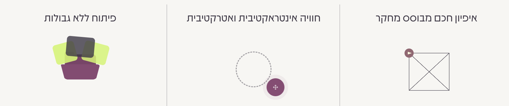

# Content planning

This document holds the source content inventory and agreed wording, separate from information architecture and page structure. Develop homepage Hebrew copy proposals alongside layout comparisons in [the shared workbook](homepage-workbook.md), then reflect agreed content here with a link to its review record. Hebrew is the first website language; no content translation or English website copy is created here.

## Text editing

Earlier on 2026-10-06, the owner took text editing separately while requesting documentation status and structural planning. The approved workbook plan supersedes that workflow: define each section's purpose/information, review saved references together, draft 2–3 Hebrew options, refine the preferred version and compare desktop/mobile layouts. Record agreed copy and layout before moving to the next section. The [homepage workbook](homepage-workbook.md) is the shared drafting workspace; this document remains the source inventory and agreed-content record. The owner supplied the agreed hero H1 and description, then authorized a [coded Mammoth hero/header trial](14-decisions.md#mammoth-murals-hero-trial) before finishing later sections. Copy for later sections remains open.

The coded wireframe uses Hebrew-first, bilingual-ready architecture. Hebrew UI labels, the exact agreed hero wording and later-section placeholders are separate from components in [src/i18n/dictionaries/he.ts](../src/i18n/dictionaries/he.ts). The approved hero trial reflects the agreed H1, description and CTA in that dictionary now; later copy updates follow their section reviews. No English dictionary or translation exists yet; future English must use matching content keys and the same components.

## Available credibility material

The following material is reported by the project owner. This inventory does not select page placement, presentation order, or final website wording.

### Testimonials

- Five testimonials are available.
- Exact text, names, roles, organizations, and attribution: TODO: Decision required
- Publication permissions and constraints: TODO: Decision required

### Product user counts

- The owner reports actual usage figures for existing products.
- These describe usage of existing products, rather than projected future usage.
- Values, associated products, measurement definitions, dates, and supporting sources: TODO: Decision required

### Experience at well-known organizations

- The owner's experience with well-known organizations includes both employee roles and independent engagements.
- The owner will provide the organization and engagement details later.
- Organization names, specific roles, dates, and relationship type for each organization: TODO: Decision required
- Publication permissions and constraints: TODO: Decision required

### Selection and presentation

Which material to publish, on which pages, and how to present it: TODO: Decision required

## Home

### Main message

Moriz combines research, UX/UI design and web app development, as specified by the approved workbook plan. The owner-agreed headline and supporting text below express a research-led approach to solving complex problems and building a system suited to the business and its users. See [the workbook hero](homepage-workbook.md#1-hero) for layout proposals and [the copy decision](14-decisions.md#owner-supplied-hero-copy).

### Supporting messages

On 2026-10-06, the owner supplied an image showing the three themes she wants to present. The English descriptions below are internal planning notes; the supplied Hebrew wording is preserved as source material for future content work.

| Internal planning theme | Owner-supplied Hebrew wording |
| --- | --- |
| Research-based specification. | איפיון חכם מבוסס מחקר |
| An interactive and attractive experience. | חוויה אינטראקטיבית ואטרקטיבית |
| Development; exact scope of the supplied claim remains to be clarified. | פיתוח ללא גבולות |

The image is retained as a record of the owner's original input. On 2026-10-07 the owner approved implementation of the first card with heading **איפיון ועיצוב מבוססי מחקר** and supporting text **כל כפתור, כל אנימציה וכל בחירה היא מושכלת. אני מתעדכנת כל הזמן במחקרים ומתודולוגיות חדשות.** The approved plan corrects the supplied typo “ויעצוב”.

Its eight grayscale falling pills are **מחקר משתמשים, UI, UX, מסע משתמש, בדיקות שמישות, מחקר מתחרים, ארכיטקטורת מידע, Design System**. The owner requested removing נגישות and פרוטוטייפ and adding מחקר מתחרים in a subsequent revision on 2026-10-07. The terms are capability labels, not results or endorsement claims. The card is implemented locally; visual acceptance is pending. See [the workbook composition](homepage-workbook.md#2-three-communication-themes--advantages). The owner approved **NORMAL / PARTY** as the second card’s interactive demonstration. Its title remains **חוויה אינטראקטיבית ואטרקטיבית** and paragraph remains **מידע תומך — להשלמה**. Accessible switch/status/off-control strings are in the Hebrew dictionary. The second card’s final supporting copy and third card’s content/treatment remain open. See [Party Mode](party-mode.md).

### How it works — source information

The owner supplied the following sequence on 2026-10-06 to explain how a prospective client starts working with her after initial contact. These are internal content-planning facts, not website copy.

1. A short telephone call lasting 5–10 minutes.
2. An in-depth specification discussion.
3. The prospective client receives a quote.

These three steps describe the start of the working relationship. The owner subsequently confirmed that this section belongs after client testimonials and before FAQ on Home. Page sequence is recorded separately in [02-page-structure.md](02-page-structure.md#hierarchy); supporting information and final copy remain open.

Client preparation, the duration of the in-depth discussion, quote timing, and any subsequent steps: TODO: Decision required

Final website wording: TODO: Decision required

### FAQ — source information

On 2026-10-06, the owner deferred supplying the common questions that prospective clients ask before agreeing to a project. The owner will complete this later; continue the current planning work in the meantime.

Questions: TODO: Decision required

Answers and final website wording: TODO: Decision required

### Headlines

Hero H1 — agreed, supplied by the owner on 2026-10-06; preserved verbatim:

> יוצרת פתרונות דיגיטליים מבוססי מחקר

Owner clarification, 2026-10-09: **נעים להכיר, אני מור** is small introductory text above the existing H1, beside the supplied avatar in a horizontal RTL row. The portrait is 48px wide on mobile and 56px from 768px, preserving its full proportions; the introduction is 16px/18px. The H1, supporting copy and hero action remain unchanged. The subsequent enlargement and move beside the H1 were undone at the owner's request.

Later section headlines: TODO: Decision required

### Body copy

Hero supporting text — agreed, supplied by the owner on 2026-10-06; preserved verbatim:

> **מחקר מנצח טיעונים**. מתוך התפיסה הזו אני ניגשת לכל פרויקט – מורכב ככל שיהיה.  
> עם תואר בטכנולוגיות למידה מ-HIT וניסיון עשיר בפיתוח  
> אצור עבורכם כלי דיגיטלי שבאמת מביא לפעולה.

The owner now supplies years of development experience as a fact; no exact duration is recorded. Later section body copy: TODO: Decision required

### CTAs

WhatsApp is the primary conversion channel. On Home, the owner selected a floating contact control at the lower side only, with no inline WhatsApp CTA in the hero or other sections. See [the placement decision](14-decisions.md#floating-only-whatsapp-access).

One inline hero CTA is selected: **לצפיה בפרויקטים** → existing homepage Projects section (`#projects`). Preserve this spelling exactly as supplied by the owner; see [the trial record](homepage-workbook.md#selected-trial--mammoth-murals-layout). The temporary menu labels are **פרויקטים**, **קצת עליי**, **יצירת קשר**, plus language selection.

The owner subsequently requested a left CTA in the desktop header. Its text/destination were not supplied; provisionally reuse **לצפיה בפרויקטים** → `#projects` pending the owner's preference. This does not change the single inline hero CTA. Desktop navigation is visible and centered; mobile retains the hamburger. See [the revision record](14-decisions.md#desktop-header-navigation-revision).

Language control: owner-selected underlined **EN** text link beside the desktop header CTA, replacing the Hebrew/English button pair. Use the same single text link in the mobile drawer. Hebrew accessible language names remain in the dictionary; English is still unavailable until translated content is supplied. See [the choice](14-decisions.md#compact-language-link).

Final WhatsApp wording/accessible label, contact number and message content: TODO: Decision required

### Project descriptions

TODO: Decision required

### Social proof

TODO: Decision required

### SEO copy

TODO: Decision required

### Hebrew copy

Hero wording is agreed under [Headlines](#headlines) and [Body copy](#body-copy). Keep it unchanged during layout comparison. Later sections: TODO: Decision required

### Future English version

TODO: Decision required

## Projects

### Main message

TODO: Decision required

### Supporting messages

TODO: Decision required

### Headlines

TODO: Decision required

### Body copy

TODO: Decision required

### CTAs

TODO: Decision required

### Project descriptions

TODO: Decision required

### Social proof

TODO: Decision required

### SEO copy

TODO: Decision required

### Hebrew copy

TODO: Decision required

### Future English version

TODO: Decision required

## Project / Case Study

### Main message

TODO: Decision required

### Supporting messages

TODO: Decision required

### Headlines

TODO: Decision required

### Body copy

TODO: Decision required

### CTAs

TODO: Decision required

### Project descriptions

TODO: Decision required

### Social proof

TODO: Decision required

### SEO copy

TODO: Decision required

### Hebrew copy

TODO: Decision required

### Future English version

TODO: Decision required

## About

### Main message

TODO: Decision required

### Supporting messages

TODO: Decision required

### Headlines

TODO: Decision required

### Body copy

TODO: Decision required

### CTAs

TODO: Decision required

### Project descriptions

TODO: Decision required

### Social proof

TODO: Decision required

### SEO copy

TODO: Decision required

### Hebrew copy

TODO: Decision required

### Future English version

TODO: Decision required

## Research & Tools

### Main message

TODO: Decision required

### Supporting messages

TODO: Decision required

### Headlines

TODO: Decision required

### Body copy

TODO: Decision required

### CTAs

TODO: Decision required

### Project descriptions

TODO: Decision required

### Social proof

TODO: Decision required

### SEO copy

TODO: Decision required

### Hebrew copy

TODO: Decision required

### Future English version

TODO: Decision required

## Research / Article page

### Main message

TODO: Decision required

### Supporting messages

TODO: Decision required

### Headlines

TODO: Decision required

### Body copy

TODO: Decision required

### CTAs

TODO: Decision required

### Project descriptions

TODO: Decision required

### Social proof

TODO: Decision required

### SEO copy

TODO: Decision required

### Hebrew copy

TODO: Decision required

### Future English version

TODO: Decision required

## Diagnostic Questionnaire

### Main message

TODO: Decision required

### Supporting messages

TODO: Decision required

### Headlines

TODO: Decision required

### Body copy

TODO: Decision required

### CTAs

TODO: Decision required

### Project descriptions

TODO: Decision required

### Social proof

TODO: Decision required

### SEO copy

TODO: Decision required

### Hebrew copy

TODO: Decision required

### Future English version

TODO: Decision required
