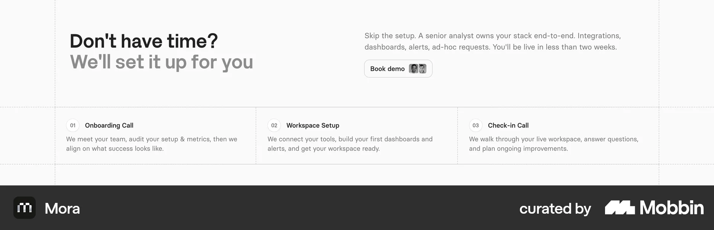
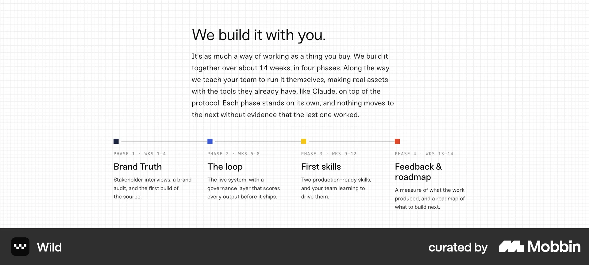
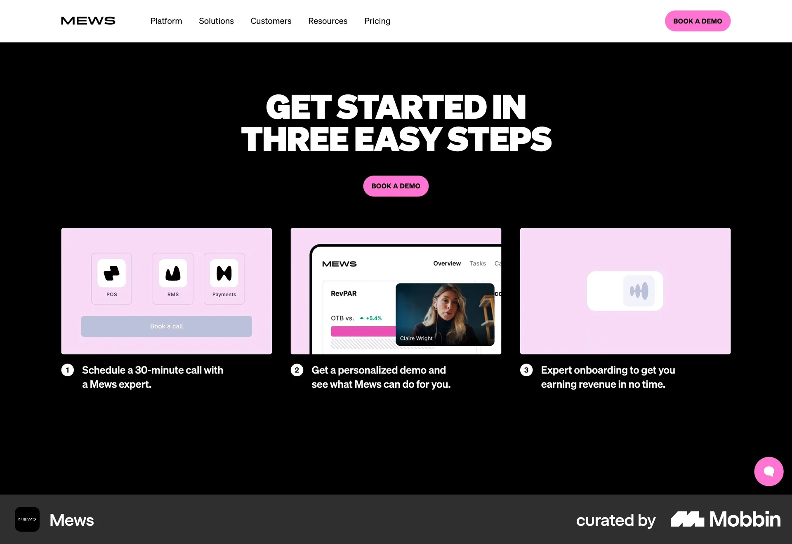
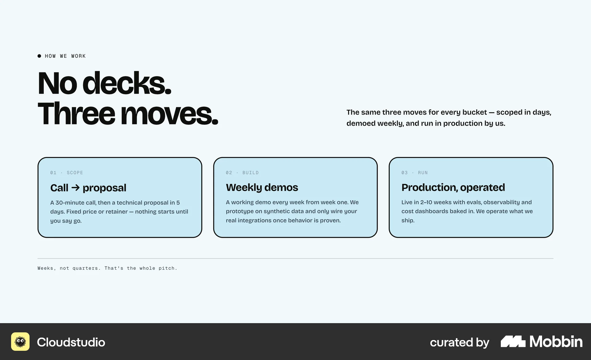
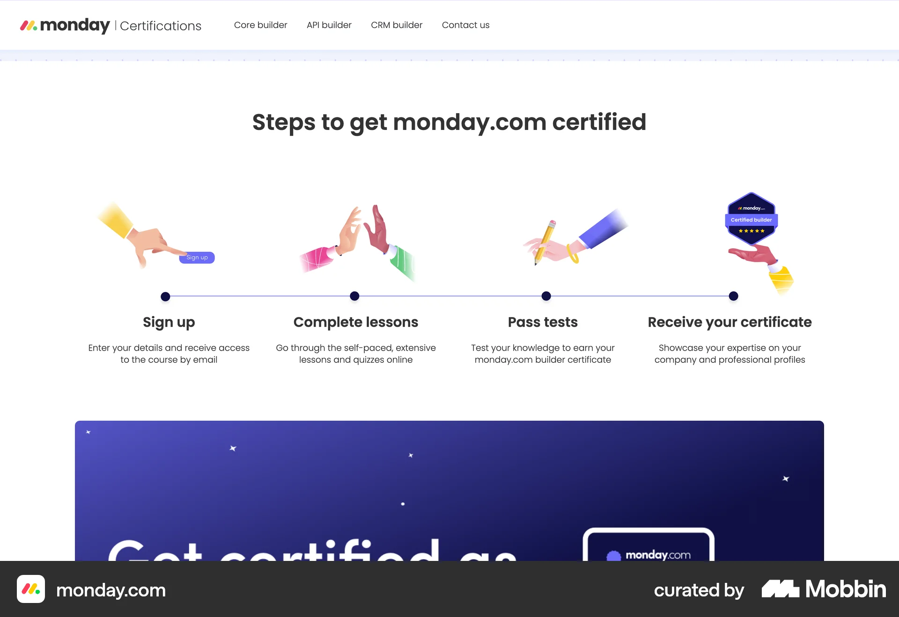
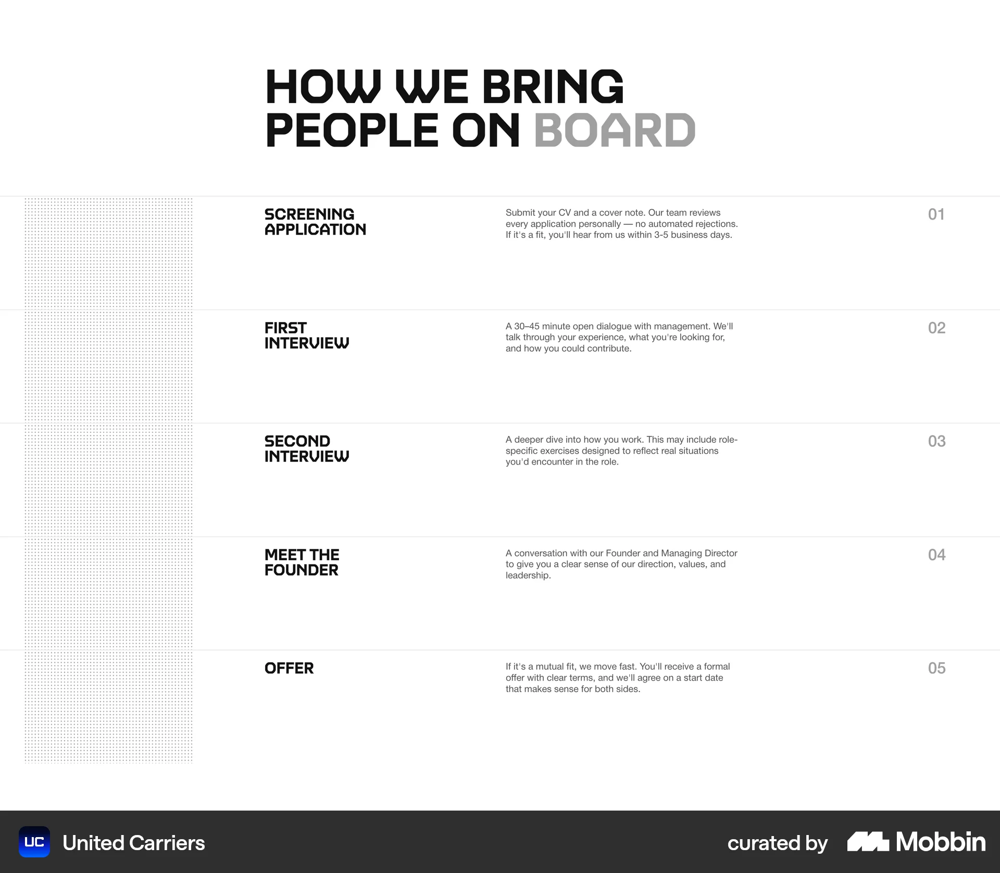
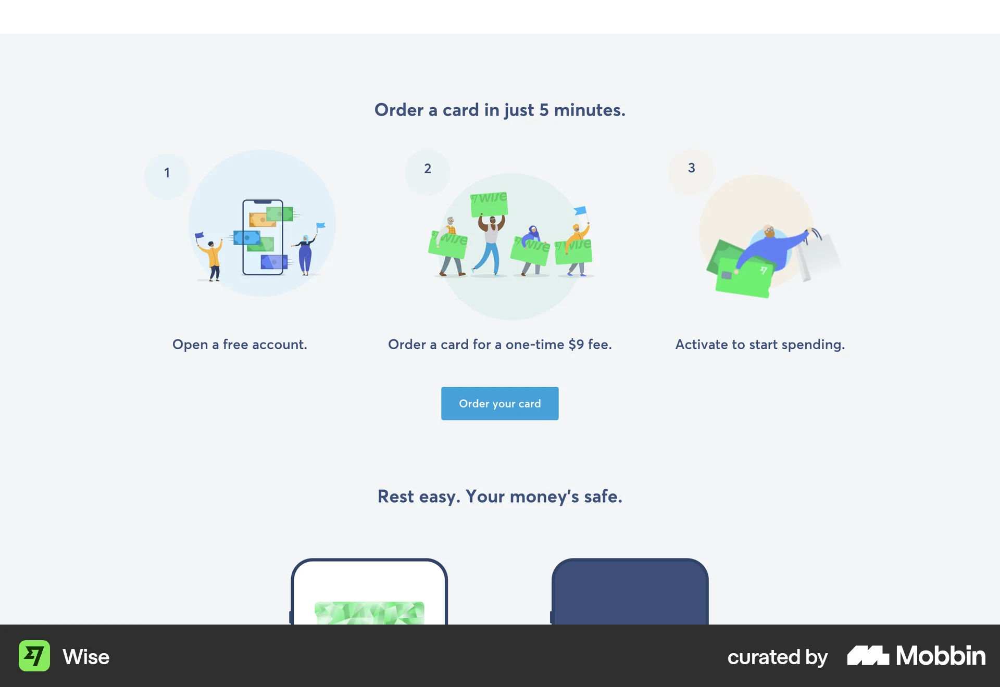

# Mobbin research for the homepage getting-started section

Research date: 10 October 2026. Owner request: research how to present the three-step getting-started process (איך מתחילים לעבוד יחד) with short descriptions, then implement it with animated icons, drawing new icons where the set lacks them.

Show the three steps as hairline columns on a single rail. The recommended direction combines Mora’s ruled columns with Runway’s progress line and meta row: each step gets a two-tone icon, a number, a short title and one line, and its fine print sits in quiet chips. “ללא עלות” is the only emphasised chip. As the section scrolls into view the rail fills from the right, and each icon plays once. It is implemented on the homepage for visual acceptance. Editorial ruled rows are the alternative, and equal cards are rejected as the most generic option.

## Current section and boundaries

The homepage `#getting-started` section was a wireframe `<ol>` with a number, a title and a detail line per step; steps 2 and 3 still read “מידע נוסף — להשלמה”. The owner has now supplied the facts:

| Order | Step | One line | Chips | Icon | Source |
| --- | --- | --- | --- | --- | --- |
| 1 | שיחת טלפון קצרה | כמה שאלות פשוטות, כדי לראות אם יש התאמה ראשונית לצרכים שלכם. | 5–10 דקות | mobile.svg (existing) | Owner-supplied; duration from the earlier wireframe copy |
| 2 | שיחת אפיון | נכיר לעומק את הפרויקט, המטרות והצרכים שלכם. | ללא עלות (emphasised) · בזום | video.svg (new) | Facts owner-supplied (free, on Zoom); title shortened from “שיחת אפיון מעמיקה” and the line drafted — awaiting approval |
| 3 | קבלת הצעת מחיר | הצעה מסודרת שמבוססת על מה שאפיינו יחד. | בתוקף ל־14 ימי עבודה | quote.svg (new) | Validity owner-supplied; the line drafted — awaiting approval |

Owner decisions, 10 October 2026: hairline columns with a rail; no duration is shown for the Zoom call; step 1 keeps the existing `mobile.svg` and two new icons (`video.svg`, `quote.svg`) are drawn in the same two-tone style; no CTA in the section, because WhatsApp stays floating only. The heading stays “איך מתחילים לעבוד יחד” (`PRODUCT.md`). Motion is owner-requested for this section only.

Sources: [homepage implementation](../../src/app/[locale]/page.tsx), [component](../../src/components/getting-started.tsx), [styles](../../src/components/getting-started.module.css) and [icons](../../src/components/getting-started-icons.tsx), [Hebrew content](../../src/i18n/dictionaries/he.ts) (`gettingStarted.steps`), [type](../../src/content/getting-started.ts), [static icons](../../public/icons/), [section workbook](../homepage-workbook.md#6-how-to-start-working-together), [content inventory](../03-content.md), [earlier research](homepage-section-research-2026-10-06.md#starting).

## Three layout directions

### Hairline columns on a rail

**Recommended · implemented.** References: Runway, Mora, Wild, monday.com.

Desktop (64rem and wider): three columns separated by fine vertical rules, with a 1px rail across the top and a node where each column starts. Each step has a two-tone icon in a ruled tile, its number, a short title, one line of description and quiet chips for the fine print; “ללא עלות” is the only emphasised chip. As the section enters the viewport the rail fills from right to left in RTL, each node lights as the line reaches it, the step text rises in, and each icon plays once: the phone rings, the Zoom “live” dot blinks, the quote’s check draws in.

**Mobile adaptation:** The rail runs vertically along the right edge with a node beside each icon; steps stack and each reveals when it reaches the screen.

**Tradeoff:** Adds a client component and a small amount of motion. The rail implies a timeline, so the steps must stay strictly sequential.

### Editorial ruled rows

**Alternative.** References: United Carriers.

Full-width rows separated by rules: number, icon and large title on the start side, the description and chips on the end side.

**Mobile adaptation:** Each row stacks: number and title, then description and chips.

**Tradeoff:** The most studio-like and the simplest to build, but it reads as a list rather than a sequence, and three rows look sparse.

### Equal cards

**Rejected.** References: Cloudstudio, Mews, Wise.

Three bordered or tinted cards with an icon or image, a number, a title, a line and chips.

**Mobile adaptation:** One card per row.

**Tradeoff:** The most generic option. Card backgrounds add weight that the rest of the ruled homepage avoids, and image cards need product imagery Moriz does not have.

These are proposed adaptations for Moriz. The source screenshots are LTR, so the layouts are mirrored for RTL: the rail starts on the right and fills leftward, and on mobile it runs down the right edge. A static screenshot does not establish a source’s motion or mobile behaviour.

## Reference comparison

| Reference | Pattern | Best use for Moriz |
| --- | --- | --- |
| [Runway](https://mobbin.com/sites/sections/bcbe23c6-95ea-467d-abc5-d913d2bc3667) | Three steps on a partly filled progress line, with a meta row under each | Strong layout reference |
| [Mora](https://mobbin.com/sites/sections/a3376afd-3fc7-4f42-94e4-a84e3b6deede) | Hairline columns with boxed numbers; two of the three steps are calls | Strong layout reference |
| [Wild](https://mobbin.com/sites/sections/1bac0acb-c4fe-46ec-acd7-fe0bf057faf2) | Phase timeline with square nodes and mono meta labels | Rail and meta reference |
| [Mews](https://mobbin.com/sites/sections/192267a5-39a3-440c-bac1-220e69473600) | Three image cards: book a call → video demo → onboarding | Content reference |
| [Cloudstudio](https://mobbin.com/sites/sections/02af7de2-404c-4f43-8e02-8e6e2d15d446) | Three bordered cards; the first is “Call → proposal” with its terms stated | Content reference |
| [monday.com](https://mobbin.com/sites/sections/0b9dd777-872f-4eff-84b5-b69353f3207b) | A visual above a line of dots, one per step | Icon + rail reference |
| [United Carriers](https://mobbin.com/sites/sections/21cf0851-381d-4fb1-a6fa-a22d22bb100b) | Editorial ruled rows: title, description, number at the far end | Alternative composition |
| [Wise](https://mobbin.com/sites/sections/5913d254-146e-49b6-bc26-caaee21e868e) | Illustrated centred columns with “free” written into one line | Counter-example |

### Runway: three steps on a partly filled progress line, with a meta row under each

[Mobbin reference](https://mobbin.com/sites/sections/bcbe23c6-95ea-467d-abc5-d913d2bc3667) · [Full screenshot](assets/homepage-getting-started-2026-10-10/runway-progress-meta.webp)

**Visible:** Heading “Fast track to clarity” with a short intro on the right. A white rounded panel holds “Onboarding guided by finance experts” and an orange “Book a demo” button. A thin line runs across with a dot above each of three columns; the line is dark up to the first column’s end and pale after it. Each column has a boxed chip (“01 | Kickoff”), a bold one-line title, two lines of description and a grey meta line: “1-week average”, “4-week average”, “Ongoing”.

**For Moriz:** The direct model for the rail and the meta row. Moriz moves its fine print (free of charge, Zoom, valid for 14 working days) into quiet chips in the same position, so the one-line description stays about what happens. In RTL the rail fills from the right.

**Tradeoff:** Runway wraps the steps in a card panel with a CTA inside; Moriz keeps the open hairline layout and adds no CTA, because WhatsApp stays floating. The static capture does not show whether the line animates.

**Page context:** Marketing-page context with site navigation and a rating badge. Original capture page unconfirmed; live site not checked.

### Mora: hairline columns with boxed numbers; two of the three steps are calls

[Mobbin reference](https://mobbin.com/sites/sections/a3376afd-3fc7-4f42-94e4-a84e3b6deede) · [Full screenshot](assets/homepage-getting-started-2026-10-10/mora-hairline-calls.webp)

**Visible:** A two-tone heading (“Don’t have time? We’ll set it up for you”) on the left; an intro paragraph and a “Book demo” pill with two small avatars on the right. Below, three columns separated by vertical hairlines and dashed grid guides, each with a tiny boxed number (“01”), a short title (“Onboarding Call”, “Workspace Setup”, “Check-in Call”) and two lines of description. The timing (“You’ll be live in less than two weeks”) sits in the intro.

**For Moriz:** The base of the Moriz layout: no card backgrounds, fine rules between columns, small numbers. Its content, with calls as steps, is the closest match to Moriz’s phone call → Zoom call → quote.

**Tradeoff:** Very quiet: without a rail or icons the steps read like a feature list. Fine print in the intro paragraph is easy to miss, which is why Moriz attaches it to each step as chips.

**Page context:** Section context only. Original capture page unconfirmed; live site not checked.

### Wild: phase timeline with square nodes and mono meta labels

[Mobbin reference](https://mobbin.com/sites/sections/1bac0acb-c4fe-46ec-acd7-fe0bf057faf2) · [Full screenshot](assets/homepage-getting-started-2026-10-10/wild-phase-line.webp)

**Visible:** Heading “We build it with you.” over a paragraph that states the duration (“about 14 weeks, in four phases”). Four columns sit on a thin horizontal line; each starts with a small square node in its own colour, then a mono label (“PHASE 1 · WKS 1–4”), a title and two to three lines of description. A faint grid texture covers the background.

**For Moriz:** Shows that a node on a line plus a small meta label can carry timing without crowding the description. Supports Moriz’s node-per-step rail and the quiet chips.

**Tradeoff:** It describes a four-phase delivery process, not client onboarding. A different colour per node would compete with Moriz’s single brand-red accent, so Moriz uses one accent for every node.

**Page context:** Section context only. Original capture page unconfirmed; live site not checked.

### Mews: three image cards: book a call → video demo → onboarding

[Mobbin reference](https://mobbin.com/sites/sections/192267a5-39a3-440c-bac1-220e69473600) · [Full screenshot](assets/homepage-getting-started-2026-10-10/mews-call-video-steps.webp)

**Visible:** A dark section with the uppercase heading “GET STARTED IN THREE EASY STEPS” and a pink “BOOK A DEMO” button. Three pink cards hold product images: a “Book a call” interface, a video-call still of a person and a logo. Under each card a numbered circle precedes one sentence, for example “Schedule a 30-minute call with a Mews expert.”

**For Moriz:** The same arc as Moriz (a call, then a video call, then the next step) and the clearest signal that one step happens on video. Moriz carries that signal with the new video icon and the “בזום” chip instead of a screenshot.

**Tradeoff:** Depends on product imagery Moriz does not have. One sentence per step folds the duration into the copy, where it is harder to scan.

**Page context:** Marketing-page context with site navigation. Original capture page unconfirmed; live site not checked.

### Cloudstudio: three bordered cards; the first is “Call → proposal” with its terms stated

[Mobbin reference](https://mobbin.com/sites/sections/02af7de2-404c-4f43-8e02-8e6e2d15d446) · [Full screenshot](assets/homepage-getting-started-2026-10-10/cloudstudio-call-proposal.webp)

**Visible:** A “HOW WE WORK” eyebrow and the heading “No decks. Three moves.” with a one-line summary on the right. Three light-blue cards with dark borders each carry a mono meta line (“01 · SCOPE”), a title (“Call → proposal”, “Weekly demos”, “Production, operated”) and a paragraph. The first reads “A 30-minute call, then a technical proposal in 5 days. Fixed price or retainer — nothing starts until you say go.” A mono footnote closes the section.

**For Moriz:** The closest content match to Moriz’s steps: a call that leads to a proposal, with timing and terms stated plainly. Supports stating the quote’s 14-working-day validity as a visible fact.

**Tradeoff:** Coloured bordered cards are heavier than the hairline layout, and terms inside a paragraph are harder to scan than a chip. The eyebrow is not borrowed.

**Page context:** Section context only. Original capture page unconfirmed; live site not checked.

### monday.com: a visual above a line of dots, one per step

[Mobbin reference](https://mobbin.com/sites/sections/0b9dd777-872f-4eff-84b5-b69353f3207b) · [Full screenshot](assets/homepage-getting-started-2026-10-10/monday-line-icons.webp)

**Visible:** Heading “Steps to get monday.com certified”. Four colourful hand illustrations sit above a thin horizontal line with a dark dot under each; below each dot are a bold title and two centred lines of description.

**For Moriz:** Confirms the reading order of icon, node on the rail, then text. Moriz uses its own small two-tone icons in a ruled tile instead of illustrations.

**Tradeoff:** Centred text and large illustrations give a generic SaaS look, and it has four steps where Moriz has three.

**Page context:** Certification-page context with site navigation. Original capture page unconfirmed; live site not checked.

### United Carriers: editorial ruled rows: title, description, number at the far end

[Mobbin reference](https://mobbin.com/sites/sections/21cf0851-381d-4fb1-a6fa-a22d22bb100b) · [Full screenshot](assets/homepage-getting-started-2026-10-10/united-carriers-editorial-rows.webp)

**Visible:** A large uppercase heading (“HOW WE BRING PEOPLE ON BOARD”) with the last word in grey. Five full-width rows separated by rules, each with a bold uppercase title, a small description in a middle column and a grey number (“01”–“05”) at the far right. A dotted texture fills a column on the left. Descriptions state durations, for example “A 30–45 minute open dialogue”.

**For Moriz:** The alternative direction: typography-led rows that suit long Hebrew titles and need no icons. Shows durations written into short descriptions.

**Tradeoff:** A weaker sense of progression than a rail, and with only three steps the rows look sparse under a large heading.

**Page context:** Careers-page context. Original capture page unconfirmed; live site not checked.

### Wise: illustrated centred columns with “free” written into one line

[Mobbin reference](https://mobbin.com/sites/sections/5913d254-146e-49b6-bc26-caaee21e868e) · [Full screenshot](assets/homepage-getting-started-2026-10-10/wise-free-in-copy.webp)

**Visible:** Heading “Order a card in just 5 minutes.” Three columns each have a small number in a soft circle, a large circular illustration and one line (“Open a free account.”, “Order a card for a one-time $9 fee.”, “Activate to start spending.”). A blue “Order your card” button sits below.

**For Moriz:** Shows the value of stating cost plainly in a step. Moriz keeps that clarity but moves “ללא עלות” into an emphasised chip, so it is seen at a glance.

**Tradeoff:** Illustrations and centred columns are the most template-like option, and “free” inside a sentence is easy to skim past.

**Page context:** Product-page context. Original capture page unconfirmed; live site not checked.

## Presentation principles

- One short line per step. The line says what happens; facts such as duration, cost, platform and validity go into chips.
- Only one chip is emphasised: “ללא עלות”. Its text stays in the primary colour for contrast; the brand red carries through the border and dot.
- Do not invent durations. The Zoom call shows no duration (owner decision); the 5–10 minutes for the phone call is carried over from the earlier copy.
- Mirror for RTL with logical properties only. The rail fills from the right; number ranges are isolated as LTR so “5–10” does not flip to “10–5”.
- Icons come from the studio set (24px, filled `currentColor` with one red accent) and are inlined so they follow the theme. Each plays one short animation after its step appears: ring, live blink, check draw-in.
- No CTA in the section. WhatsApp stays floating only.
- Motion is progressive: without JavaScript every step is shown in its final state; with reduced motion everything appears at once.

## Content needed

- Approval or rewording of the drafted lines for steps 2 and 3, and of the shortened step 2 title (“שיחת אפיון” instead of “שיחת אפיון מעמיקה”).
- Whether the phone call is still 5–10 minutes (carried over from the earlier wireframe copy).
- Optional: what the client should prepare before the Zoom call. No Zoom duration is shown (owner decision).

## Search coverage and evidence limits

Six Mobbin section searches (`search_sections`, page 1 of each, limit 8, all with further pages available) returned 48 results: 39 distinct sections from 36 distinct sites. Mora, Kastle, Wise, Blue Apron, Kalstore, Framer and Duolingo sections recur across queries; section IDs were retained for every result, so repeats are identifiable in the [search log](homepage-getting-started-mobbin-2026-10-10.json).

- How it works section with 3 numbered steps in horizontal columns: 8 results
- Agency process steps from discovery call to proposal: 8 results
- Horizontal timeline of steps with progress line and duration labels: 8 results
- Get started in three easy steps: book a call, video call demo, onboarding: 8 results
- Free consultation call then receive a quote, process steps with no commitment note: 8 results
- Process steps with small icons, step title and one line description: 8 results

Eight images were downloaded from Mobbin on 10 October 2026, and none failed. Mobbin served them as WebP at 1920 pixels wide, so no conversion was needed. Only these eight were inspected at full size. The rejected patterns below were assessed from the search previews:

- Sticky split or stacked scroll cards (Framer, Kalstore, Air, Fiasco): spend a lot of scroll height on three short steps.
- Accordion of steps (Titan): hides content behind clicks; three short steps fit on screen.
- Company-history timelines (Circle, SpaceXAI, Grok, Square, Apollo, Framer): chronological milestones, not steps a client takes.
- Illustrated centred columns (Blue Apron, ClassPass, HubSpot, Duolingo, Amie, Visitors): generic SaaS look; the illustration styles do not match the two-tone icon set.
- The remaining results (Grammarly, Escape Cafe, Kastle, PayPal, Ragged Edge, Parker AI, FLORA, V7, YLLW, Maxima Therapy, Granola, Adaline) were not promoted. Their individual reasons were not recorded. Ragged Edge, Fiasco and Framer are already covered in the [earlier research](homepage-section-research-2026-10-06.md#starting).

An earlier exploratory pass in the same session used different queries; its counts were not retained, and only references re-found in the logged searches are cited here. Live source sites were not checked. 10 October 2026 is the research and download date, not a verified capture or redesign date. Static screenshots do not establish animation or scroll behaviour. Mobile descriptions are proposed adaptations for Moriz, and these desktop captures do not validate responsive behaviour, accessibility or conversion outcomes. The implementation’s motion and accessibility details come from the code, not from the references.

[Open the visual research board](homepage-getting-started-mobbin-2026-10-10.html).
