# Mobbin research for the homepage Projects section — alternatives and live mobile captures

Research date: 10 October 2026. Owner confirmed scope: **alternatives to the current rows** and **real mobile website captures**. Research only; no implementation changes.

The current section follows the owner-selected basement.studio rows from the [7 October research](mobbin-projects-2026-10-07.md). This study looks for different directions and fills that study's documented gap: it used native iOS app screens instead of mobile websites. The recommended starting point is **numbered project panels** from [Huncwot](https://huncwot.com/), the site the owner already named for its project layout. It was captured live on desktop and mobile for this study. Each panel pairs a large project number, expertise and client facts, and a paragraph with a tile collage of website screens. The panel has room for Moriz's four questions and stacks cleanly on a phone. Until real project images exist, a **typographic project index** (Locomotive, verified on live mobile) is the alternative that looks finished without imagery.

[Reference manifest](homepage-projects-mobbin-2026-10-10.json) · [Earlier Projects research](mobbin-projects-2026-10-07.md)

## Current section and boundaries

`#projects` sits third on the homepage, after the hero and advantages. It has a large heading, **לצפייה בכל הפרויקטים** and fine rules. Each project is a row. On desktop the name sits on the right, the description and four `
` questions in the middle, and a 16:9 media frame on the left. Mobile order is name → image → information → four details → page button. The whole canvas fades to charcoal while Projects is in view.

Constraints that apply to every direction below:

- There are three projects (practice ai, הארץ — וורדעל, Chabad Club). Their order is provisional.
- **No project images exist yet.** All `image` fields are `null`.
- Roles, results and metrics have not been supplied. Do not invent them.
- Keep Danidin/Leon, the palette, Hebrew RTL reading order, the dark scroll backdrop and the dedicated project pages.
- The four questions per project are owner-authorized. Any direction that moves them off Home needs the owner's decision.

Sources: [workbook §3](../homepage-workbook.md#3-projects), [surface brief](../projects-surface-brief.md), [project inventory](../04-projects-and-case-studies.md), [`projects-section.tsx`](../../src/components/projects-section.tsx).

## Live mobile findings (new)

Captured on 10 October 2026 from the live homepages. Headless WebKit (Playwright's iPhone 13 profile, 390px wide) scrolled each page once before a full-page capture, then the work section was cropped.

| Site | What the phone layout actually does | Takeaway for Moriz |
| --- | --- | --- |
| [Huncwot](https://huncwot.com/) (owner preference) | One panel per project: large `01/06` number, then Expertise and Client columns, an info paragraph, an image collage at mixed widths and a **Visit website** button. Panels are separated by red gaps. | The panel structure survives on a phone without hiding anything. The order (number → facts → explanation → images → link) maps onto Moriz's current content. |
| [basement.studio](https://basement.studio/) | Full-width image first, then name, description and a rule. No tags, no buttons. | This is the current reference's real mobile. Moriz's mobile puts the **name before the image**; basement puts the image first. Worth comparing. |
| [Locomotive](https://locomotive.ca/en) | Text-only list: large serif names, centered, separated by rules. **All Work** is the final row of the list. No images on mobile. | A text index stays strong at 390px. The archive link can live inside the list instead of in the header. |
| [Fiasco](https://fiasco.design/) | Images at about 70% width, alternating left and right. Each has an italic name, a one-line description and category pills. | A staggered desktop layout can keep its rhythm on a phone. It doesn't have to collapse into a uniform stack. |
| [Instrument](https://www.instrument.com/) | Full-width image stack on black with a tiny label under each. No descriptions. | The work carries the section. It only works with strong images, which Moriz doesn't have yet. |
| [Vucko](https://vucko.co/) | One featured project card near the top, with the name and a **View project** pill over the image. | A desktop horizontal strip can reduce to a single featured card on mobile. |
| [Pentagram](https://www.pentagram.com/) | Full-bleed featured image with a caption, then a horizontally scrolling card row with a partial next card. | A featured-stage pattern on mobile. The partial card signals more content without any controls. |

Not captured: Wild, Unseen Studio and Cloudstudio open behind intro or interaction gates (an Enter screen, a "choose your driver" screen, a custom scroll container), so headless capture never reached their work sections. The Analogue Agency domain that was tried (`analogue.agency`) is a parked domain, so the real site wasn't identified.

## Alternative directions

### Owner-aligned: numbered project panels (Huncwot)

**Recommended starting point.** Reference: [Huncwot](#huncwot-numbered-project-panels), selected by the owner for its project layout in [owner inspiration](owner-inspiration-references.md#huncwot). Verified mobile: Huncwot.

Each project is a large rounded panel. A huge `01/03` number leads, with small facts beside it: scope or expertise, and client. A prominent paragraph explains the project. Below, a modular grid of square and wide tiles mixes website screens, graphics and key facts, ending in a link to the project page. The panels sit on a contrasting background with a gap between them. Whether they stack or stick on scroll can't be judged from stills.

**For Moriz:** Number the three projects `01/03`–`03/03`. Map the facts columns to the owner's role and scope fields, which are currently null. Keep the four questions as the panel's text block, and send the link to the dedicated page. The colored-background-with-gaps treatment would replace or need reconciling with the charcoal scroll backdrop.

**Mobile adaptation:** Verified on Huncwot's live site: number and facts side by side, then paragraph, stacked images and the link.

**Tradeoff:** This is the most image-hungry direction: each Huncwot panel uses four to six tiles. Without supplied visuals, empty tiles would dominate. Panels are tall, so three projects make a long section. Number glyphs should come from the display font.

### A. Typographic project index

**Alternative while there are no images.** References: [Locomotive](#locomotive-featured-work-index), [Freshman](#freshman-name-index-with-side-images), [A24](#a24-title-index-with-years). Verified mobile: Locomotive.

Each project name is a very large Danidin line between full-width rules. Each name carries a short Hebrew descriptor (type of system, the studio's contribution) and links to its project page. **לכל הפרויקטים** becomes the last row of the list, as in Locomotive's mobile.

**Why it fits now:** The current rows depend on imagery, and none has been supplied. An index looks finished with names alone. Once images arrive, desktop can add a preview on hover or focus (Freshman's side images) without changing the structure.

**Mobile adaptation:** Keep the text-only stacked rows (verified on Locomotive). Put a one-line descriptor under each name so the list still explains the projects.

**Tradeoff:** With only three names the list is short. It reads as confident only if the type is very large. The four questions would move to the project pages, which needs the owner's decision. Hover previews need a keyboard focus equivalent and don't exist on touch. The names mix scripts: **practice ai learning system** is Latin, while **הארץ — וורדעל** and **חב״ד קלאב** are Hebrew. At display size the Latin glyph coverage of Danidin and the bidirectional alignment both need checking.

### B. One featured project at a time

**Alternative for a stronger first impression.** References: [Analogue](#analogue-success-cases-stage), [Pentagram](#pentagram-featured-slideshow), [Webflow](#webflow-centered-carousel-with-peek). Verified mobile: Pentagram, Vucko.

One large stage shows one project: its image, its name and a link. The other two are reachable through a small index (Analogue's name pill, Pentagram's dots) or by a peek at the next card.

**Mobile adaptation:** A full-width stage with a horizontally scrollable row and a partial next card, as in Pentagram. Alternatively, show only the lead project as a card and link the rest, as in Vucko.

**Tradeoff:** Two of the three projects are hidden at any moment. That suits a clear lead project, but no Home order has been approved. Carousels need an RTL swipe direction, visible controls and pause behavior. It is also the most image-dependent direction.

### C. Product case-study panels

**Alternative that keeps the four questions.** References: [Zipline](#zipline-product-ui-beside-accordion), [Twenty](#twenty-case-study-card-with-facts), [Sketch](#sketch-device-screenshot-cards). Mobile: not captured; these are product companies, not studios.

Each project is a panel. One side shows real interface fragments or a collage of UI screens. The other side has the name, category, a one-line problem statement and the **existing four-question accordion**. Zipline puts an accordion directly beside its UI visual.

**Mobile adaptation (proposed, unverified):** Stack visual → name → statement → accordion → project link. That is close to today's order, so the change is mostly visual.

**Tradeoff:** It needs real interface screenshots. The metric rows in Twenty and Clay have no Moriz data yet, so they must be left out until figures are supplied. It can look like SaaS marketing rather than a studio portfolio.

### Image-led variant of the current rows

References: [Fiasco screen collage](#fiasco-website-screen-collage), [Instrument](#instrument-lead-and-secondary-projects), [Vucko](#vucko-horizontal-project-strip). Verified mobile: Fiasco, Instrument.

This keeps the rows but varies their scale: one lead project large, the others smaller or offset, as Fiasco does on both desktop and live mobile. Fiasco's desktop offset grid was previously reviewed as [D02 in the 7 Oct research](mobbin-projects-2026-10-07.md#d02). That entry also linked it to the owner's Huncwot preference; Huncwot is captured directly above. Fiasco's collage of website screens suggests a way to present web projects without photographed device mockups.

## Reference comparison

| Reference | Pattern | Best use for Moriz | Page context |
| --- | --- | --- | --- |
| [Huncwot](https://huncwot.com/) (live capture, not Mobbin) | Numbered panels with facts, paragraph and screen collage | Owner-aligned, primary | Homepage, captured 10 Oct 2026 |
| [Locomotive](https://mobbin.com/sites/sections/d7f7059d-53e2-4055-83e2-4408b715a307) | Huge serif names in ruled rows | Direction A, primary | Homepage; live list now differs |
| [Freshman](https://mobbin.com/sites/sections/3641b988-b26c-471d-a177-c5fc2254b123) | Centered names with side images | Direction A, image preview | Directors list, not a client-work list |
| [A24](https://mobbin.com/sites/sections/b645a881-adf5-43f3-a86c-758cd54f0b72) | Left-aligned giant titles with years | Direction A, type scale | Film studio, not an agency |
| [Analogue Agency](https://mobbin.com/sites/sections/c27f50ff-dd09-41f9-afc8-598c3ccae77a) | One case on a colored stage with a name pill | Direction B, primary | Live site not identified |
| [Pentagram](https://mobbin.com/sites/sections/933958ee-3d23-4692-bcb7-650e850a84ee) | Full-bleed slideshow with caption | Direction B, stage | Homepage hero |
| [Webflow](https://mobbin.com/sites/sections/103632e2-e594-4aba-8287-68eedd2cfb44) | Centered card with a peek at the next | Direction B, carousel | Product showcase, not a studio |
| [Zipline](https://mobbin.com/sites/sections/9fff6104-d098-4039-a6c5-5f8521058cad) | UI fragments beside an accordion | Direction C, primary | Product page |
| [Twenty](https://mobbin.com/sites/sections/e15c2850-a6fd-4c05-8848-e578c0ed21ad) | Image plus category, title, quote, metrics | Direction C, facts layout | Customer-story card |
| [Sketch](https://mobbin.com/sites/sections/83492699-4967-4510-9f31-337fc2494aa4) | Device screenshots over dark caption panels | Direction C, UI imagery | Community showcase |
| [Instrument](https://mobbin.com/sites/sections/05811dd7-a07a-41ae-9fa7-192b8eede1b1) | Lead and secondary project, stack/grid toggle | Image-led variant | Work page; also in 6 Oct research |
| [Vucko](https://mobbin.com/sites/sections/ceab4ab4-d046-4356-bde4-32acd9781fa8) | Horizontal project strip | Image-led variant | Homepage capture; live mobile differs |
| [Fiasco](https://mobbin.com/sites/sections/606e7e35-d462-4a42-939e-df4d3a19af0a) | Text beside a collage of website screens | Image-led variant, web work | About/approach block |

## Desktop references

### Huncwot numbered project panels

[Live site](https://huncwot.com/) · [Live mobile](assets/homepage-projects-2026-10-10/mobile-huncwot-numbered-panel.jpg) · Live capture with WebKit at 1440px, 10 Oct 2026. Not from Mobbin.

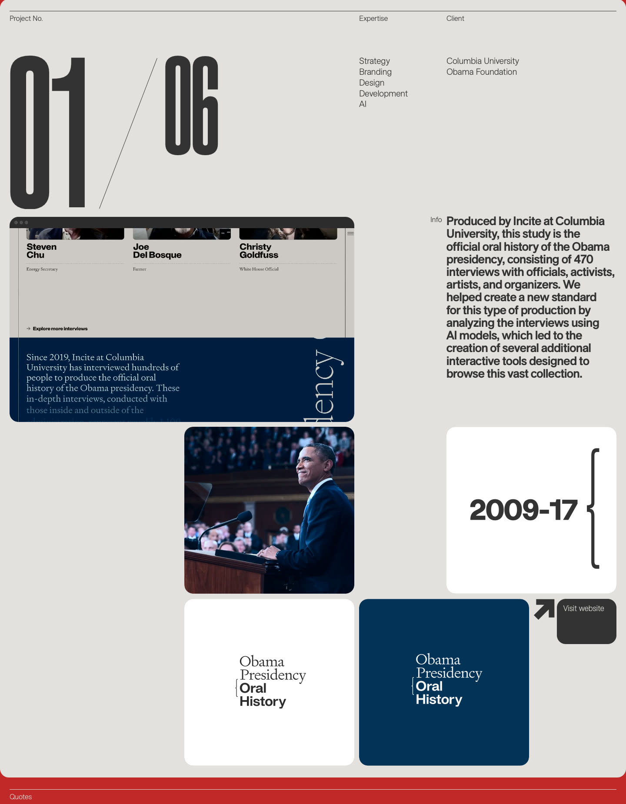

**Visible:** The panel opens with "Project No." over a huge condensed `01/06`. Expertise and Client lists sit in columns to the side. A bold info paragraph sits right of the first screenshot. Below are square and wide tiles: a website screenshot, a photo, a date tile, two logo tiles and a dark **Visit website** button. The red page background shows between panels.

**For Moriz:** This is the owner's named project-layout reference. The number-plus-facts header suits three projects, and the tile grid can mix interface screens with text facts once supplied.

**Tradeoff:** Requires several visuals per project. Stacking or scroll behavior isn't established by a still.

### Locomotive featured work index

[Mobbin](https://mobbin.com/sites/sections/d7f7059d-53e2-4055-83e2-4408b715a307) · [Live mobile](assets/homepage-projects-2026-10-10/mobile-locomotive-text-index.jpg)

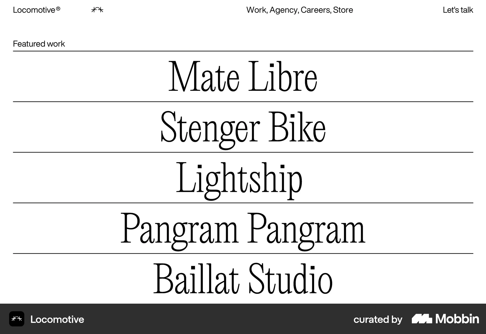

**Visible:** A small "Featured work" label sits over five very large, centered serif names separated by full-width rules. There are no images or descriptions in the still.

**For Moriz:** Three Danidin names at this scale would fill the section. Add a one-line descriptor to each. It works with no images.

**Tradeoff:** Names alone don't explain the work. Any hover image is unverified in a still.

### Freshman name index with side images

[Mobbin](https://mobbin.com/sites/sections/3641b988-b26c-471d-a177-c5fc2254b123)

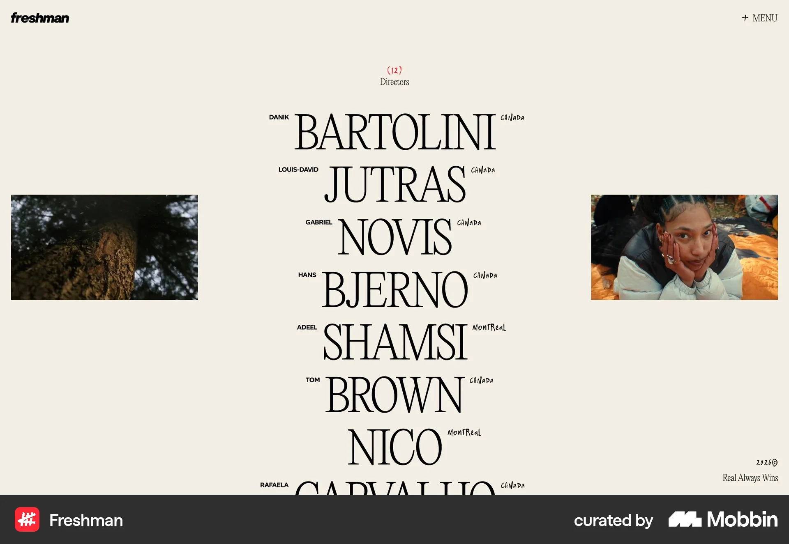

**Visible:** Large serif names are stacked in the center, each with a small label on either side. Two images sit at the left and right edges.

**For Moriz:** Side images could show the hovered or focused project on desktop. The small side labels could carry the project type.

**Tradeoff:** It lists directors, not projects. The side-image behavior is not verified.

### A24 title index with years

[Mobbin](https://mobbin.com/sites/sections/b645a881-adf5-43f3-a86c-758cd54f0b72)

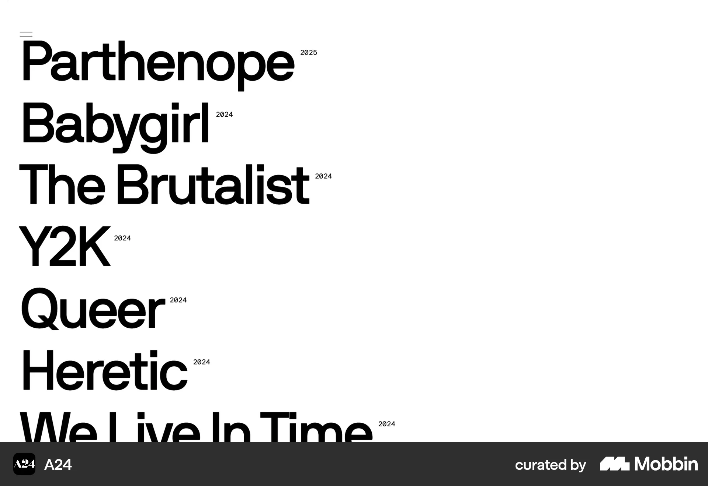

**Visible:** Giant, tightly stacked titles, each with a small superscript year.

**For Moriz:** A superscript slot could hold a short tag (for example a system type) once the owner supplies it.

**Tradeoff:** A long list, where Moriz has three. Film-catalog tone.

### Analogue success-cases stage

[Mobbin](https://mobbin.com/sites/sections/c27f50ff-dd09-41f9-afc8-598c3ccae77a)

**Visible:** A centered "Success cases / See all" heading sits above a full-width colored stage with a phone mockup. A pill at the top names the project and says "See case".

**For Moriz:** One project at a time, with a name pill that could switch between the three.

**Tradeoff:** Depends on strong mockups. The switching behavior isn't shown in the still.

### Pentagram featured slideshow

[Mobbin](https://mobbin.com/sites/sections/933958ee-3d23-4692-bcb7-650e850a84ee) · [Live mobile](assets/homepage-projects-2026-10-10/mobile-pentagram-feature-and-carousel.jpg)

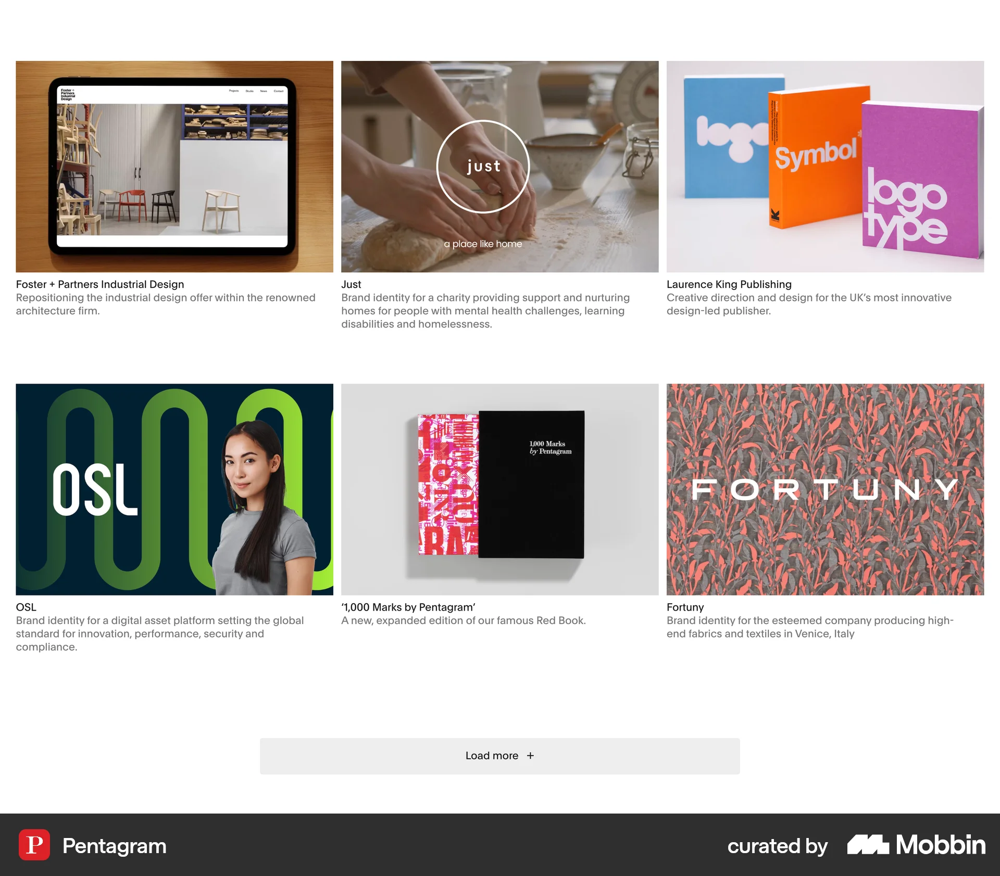

**Visible:** A full-bleed image with a project name and one-line caption at the lower left, progress dots, and "See latest projects" below.

**For Moriz:** A minimal featured stage: a caption pairs each name with a one-line contribution.

**Tradeoff:** On the live site this is the homepage hero, not a work section below it.

### Webflow centered carousel with peek

[Mobbin](https://mobbin.com/sites/sections/103632e2-e594-4aba-8287-68eedd2cfb44)

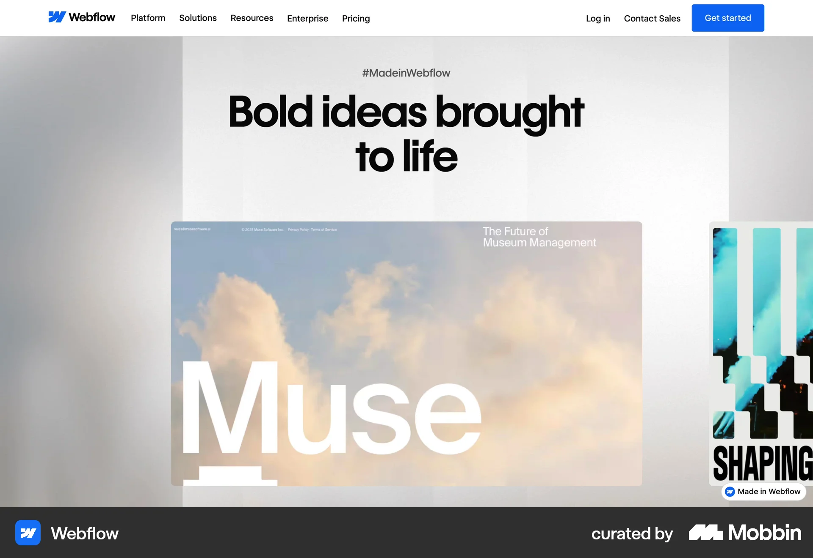

**Visible:** A centered heading, one large card, and the next card cropped at the edge.

**For Moriz:** The peek signals more projects. In RTL the next card would peek from the left.

**Tradeoff:** A product showcase, not a studio. Carousel accessibility needs explicit controls.

### Zipline product UI beside accordion

[Mobbin](https://mobbin.com/sites/sections/9fff6104-d098-4039-a6c5-5f8521058cad)

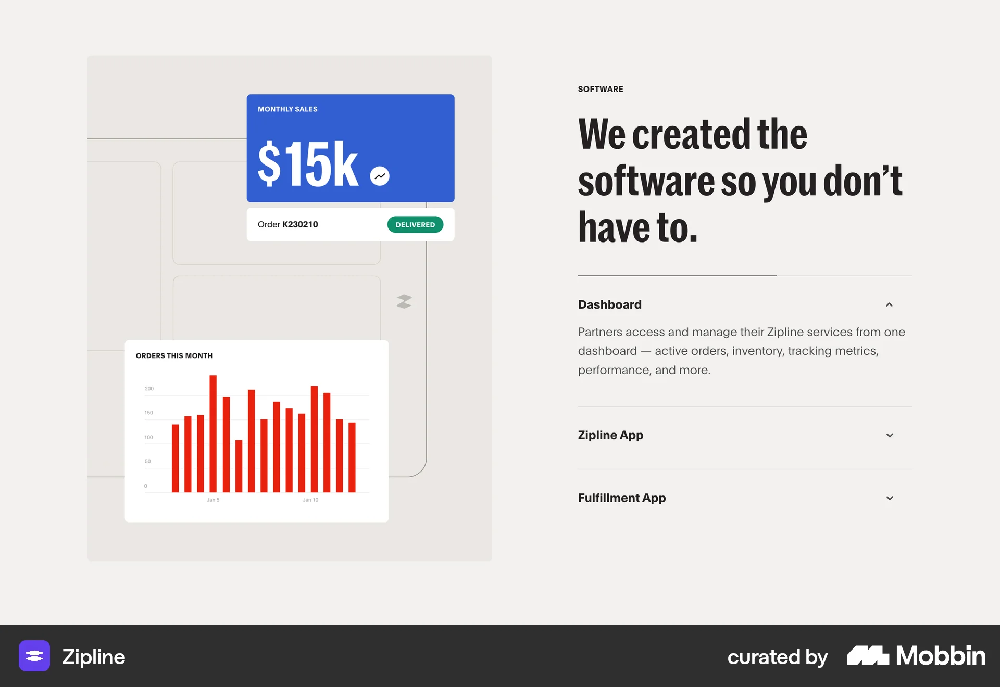

**Visible:** Floating UI fragments (a sales card, an order status, a bar chart) sit on the left. A category, a large heading and a three-item accordion with one item open sit on the right.

**For Moriz:** This is the closest match to today's four questions, with the media frame replaced by extracted interface fragments.

**Tradeoff:** It needs real UI material from each project. It is a product page, not a portfolio.

### Twenty case-study card with facts

[Mobbin](https://mobbin.com/sites/sections/e15c2850-a6fd-4c05-8848-e578c0ed21ad)

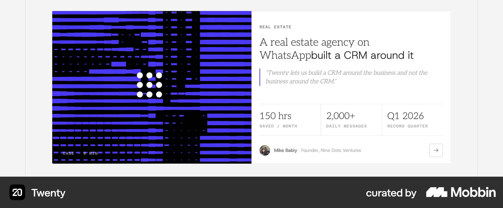

**Visible:** An image sits beside a category, title, quote, three metrics, an attribution and an arrow link.

**For Moriz:** Use only the category, title and link structure for now. Add quote and metric slots only when the owner supplies data.

**Tradeoff:** Leaving the metric slots empty or filling them with placeholders would look unfinished or invented.

### Sketch device screenshot cards

[Mobbin](https://mobbin.com/sites/sections/83492699-4967-4510-9f31-337fc2494aa4)

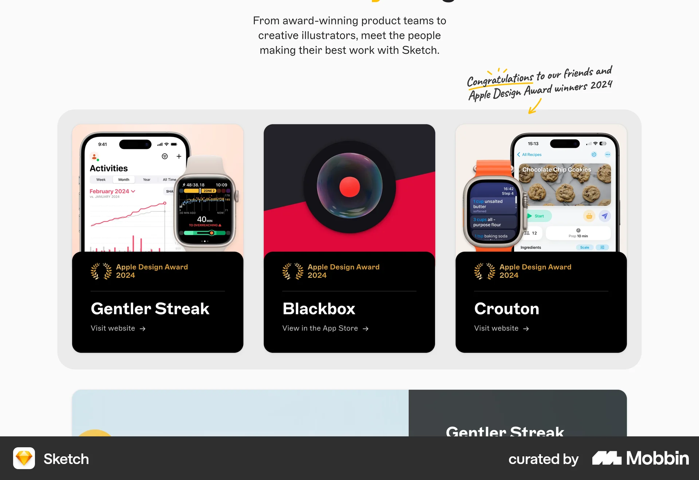

**Visible:** App UI in device frames sits above dark caption panels with a name and a link.

**For Moriz:** Three equal cards fit three projects. The dark panels suit the charcoal backdrop.

**Tradeoff:** Equal cards resemble the 7 Oct "three equal previews" option (Wild). Device frames need real screens.

### Instrument lead and secondary projects

[Mobbin](https://mobbin.com/sites/sections/05811dd7-a07a-41ae-9fa7-192b8eede1b1) · [Live mobile](assets/homepage-projects-2026-10-10/mobile-instrument-stacked-images.jpg)

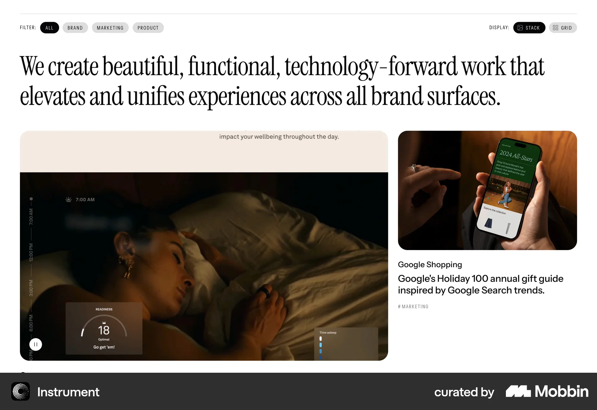

**Visible:** A large statement above one wide lead project and one smaller project with a name, a two-line description and a tag. Filters and a Stack/Grid toggle sit above.

**For Moriz:** Scale contrast between a lead project and the others, once the owner sets a Home order.

**Tradeoff:** Its live mobile drops descriptions entirely. Also reviewed in the 6 Oct section research.

### Vucko horizontal project strip

[Mobbin](https://mobbin.com/sites/sections/ceab4ab4-d046-4356-bde4-32acd9781fa8) · [Live mobile](assets/homepage-projects-2026-10-10/mobile-vucko-single-feature.jpg)

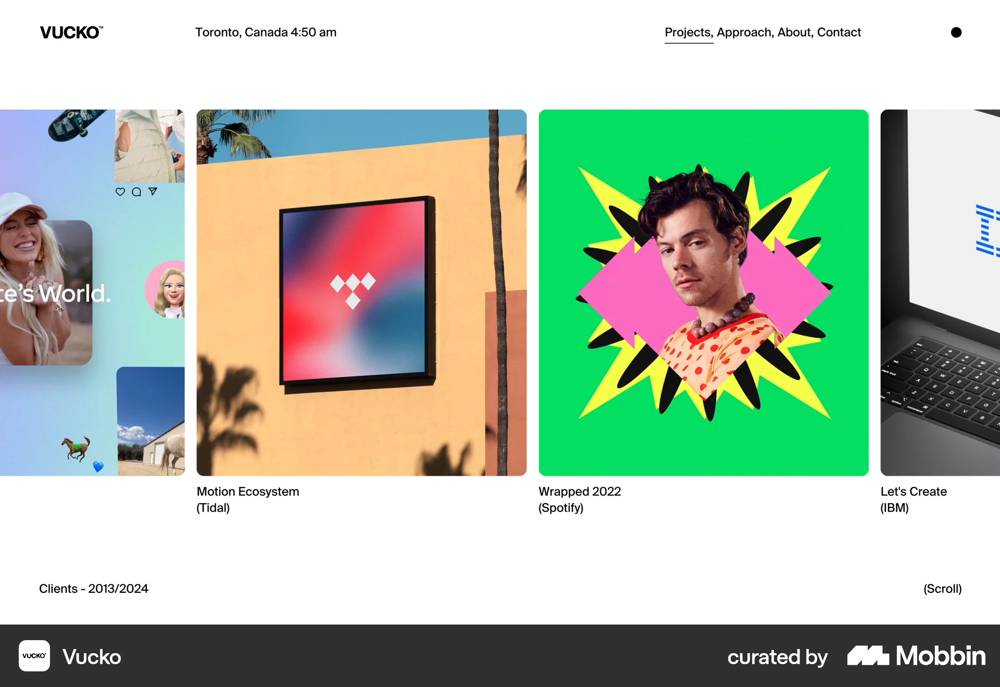

**Visible:** Large tiles run off both edges with small two-line captions and a "(Scroll)" hint.

**For Moriz:** A strip could hold several screens per project.

**Tradeoff:** Horizontal scrolling of the page itself conflicts with the vertical backdrop fade. The live mobile shows a single featured card instead.

### Fiasco website screen collage

[Mobbin](https://mobbin.com/sites/sections/606e7e35-d462-4a42-939e-df4d3a19af0a) · [Live mobile (work list)](assets/homepage-projects-2026-10-10/mobile-fiasco-offset-stack.jpg)

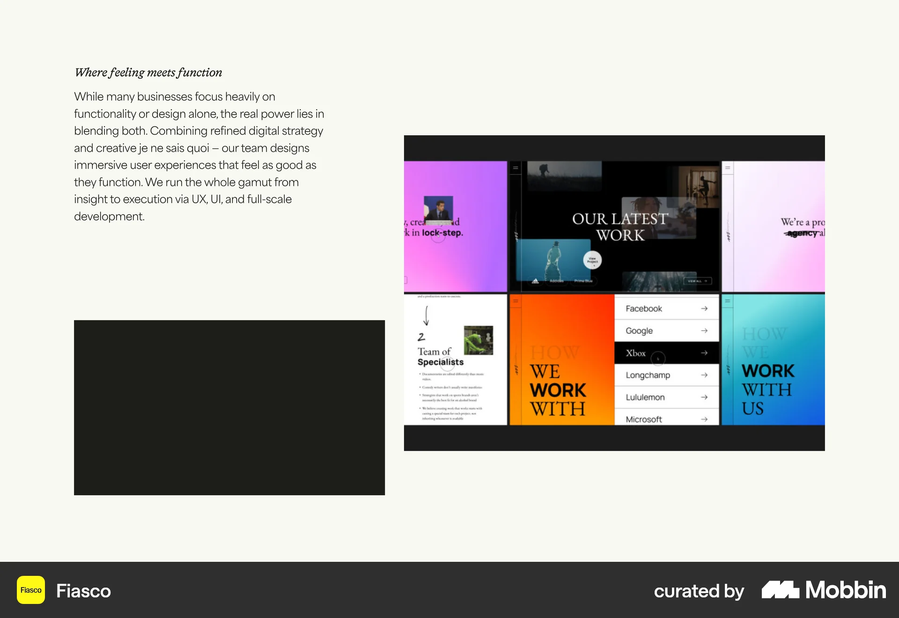

**Visible:** A short explanation sits beside a collage of website screens.

**For Moriz:** A practical way to show web projects using flat screenshots instead of photographed devices.

**Tradeoff:** This block is about Fiasco's capability, not a project list. The mobile capture shows Fiasco's separate Selected works offset stack.

## Mobile captures

| Capture | File |
| --- | --- |
| Huncwot, numbered project panel | 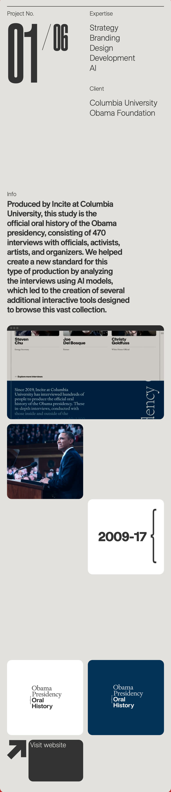 |
| basement.studio, Featured Projects | 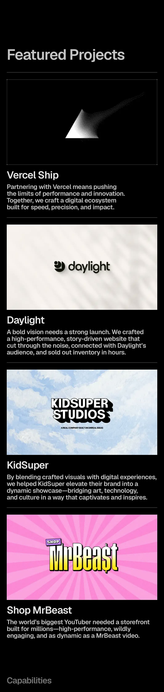 |
| Locomotive, Featured work | 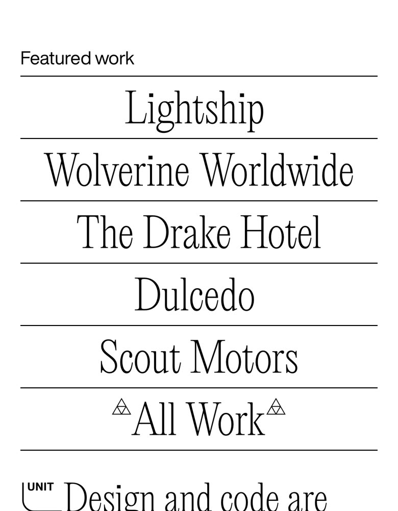 |
| Fiasco, Selected works | 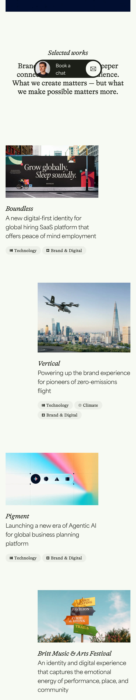 |
| Instrument, Recent work | 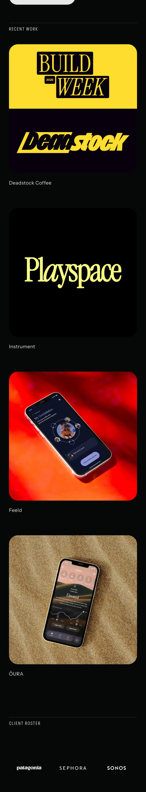 |
| Vucko, featured project | 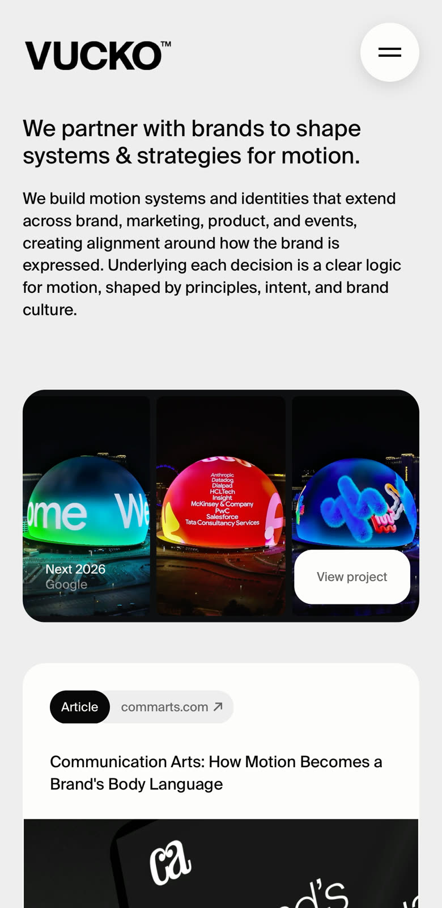 |
| Pentagram, featured and carousel | 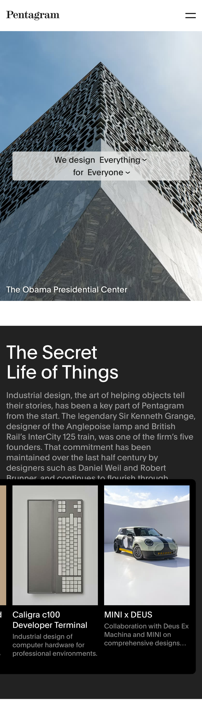 |

## Method and limits

- **Mobbin:** seven section searches, 110 results. Every returned preview was viewed. References from the 7 Oct study were excluded, and 12 new sections were kept. Full-resolution images were downloaded; the Mobbin links are canonical.
- **Mobile:** live homepages captured on 10 Oct 2026 with Playwright WebKit using the iPhone 13 profile. That is emulation of mobile Safari's engine, not a physical device.
  - Each page was scrolled once to trigger lazy content. Scroll-triggered animations may be caught mid-state.
  - Cookie banners were accepted. Fiasco's floating "Book a chat" control is still visible over its intro.
- **Live pages differ from the Mobbin captures:** Locomotive and Vucko list different projects, and Vucko's mobile shows one card instead of the strip. The Mobbin download date is not the capture date.
- **What stills don't show:** hover, carousel, scroll or keyboard behavior, accessibility, and performance. Strengths and tradeoffs are design assessments, not usability findings.

## Questions for the owner

1. Which direction should get a coded trial: the Huncwot-style numbered panels, A (index), B (featured stage), C (case-study panels), or the image-led variant?
2. Should the four questions stay on Home, or move to the project pages (needed for A and B)?
3. What should the Huncwot facts columns say for each project (role, scope, client)? Is there a lead project? Direction B and the image-led variant depend on it.
4. When can real project visuals (screenshots or UI exports) be supplied?
