# Moriz homepage — section-by-section design research

Research date: 2026-10-06. **50 section references: five for each of the nine homepage sections, plus five for the client logo strip.** Sources are combined within each section; this is not five per platform. Websites recur where their different sections are useful.

Independent UX/UI design and development studio; existing confirmed homepage sections.

## How to use this research

Open [the visual research board](homepage-section-research-2026-10-06.html) for saved Mobbin images and direct Siteinspire/live-site links. Start with the recommendation for a section, then compare all five examples. The recommendations are research suggestions, not approved layout changes.

Five references per section, combining inspected Mobbin section captures with verified Siteinspire listings and checked live-site content. References recur when relevant to different sections. Observations describe sources; adaptations and recommendations are design judgments, not measured conversion findings.

**Existing decisions:** Retain the confirmed homepage order, approved Mammoth-based hero trial and one hero project-viewing action. The logo carousel is a supplementary block. Keep WhatsApp floating-only. Starting steps remain a 5–10 minute call, an in-depth specification discussion, and a quote. FAQ answers and contact content are still open.

**Evidence limits:** Mobbin capture dates are unavailable. Siteinspire publication dates identify listing dates, not website launch dates. Most Siteinspire references were checked through live content rather than a full rendered visual audit; MONOLOG’s project row was also visually inspected. Mobile, Hebrew/RTL, motion and accessibility behavior need separate exploration.

## Reference index

| Homepage section | Five examples |
| --- | --- |
| [Hero](#hero) | [Unseen Studio](https://mobbin.com/sites/sections/1bdc4e01-2f7e-4e09-9aa1-27f02c13bcbe) (M) · [Locomotive](https://mobbin.com/sites/sections/6a2f519f-af72-4525-a6ca-2ef3457bdf63) (M) · [Nick Clement](https://www.siteinspire.com/website/13580-nick-clement) (SI) · [MONOLOG](https://www.siteinspire.com/website/13508-monolog) (SI) · [Special Offer Inc](https://www.siteinspire.com/website/13602-special-offer-inc) (SI) |
| [Client logo strip — supplementary](#logos) | [Fiasco](https://mobbin.com/sites/sections/36a53c52-dc8b-4dea-814c-31580b4f1932) (M) · [basement.studio](https://mobbin.com/sites/sections/a3cf46f9-dafe-4cee-9fee-186aabb025aa) (M) · [Givingli](https://mobbin.com/sites/sections/c12c53bc-7559-4071-a051-ae1ef2f9a8a7) (M) · [MONOLOG](https://www.siteinspire.com/website/13508-monolog) (SI) · [Otherkind](https://www.siteinspire.com/website/13476-otherkind) (SI) |
| [Three communication themes](#themes) | [Metalab](https://mobbin.com/sites/sections/35ebf43a-f6bc-43a0-bdca-19b1f1f8b4e8) (M) · [Raw Materials](https://mobbin.com/sites/sections/67c9761c-a201-45f1-910a-ca8faa50cb33) (M) · [Aino Agency](https://mobbin.com/sites/sections/9bd5d780-e303-4640-b68f-d0a9f9dc2862) (M) · [Little Plains](https://www.siteinspire.com/website/13611-little-plains) (SI) · [Nick Clement](https://www.siteinspire.com/website/13580-nick-clement) (SI) |
| [Projects](#projects) | [Fiasco](https://mobbin.com/sites/sections/4ed7c118-a866-41fa-824c-32a24323c927) (M) · [Instrument](https://mobbin.com/sites/sections/05811dd7-a07a-41ae-9fa7-192b8eede1b1) (M) · [Unseen Studio](https://mobbin.com/sites/sections/797682f6-c85e-4eea-82f1-c62de43abc94) (M) · [Nick Clement](https://www.siteinspire.com/website/13580-nick-clement) (SI) · [MONOLOG](https://www.siteinspire.com/website/13508-monolog) (SI) |
| [Brief owner introduction](#about) | [Mother Design](https://mobbin.com/sites/sections/f0c809f7-88e8-4a70-9ec9-2b4f7af538ae) (M) · [Kalstore](https://mobbin.com/sites/sections/5e1e6047-eef1-417c-b42b-c7ab44205e35) (M) · [Nick Clement](https://www.siteinspire.com/website/13580-nick-clement) (SI) · [Otherkind](https://www.siteinspire.com/website/13476-otherkind) (SI) · [MONOLOG](https://www.siteinspire.com/website/13508-monolog) (SI) |
| [Client testimonials](#testimonials) | [Büro](https://mobbin.com/sites/sections/3e179ff8-d623-4415-9848-be2e5ecdb66c) (M) · [OFF+BRAND](https://mobbin.com/sites/sections/7fbae4e0-ff3d-4d2d-9e81-395d1b721c2e) (M) · [Analogue Agency](https://mobbin.com/sites/sections/4660cdff-279d-4a6c-9708-2cca679432f8) (M) · [designmill®](https://www.siteinspire.com/website/13546-designmillr) (SI) · [MONOLOG](https://www.siteinspire.com/website/13508-monolog) (SI) |
| [How to start working together](#starting) | [Ragged Edge](https://mobbin.com/sites/sections/2f8c5c81-1584-415c-80b2-3ac03ae68a80) (M) · [Fiasco](https://mobbin.com/sites/sections/628d4c6b-cea8-49f0-88ca-353161a59678) (M) · [Framer](https://mobbin.com/sites/sections/ae184d2c-6579-4d93-a8a2-86948ec720b1) (M) · [MONOLOG](https://www.siteinspire.com/website/13508-monolog) (SI) · [Little Plains](https://www.siteinspire.com/website/13611-little-plains) (SI) |
| [FAQ](#faq) | [Büro](https://mobbin.com/sites/sections/2ecc50d0-4f74-4e6b-be84-848204dc64d9) (M) · [Fiasco](https://mobbin.com/sites/sections/2de9e891-6d2b-4142-a089-d499cfd54521) (M) · [Readymag](https://mobbin.com/sites/sections/c9d4e91b-98a6-4405-b0a6-ab4c41b9fe5c) (M) · [Pear](https://www.siteinspire.com/website/13572-pear) (SI) · [MONOLOG](https://www.siteinspire.com/website/13508-monolog) (SI) |
| [Contact](#contact) | [basement.studio](https://mobbin.com/sites/sections/a2f3898a-cd70-4d7d-b549-5f5dbb5a9fa6) (M) · [Fiasco](https://mobbin.com/sites/sections/fa4ba62d-f77e-4210-9b3b-993d86580db5) (M) · [Unseen Studio](https://mobbin.com/sites/sections/5323b0ec-3ed9-4bb0-a5a0-5f575d60333b) (M) · [Special Offer Inc](https://www.siteinspire.com/website/13602-special-offer-inc) (SI) · [MONOLOG](https://www.siteinspire.com/website/13508-monolog) (SI) |
| [Footer](#footer) | [Fiasco](https://mobbin.com/sites/sections/af0c1930-9ed3-4ed4-9af0-dfbc96b3a625) (M) · [Locomotive](https://mobbin.com/sites/sections/beb9cb86-4fed-476d-a6ec-e760e93f9b7a) (M) · [Structured](https://mobbin.com/sites/sections/cf954a98-4f2e-41d3-b2a1-168e4ba0108d) (M) · [Nick Clement](https://www.siteinspire.com/website/13580-nick-clement) (SI) · [MONOLOG](https://www.siteinspire.com/website/13508-monolog) (SI) |

M = Mobbin section capture. SI = Siteinspire listing, with the live site checked for the relevant content. Not every source section is itself on a homepage; adjacent page types and businesses are called out below.

## Hero

**Purpose:** Make the studio’s offer understandable and lead into the work.

**Suggested starting point:** Use Nick Clement for positioning clarity and Unseen for headline hierarchy. Compare these against the already selected Mammoth Murals composition; the research does not replace that trial.

### 1. Unseen Studio — Mobbin

[Open section in Mobbin](https://mobbin.com/sites/sections/1bdc4e01-2f7e-4e09-9aa1-27f02c13bcbe)

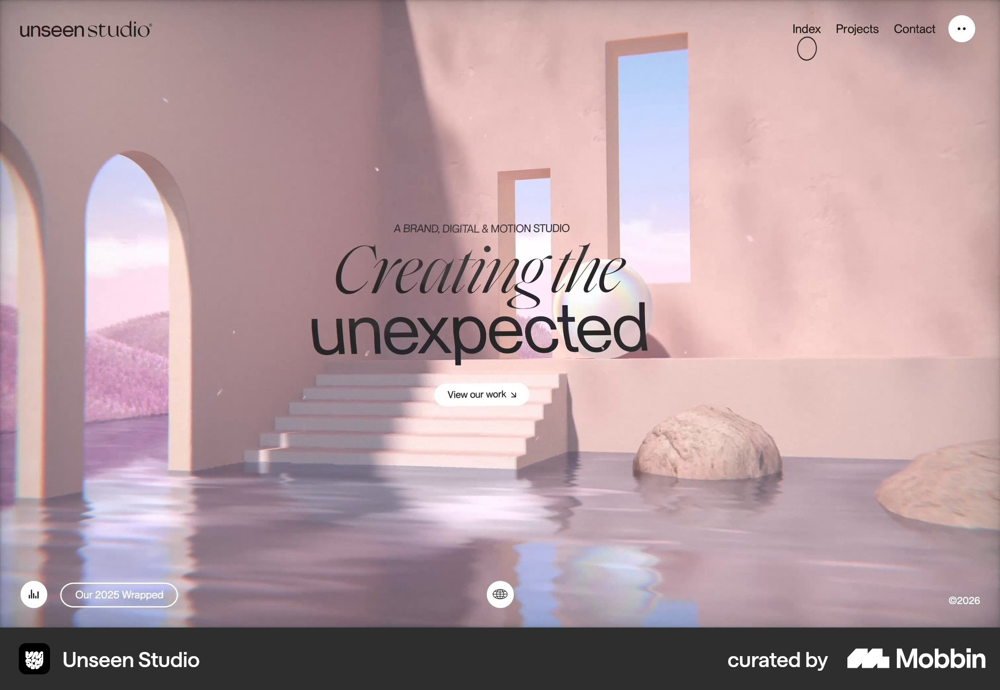

**Observed:** Centered headline, short agency descriptor and visible work button over an immersive scene.

**For Moriz:** Separate the expressive headline, concrete UX/UI and development explanation, and one project-viewing action.

**Tradeoff / fit:** The scene is visually dominant. Atmosphere alone does not communicate what Moriz delivers.

_Evidence: Mobbin section image visually inspected; capture date unavailable._

### 2. Locomotive — Mobbin

[Open section in Mobbin](https://mobbin.com/sites/sections/6a2f519f-af72-4525-a6ca-2ef3457bdf63)

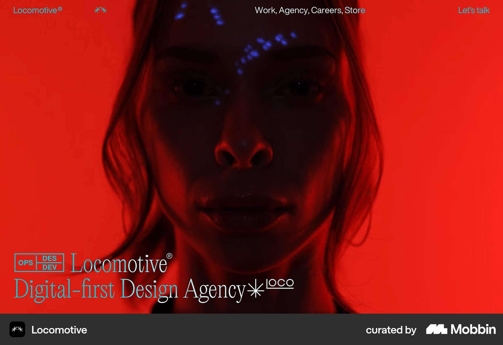

**Observed:** Large studio name and a compact digital-agency descriptor sit over a full-bleed red portrait.

**For Moriz:** Study how a strong name and short descriptor can establish personality without numerous competing elements.

**Tradeoff / fit:** The captured region offers little service explanation. This is a boldness reference rather than a complete Moriz hero.

_Evidence: Mobbin section image visually inspected; capture date unavailable._

### 3. Nick Clement — Siteinspire

[Open Siteinspire reference](https://www.siteinspire.com/website/13580-nick-clement) · [Live website](https://nickclement.com/)

**Observed:** A concise value proposition is followed by a personal product-design introduction and supporting service explanation.

**For Moriz:** Make the offer understandable before asking visitors to interpret the visual style.

**Tradeoff / fit:** The quiet personal positioning is a different expressive direction from the approved Mammoth trial.

_Evidence: Siteinspire listing and live website content checked. Detailed rendered layout and mobile states were not audited._

### 4. MONOLOG — Siteinspire

[Open Siteinspire reference](https://www.siteinspire.com/website/13508-monolog) · [Live website](https://bymonolog.com/)

**Observed:** The opening connects website and identity work to client ambition, then offers an introductory conversation.

**For Moriz:** Connect the creative headline to a concrete client need in the supporting sentence.

**Tradeoff / fit:** Its booking action differs from Moriz’s selected hero action. Borrow the positioning logic.

_Evidence: Siteinspire listing and live website content checked. Detailed rendered layout and mobile states were not audited._

### 5. Special Offer Inc — Siteinspire

[Open Siteinspire reference](https://www.siteinspire.com/website/13602-special-offer-inc) · [Live website](https://www.specialoffer.inc/)

**Observed:** The studio frames its offer around creative technology and brings together design and technical disciplines.

**For Moriz:** Make design and development read as parts of one studio offer.

**Tradeoff / fit:** A broad creative-technology umbrella can obscure the more specific UX/UI and website services.

_Evidence: Siteinspire listing and live website content checked. Detailed rendered layout and mobile states were not audited._

## Client logo strip — supplementary

**Purpose:** Add compact evidence of relevant experience immediately after the introduction.

**Suggested starting point:** Compare Fiasco’s distributed logos with Givingli’s restrained strip. Keep the already authorized carousel; use the references to study scale and density.

### 1. Fiasco — Mobbin

[Open section in Mobbin](https://mobbin.com/sites/sections/36a53c52-dc8b-4dea-814c-31580b4f1932)

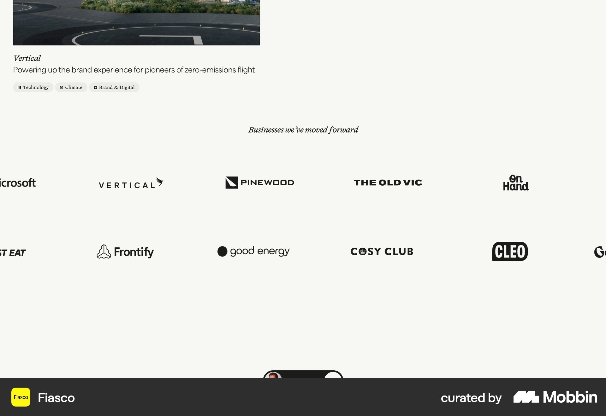

**Observed:** Two widely spaced rows of logos sit with a short introductory caption.

**For Moriz:** Use consistent optical sizing so recognizable names support the message without overpowering it.

**Tradeoff / fit:** The larger two-row block uses more vertical space than a compact strip; motion is not established by this still.

_Evidence: Mobbin section image visually inspected; capture date unavailable._

### 2. basement.studio — Mobbin

[Open section in Mobbin](https://mobbin.com/sites/sections/a3cf46f9-dafe-4cee-9fee-186aabb025aa)

**Observed:** A studio introduction leads into a dense bordered matrix of client logos.

**For Moriz:** Study consistent cell alignment and the separation between positioning and proof.

**Tradeoff / fit:** A full wall is disproportionate to a small client set; it is a grid alternative, not the selected carousel.

_Evidence: Mobbin section image visually inspected; capture date unavailable._

### 3. Givingli — Mobbin

[Open section in Mobbin](https://mobbin.com/sites/sections/c12c53bc-7559-4071-a051-ae1ef2f9a8a7)

**Observed:** A small trust caption accompanies a narrow horizontal logo band.

**For Moriz:** Keep a short caption and a restrained vertical footprint.

**Tradeoff / fit:** This is a product-company reference. Reuse its proportions, not its customer positioning.

_Evidence: Mobbin section image visually inspected; capture date unavailable._

### 4. MONOLOG — Siteinspire

[Open Siteinspire reference](https://www.siteinspire.com/website/13508-monolog) · [Live website](https://bymonolog.com/)

**Observed:** A recognizable-client name strip supports the studio introduction.

**For Moriz:** Keep the proof close to the positioning and distinguish studio clients from other professional experience.

**Tradeoff / fit:** Text names do not demonstrate a logo treatment; brand recognition varies by audience.

_Evidence: Siteinspire listing and live website content checked. Detailed rendered layout and mobile states were not audited._

### 5. Otherkind — Siteinspire

[Open Siteinspire reference](https://www.siteinspire.com/website/13476-otherkind) · [Live website](https://www.otherkind.design/)

**Observed:** Past engagements are listed with dates.

**For Moriz:** Consider factual engagement labels when a logo needs context about the owner’s role.

**Tradeoff / fit:** This is a text-based proof alternative, not a logo carousel example.

_Evidence: Siteinspire listing and live website content checked. Detailed rendered layout and mobile states were not audited._

## Three communication themes

**Purpose:** Explain research-based specification, an engaging interactive experience, and development.

**Suggested starting point:** Metalab offers the clearest benefit-led reference; Raw Materials supplies a useful comparison for organizing three disciplines. Keep Moriz’s three selected themes rather than expanding into a full service catalogue.

### 1. Metalab — Mobbin

[Open section in Mobbin](https://mobbin.com/sites/sections/35ebf43a-f6bc-43a0-bdca-19b1f1f8b4e8)

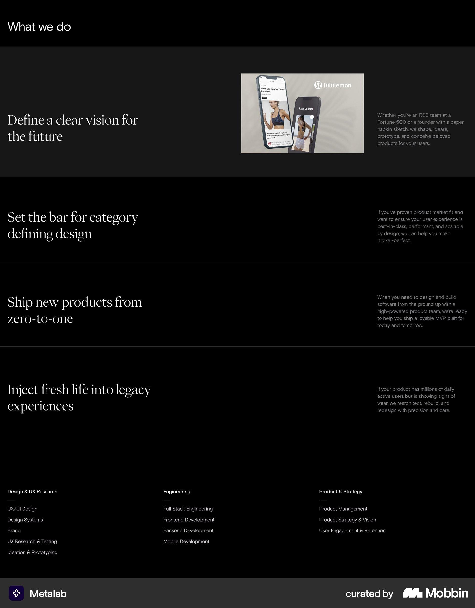

**Observed:** Large benefit headlines lead rows with supporting explanation; discipline lists follow below.

**For Moriz:** Make each theme a client benefit with one concrete sentence explaining how the studio delivers it.

**Tradeoff / fit:** Its full capabilities block is longer than this homepage section needs.

_Evidence: Mobbin section image visually inspected; capture date unavailable._

### 2. Raw Materials — Mobbin

[Open section in Mobbin](https://mobbin.com/sites/sections/67c9761c-a201-45f1-910a-ca8faa50cb33)

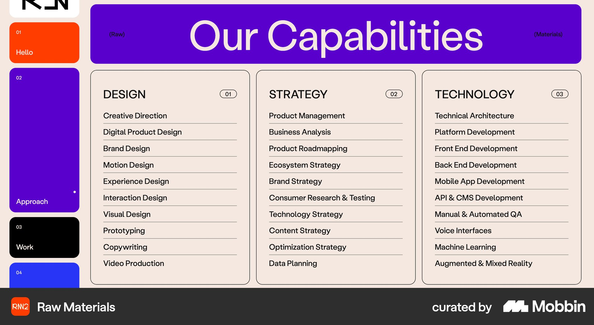

**Observed:** Design, Strategy and Technology form three parallel columns of services.

**For Moriz:** Use equal visual weight for three distinct but connected strengths.

**Tradeoff / fit:** Long service lists can make the section feel like a catalogue; Moriz’s themes need much less detail.

_Evidence: Mobbin section image visually inspected; capture date unavailable._

### 3. Aino Agency — Mobbin

[Open section in Mobbin](https://mobbin.com/sites/sections/9bd5d780-e303-4640-b68f-d0a9f9dc2862)

**Observed:** Restrained capability lists use a clear column structure with small supporting links.

**For Moriz:** Explore a quiet, scannable treatment that leaves attention available for the projects.

**Tradeoff / fit:** Lists communicate scope more readily than value; add concise benefit explanations.

_Evidence: Mobbin section image visually inspected; capture date unavailable._

### 4. Little Plains — Siteinspire

[Open Siteinspire reference](https://www.siteinspire.com/website/13611-little-plains) · [Live website](https://littleplains.com/)

**Observed:** Design, Technology and Hospitality are articulated as separate principles with explanations.

**For Moriz:** Give each Moriz theme its own meaningful heading and a short reason it matters to the client.

**Tradeoff / fit:** The reference principles are specific to Little Plains; they do not become Moriz’s claims.

_Evidence: Siteinspire listing and live website content checked. Detailed rendered layout and mobile states were not audited._

### 5. Nick Clement — Siteinspire

[Open Siteinspire reference](https://www.siteinspire.com/website/13580-nick-clement) · [Live website](https://nickclement.com/)

**Observed:** The service explanation is grouped into Design, Strategy and Build.

**For Moriz:** Connect the research, experience and implementation messages through a simple three-part story.

**Tradeoff / fit:** The grouping is content evidence; an exact three-column visual layout was not verified.

_Evidence: Siteinspire listing and live website content checked. Detailed rendered layout and mobile states were not audited._

## Projects

**Purpose:** Show the quality of the work and clarify the studio’s contribution.

**Suggested starting point:** Start the layout comparison with Fiasco’s staggered grid and MONOLOG’s image-plus-context rows. Keep Huncwot as the owner’s existing project-layout preference.

### 1. Fiasco — Mobbin

[Open section in Mobbin](https://mobbin.com/sites/sections/4ed7c118-a866-41fa-824c-32a24323c927)

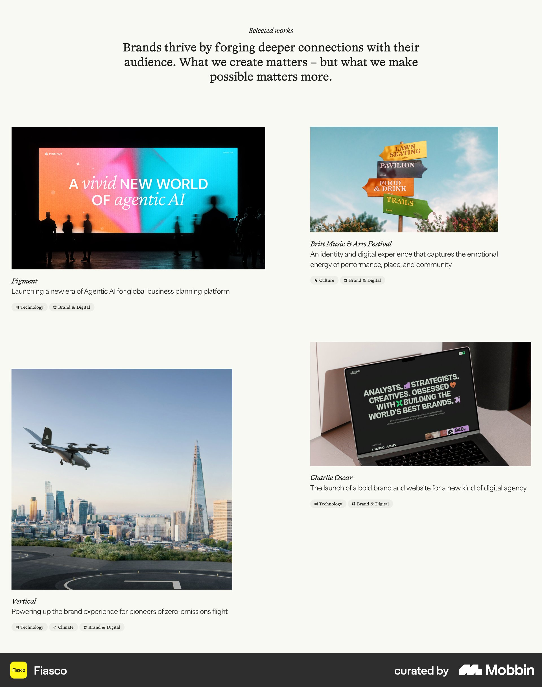

**Observed:** Staggered project images in two columns carry names, short context and tags.

**For Moriz:** Give each selected project a visual, a one-line brief and clear contribution labels.

**Tradeoff / fit:** Uneven image positions need a deliberate Hebrew reading order and a simpler mobile sequence.

_Evidence: Mobbin section image visually inspected; capture date unavailable._

### 2. Instrument — Mobbin

[Open section in Mobbin](https://mobbin.com/sites/sections/05811dd7-a07a-41ae-9fa7-192b8eede1b1)

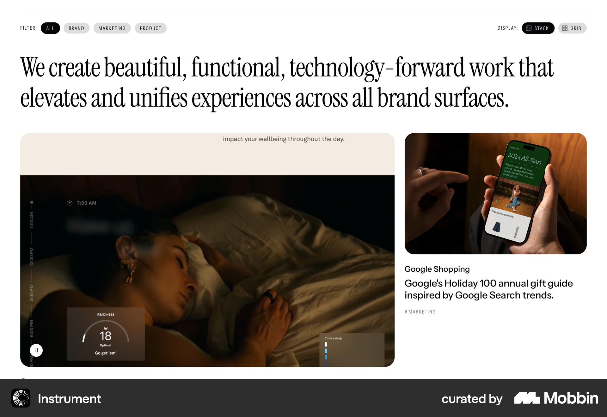

**Observed:** Different image sizes create an editorial work selection, with filtering and display controls.

**For Moriz:** Use variation to establish a featured project and a clear visual rhythm.

**Tradeoff / fit:** Filters and view controls add overhead for a small portfolio; they need an actual browsing problem to solve.

_Evidence: Mobbin section image visually inspected; capture date unavailable._

### 3. Unseen Studio — Mobbin

[Open section in Mobbin](https://mobbin.com/sites/sections/797682f6-c85e-4eea-82f1-c62de43abc94)

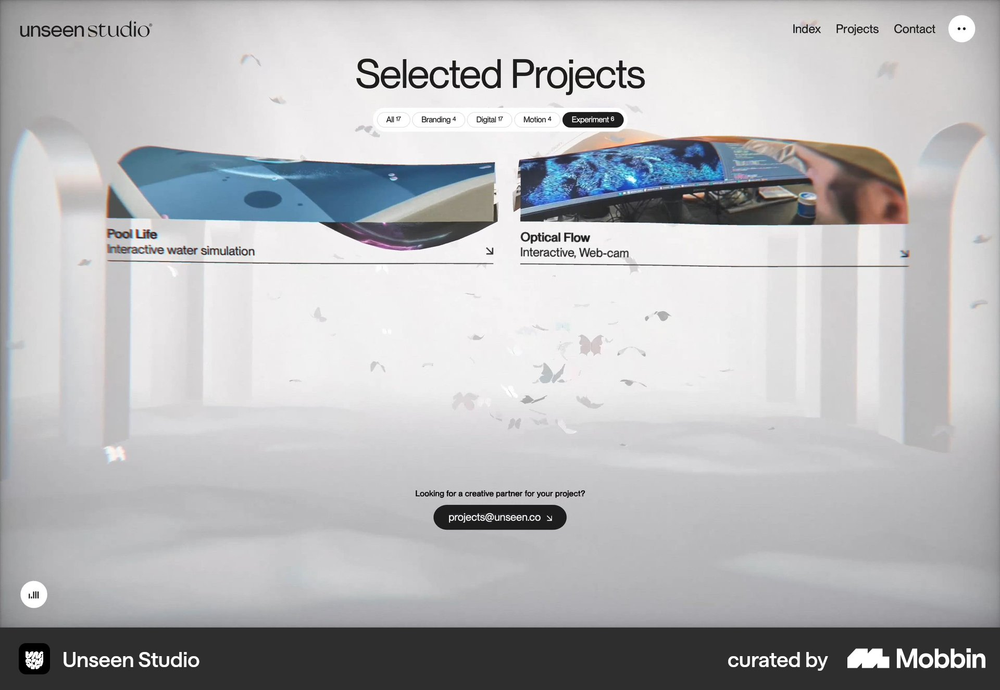

**Observed:** Two large project previews sit side by side with names, short descriptions, categories and arrows.

**For Moriz:** Keep the relationship between project preview and project context explicit.

**Tradeoff / fit:** The surrounding scene can compete with the work. A still does not establish hover or motion behavior.

_Evidence: Mobbin section image visually inspected; capture date unavailable._

### 4. Nick Clement — Siteinspire

[Open Siteinspire reference](https://www.siteinspire.com/website/13580-nick-clement) · [Live website](https://nickclement.com/)

**Observed:** Selected projects pair names with short context subtitles and discipline labels.

**For Moriz:** Make the owner’s role legible, especially when presenting employed and independent experience together.

**Tradeoff / fit:** Content grouping was checked; precise thumbnail proportions and responsive behavior were not audited.

_Evidence: Siteinspire listing and live website content checked. Detailed rendered layout and mobile states were not audited._

### 5. MONOLOG — Siteinspire

[Open Siteinspire reference](https://www.siteinspire.com/website/13508-monolog) · [Live website](https://bymonolog.com/)

**Observed:** A large project visual is paired with contextual text and an outcome metric in a success-story row.

**For Moriz:** Connect the attractive screenshot to what the project achieved and what Moriz contributed.

**Tradeoff / fit:** Only use results that Moriz can substantiate. The reference’s metrics are not transferable.

_Evidence: Siteinspire listing and live website content checked. Detailed rendered layout and mobile states were not audited._

## Brief owner introduction

**Purpose:** Help visitors understand who will work with them.

**Suggested starting point:** MONOLOG and Nick Clement are the closest content references for a personal studio. Kalstore gives a clear visual comparison for portrait and biography.

### 1. Mother Design — Mobbin

[Open section in Mobbin](https://mobbin.com/sites/sections/f0c809f7-88e8-4a70-9ec9-2b4f7af538ae)

**Observed:** A prominent studio introduction sits above a wide photograph of the real team.

**For Moriz:** Use authentic photography to put a human presence beside a short professional introduction.

**Tradeoff / fit:** This is a team studio and an information-page section; adapt the scale to one owner.

_Evidence: Mobbin section image visually inspected; capture date unavailable._

### 2. Kalstore — Mobbin

[Open section in Mobbin](https://mobbin.com/sites/sections/5e1e6047-eef1-417c-b42b-c7ab44205e35)

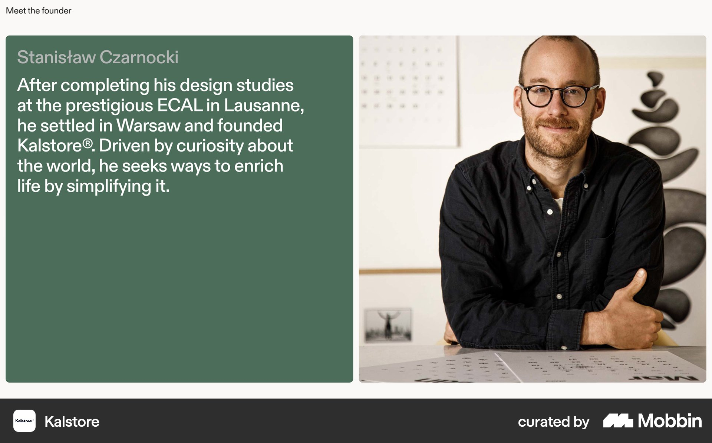

**Observed:** A founder biography occupies one colored panel beside a large portrait.

**For Moriz:** Compare a compact portrait-and-biography split with a text-first owner introduction.

**Tradeoff / fit:** The source is a furniture/design business. Its product story and commercial positioning are not relevant.

_Evidence: Mobbin section image visually inspected; capture date unavailable._

### 3. Nick Clement — Siteinspire

[Open Siteinspire reference](https://www.siteinspire.com/website/13580-nick-clement) · [Live website](https://nickclement.com/)

**Observed:** The introduction is written personally and explains collaboration with founders and engineering teams.

**For Moriz:** Explain the owner’s expertise and how direct collaboration works in a few specific sentences.

**Tradeoff / fit:** Audience and collaboration claims need to reflect the owner’s actual practice.

_Evidence: Siteinspire listing and live website content checked. Detailed rendered layout and mobile states were not audited._

### 4. Otherkind — Siteinspire

[Open Siteinspire reference](https://www.siteinspire.com/website/13476-otherkind) · [Live website](https://www.otherkind.design/)

**Observed:** Two founders are named and the team is connected to the studio’s working model.

**For Moriz:** Make the person responsible for the work visible, with a clear role.

**Tradeoff / fit:** A two-founder studio is a scale mismatch; do not imply a larger Moriz team.

_Evidence: Siteinspire listing and live website content checked. Detailed rendered layout and mobile states were not audited._

### 5. MONOLOG — Siteinspire

[Open Siteinspire reference](https://www.siteinspire.com/website/13508-monolog) · [Live website](https://bymonolog.com/)

**Observed:** The founder’s headshot and name sit alongside a personal explanation of the studio.

**For Moriz:** Study how a recognizable owner identity can connect the portfolio to the person leading the engagement.

**Tradeoff / fit:** Use a real owner image and voice; detailed spacing and mobile composition remain to be explored.

_Evidence: Siteinspire listing and live website content checked. Detailed rendered layout and mobile states were not audited._

## Client testimonials

**Purpose:** Provide credible third-party evidence about working with the studio.

**Suggested starting point:** Büro is the strongest restrained layout reference. Use MONOLOG and designmill to compare attribution and the range of client perspectives.

### 1. Büro — Mobbin

[Open section in Mobbin](https://mobbin.com/sites/sections/3e179ff8-d623-4415-9848-be2e5ecdb66c)

**Observed:** A large quote occupies the main column while author, organization and role sit in a smaller column.

**For Moriz:** Treat the testimony and its attribution as equally necessary parts of the proof.

**Tradeoff / fit:** A long quote dominates the page. This capture’s quote differs from the current live-site content.

_Evidence: Mobbin section image visually inspected; capture date unavailable._

### 2. OFF+BRAND — Mobbin

[Open section in Mobbin](https://mobbin.com/sites/sections/7fbae4e0-ff3d-4d2d-9e81-395d1b721c2e)

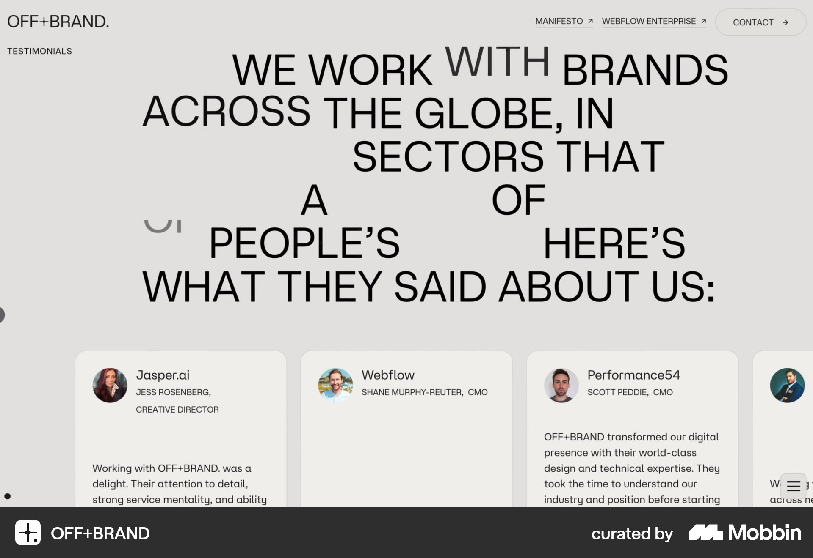

**Observed:** A large introductory statement leads horizontal testimonial cards with portraits and detailed attribution.

**For Moriz:** Compare multiple compact testimonials with one featured quote.

**Tradeoff / fit:** The heading and card density compete for space; a still cannot verify carousel interaction.

_Evidence: Mobbin section image visually inspected; capture date unavailable._

### 3. Analogue Agency — Mobbin

[Open section in Mobbin](https://mobbin.com/sites/sections/4660cdff-279d-4a6c-9708-2cca679432f8)

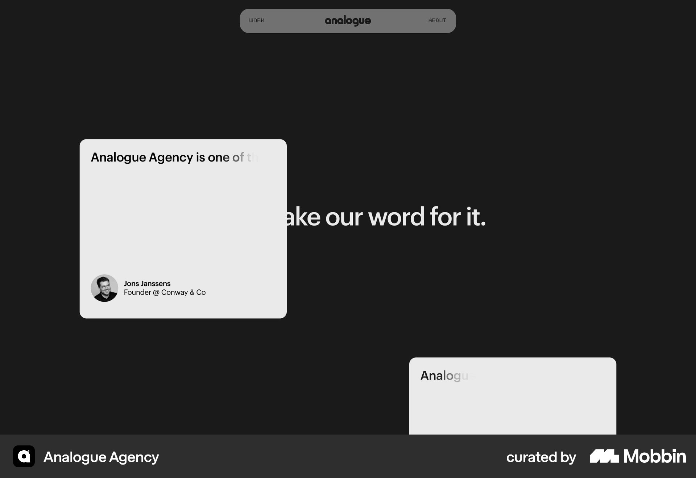

**Observed:** Two light quote cards contrast with a dark background and include small circular portraits.

**For Moriz:** Use a consistent card format when comparing short comments from several clients.

**Tradeoff / fit:** Some text is clipped in the capture. The layout is usable evidence; the complete testimonial wording is not.

_Evidence: Mobbin section image visually inspected; capture date unavailable._

### 4. designmill® — Siteinspire

[Open Siteinspire reference](https://www.siteinspire.com/website/13546-designmillr) · [Live website](https://www.designmill.in/)

**Observed:** Several testimonials identify both the speaker and their company.

**For Moriz:** Use full attribution and choose comments that describe different aspects of the engagement.

**Tradeoff / fit:** The live content was checked, but quote-card layout and controls were not visually audited.

_Evidence: Siteinspire listing and live website content checked. Detailed rendered layout and mobile states were not audited._

### 5. MONOLOG — Siteinspire

[Open Siteinspire reference](https://www.siteinspire.com/website/13508-monolog) · [Live website](https://bymonolog.com/)

**Observed:** Client comments include author, role and company; the live page exposes previous and next controls.

**For Moriz:** Keep attribution visible and make additional quotes easy to access if a carousel is chosen.

**Tradeoff / fit:** Controls establish a carousel exists, not how well it works. Approved real quotes are still required.

_Evidence: Siteinspire listing and live website content checked. Detailed rendered layout and mobile states were not audited._

## How to start working together

**Purpose:** Explain the 5–10 minute call, in-depth specification conversation and quotation.

**Suggested starting point:** Use Ragged Edge’s numbered hierarchy for the selected three steps, with Framer’s expectation-setting as a comparison. These references mostly describe broader collaboration or delivery; only their presentation patterns transfer.

### 1. Ragged Edge — Mobbin

[Open section in Mobbin](https://mobbin.com/sites/sections/2f8c5c81-1584-415c-80b2-3ac03ae68a80)

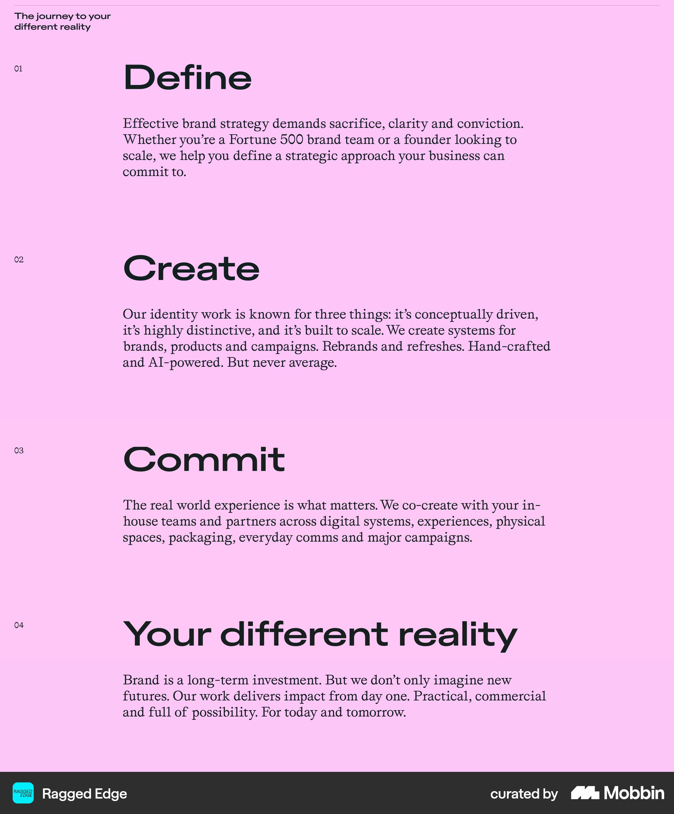

**Observed:** Numbered vertical stages each use a large heading and a short explanatory paragraph.

**For Moriz:** Present the three actual starting steps with a title and an explanation of what the visitor can expect.

**Tradeoff / fit:** The source describes a four-stage brand journey. Do not copy its stages or imply Moriz has approved a delivery process.

_Evidence: Mobbin section image visually inspected; capture date unavailable._

### 2. Fiasco — Mobbin

[Open section in Mobbin](https://mobbin.com/sites/sections/628d4c6b-cea8-49f0-88ca-353161a59678)

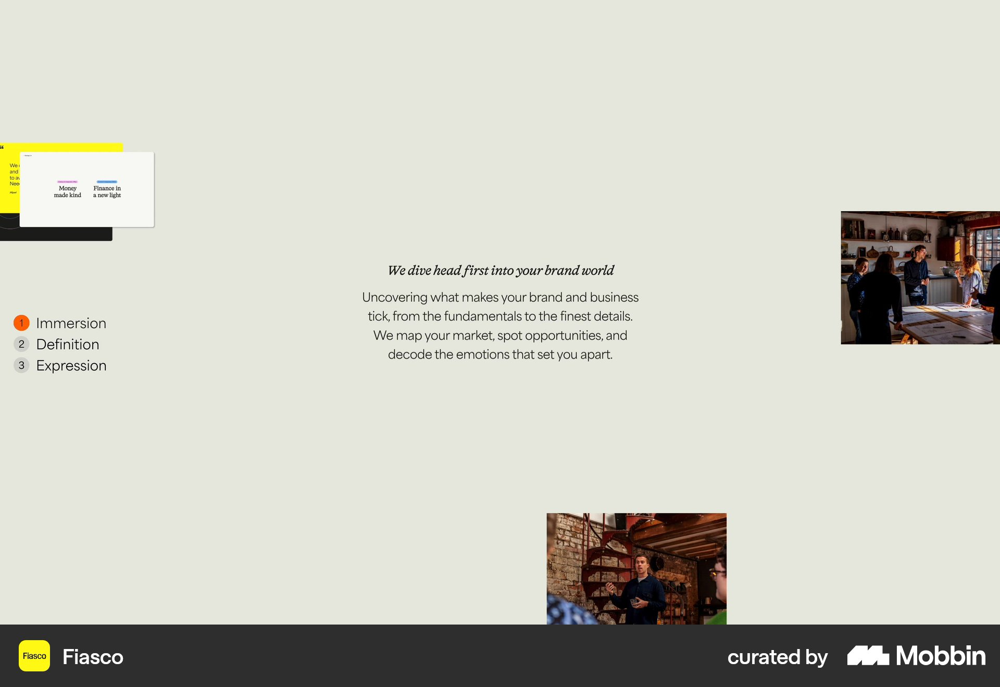

**Observed:** A compact three-stage index sits beside the explanation and imagery of a highlighted stage.

**For Moriz:** Compare a compact step index with three fully visible explanations.

**Tradeoff / fit:** The selected-state appearance does not prove tab behavior; hidden steps may be unnecessary for a short sequence.

_Evidence: Mobbin section image visually inspected; capture date unavailable._

### 3. Framer — Mobbin

[Open section in Mobbin](https://mobbin.com/sites/sections/ae184d2c-6579-4d93-a8a2-86948ec720b1)

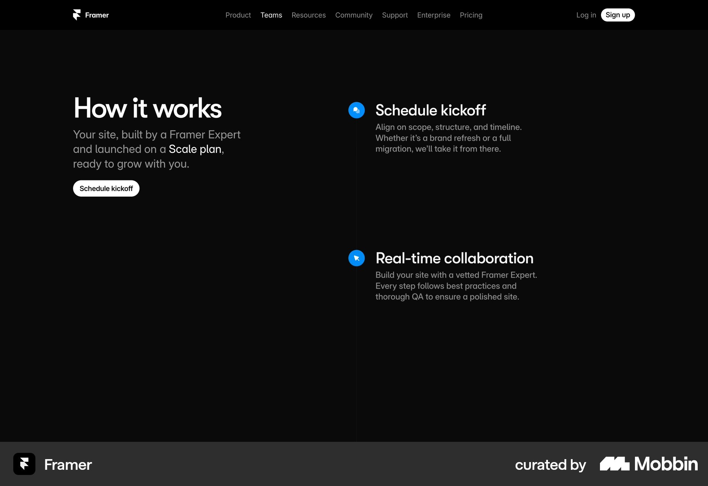

**Observed:** A consultation introduction and kickoff action sit beside a short vertical explanation of collaboration.

**For Moriz:** State what happens when contact begins and what the first conversation is for.

**Tradeoff / fit:** This is an expert-service offering on a platform. Its ongoing collaboration steps are not Moriz’s selected starting sequence.

_Evidence: Mobbin section image visually inspected; capture date unavailable._

### 4. MONOLOG — Siteinspire

[Open Siteinspire reference](https://www.siteinspire.com/website/13508-monolog) · [Live website](https://bymonolog.com/)

**Observed:** Three stages explain the studio’s broader delivery journey, with examples linked alongside.

**For Moriz:** Keep step titles short and let the explanation carry practical expectations.

**Tradeoff / fit:** Its delivery stages differ from call → specification discussion → quote. Reuse the communication pattern only.

_Evidence: Siteinspire listing and live website content checked. Detailed rendered layout and mobile states were not audited._

### 5. Little Plains — Siteinspire

[Open Siteinspire reference](https://www.siteinspire.com/website/13611-little-plains) · [Live website](https://littleplains.com/)

**Observed:** The studio explains collaboration cadence and separates project work from a retainer arrangement.

**For Moriz:** Use concrete expectations so visitors know what the starting conversation will clarify.

**Tradeoff / fit:** This is working-model content rather than an exact three-step onboarding layout; do not import unapproved cadence or retainer terms.

_Evidence: Siteinspire listing and live website content checked. Detailed rendered layout and mobile states were not audited._

## FAQ

**Purpose:** Resolve remaining questions before the contact section.

**Suggested starting point:** Compare Fiasco’s split layout with Büro’s numbered list. Final Moriz questions and answers remain open; the research only supplies presentation and topic-selection patterns.

### 1. Büro — Mobbin

[Open section in Mobbin](https://mobbin.com/sites/sections/2ecc50d0-4f74-4e6b-be84-848204dc64d9)

**Observed:** A dark list uses numbered questions, horizontal rules and expandable-answer affordances.

**For Moriz:** Explore strong question hierarchy and a clear distinction between collapsed and open states.

**Tradeoff / fit:** The captured seven-question list differs from the current contact page. Its questions do not automatically fit Moriz.

_Evidence: Mobbin section image visually inspected; capture date unavailable._

### 2. Fiasco — Mobbin

[Open section in Mobbin](https://mobbin.com/sites/sections/2de9e891-6d2b-4142-a089-d499cfd54521)

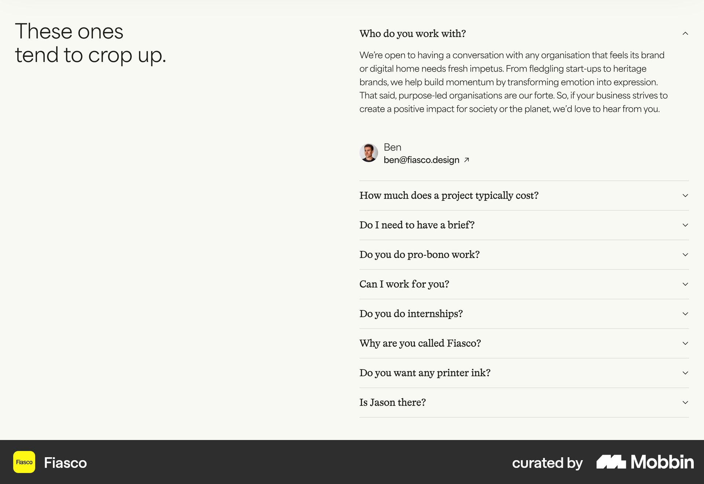

**Observed:** A heading occupies one side while ruled question rows occupy the other; one answer is open.

**For Moriz:** Keep the section label stable while visitors scan concise questions.

**Tradeoff / fit:** A split layout needs a mobile stack and Hebrew reading-order check; keyboard behavior is not established by the still.

_Evidence: Mobbin section image visually inspected; capture date unavailable._

### 3. Readymag — Mobbin

[Open section in Mobbin](https://mobbin.com/sites/sections/c9d4e91b-98a6-4405-b0a6-ab4c41b9fe5c)

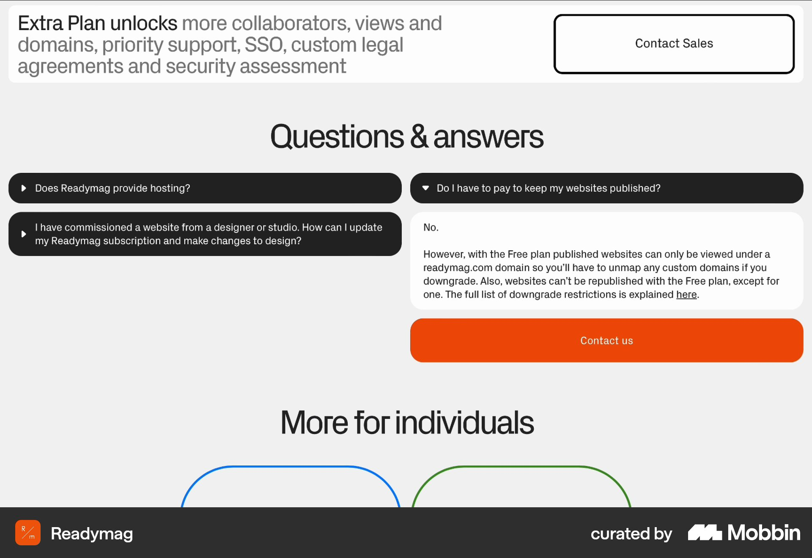

**Observed:** Questions and visible answers are grouped in two columns with contrasting dark question headers.

**For Moriz:** Compare an answer-visible format with a compact accordion.

**Tradeoff / fit:** This is a web-creation product. Its support, hosting and plan questions need different treatment for a studio.

_Evidence: Mobbin section image visually inspected; capture date unavailable._

### 4. Pear — Siteinspire

[Open Siteinspire reference](https://www.siteinspire.com/website/13572-pear) · [Live website](https://pear.no/)

**Observed:** A short question-and-answer group addresses the unusual commercial model and likely objections.

**For Moriz:** Select questions from actual client uncertainty and answer directly.

**Tradeoff / fit:** Pear’s revenue-sharing model is unrelated. This is an objection-handling reference; accordion behavior was not verified.

_Evidence: Siteinspire listing and live website content checked. Detailed rendered layout and mobile states were not audited._

### 5. MONOLOG — Siteinspire

[Open Siteinspire reference](https://www.siteinspire.com/website/13508-monolog) · [Live website](https://bymonolog.com/)

**Observed:** Questions address founder involvement, timing, communication, getting started and post-launch work.

**For Moriz:** Use the client’s practical concerns as a filter for deciding what belongs in the FAQ.

**Tradeoff / fit:** Topics are prompts for investigation, not approved Moriz answers, timelines or service promises.

_Evidence: Siteinspire listing and live website content checked. Detailed rendered layout and mobile states were not audited._

## Contact

**Purpose:** End with a clear invitation and an understandable next action.

**Suggested starting point:** Compare basement’s concentrated invitation with MONOLOG’s personal ending. Contact content still needs selection within Moriz’s confirmed floating-only WhatsApp access.

### 1. basement.studio — Mobbin

[Open section in Mobbin](https://mobbin.com/sites/sections/a2f3898a-cd70-4d7d-b549-5f5dbb5a9fa6)

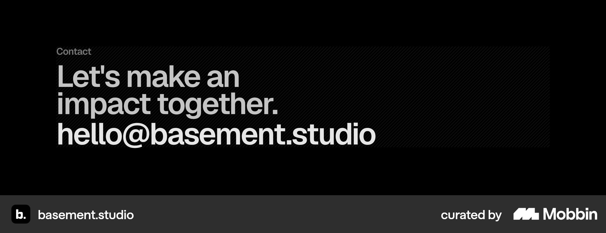

**Observed:** A short invitation leads to a prominent email address on a dark background.

**For Moriz:** Make the invitation identifiable without adding several competing messages.

**Tradeoff / fit:** Email is the reference’s channel. It does not authorize an inline WhatsApp action or a new Moriz contact channel.

_Evidence: Mobbin section image visually inspected; capture date unavailable._

### 2. Fiasco — Mobbin

[Open section in Mobbin](https://mobbin.com/sites/sections/fa4ba62d-f77e-4210-9b3b-993d86580db5)

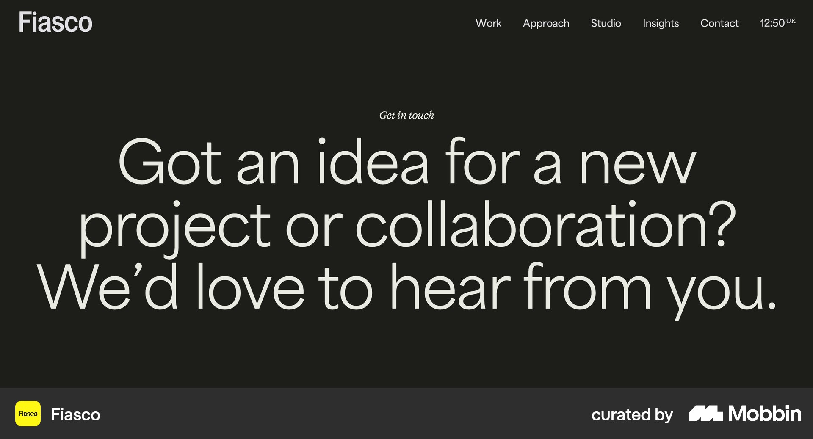

**Observed:** An oversized inquiry prompt creates a dramatic final contact region.

**For Moriz:** Study scale and whitespace as ways to mark the end of the homepage.

**Tradeoff / fit:** The crop does not show a complete form or contact flow; large lettering must still communicate a useful next step.

_Evidence: Mobbin section image visually inspected; capture date unavailable._

### 3. Unseen Studio — Mobbin

[Open section in Mobbin](https://mobbin.com/sites/sections/5323b0ec-3ed9-4bb0-a5a0-5f575d60333b)

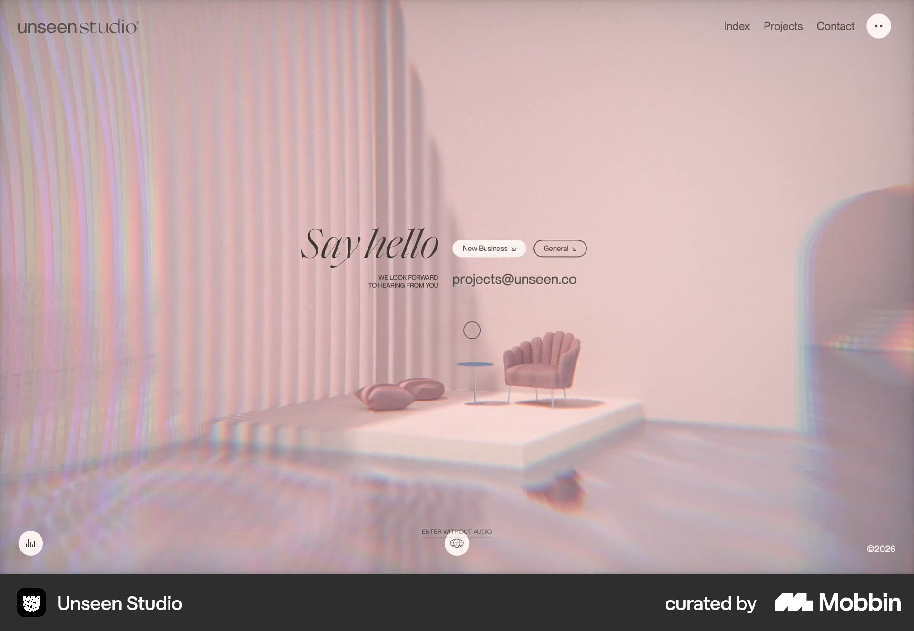

**Observed:** A contact title, inquiry-type choices and email sit over an immersive scene.

**For Moriz:** Compare direct contact with a lightly guided inquiry.

**Tradeoff / fit:** Routing choices need real destinations; the scene can reduce practical clarity.

_Evidence: Mobbin section image visually inspected; capture date unavailable._

### 4. Special Offer Inc — Siteinspire

[Open Siteinspire reference](https://www.siteinspire.com/website/13602-special-offer-inc) · [Live website](https://www.specialoffer.inc/)

**Observed:** The contact explanation describes suitable work and provides a direct email route.

**For Moriz:** Use one concise sentence to help a prospective client recognize when to contact the studio.

**Tradeoff / fit:** Do not adopt the source’s email channel or project criteria without a content decision.

_Evidence: Siteinspire listing and live website content checked. Detailed rendered layout and mobile states were not audited._

### 5. MONOLOG — Siteinspire

[Open Siteinspire reference](https://www.siteinspire.com/website/13508-monolog) · [Live website](https://bymonolog.com/)

**Observed:** A final introductory-conversation invitation is paired with a candid founder-at-work image.

**For Moriz:** Connect the invitation to the person the visitor will actually speak with.

**Tradeoff / fit:** Its booking flow is separate from Moriz’s agreed access pattern; the contact section still needs its own content decision.

_Evidence: Siteinspire listing and live website content checked. Detailed rendered layout and mobile states were not audited._

## Footer

**Purpose:** Provide compact navigation, identity and necessary secondary information.

**Suggested starting point:** Nick Clement is the best scale reference for an independent owner. Compare Fiasco’s grouping and Structured’s minimal density before selecting Moriz’s footer content.

### 1. Fiasco — Mobbin

[Open section in Mobbin](https://mobbin.com/sites/sections/af0c1930-9ed3-4ed4-9af0-dfbc96b3a625)

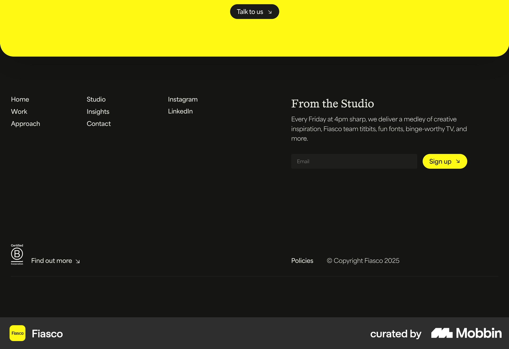

**Observed:** Navigation and social groups sit beside a newsletter area, with policies and copyright below.

**For Moriz:** Separate useful navigation from legal and identity information.

**Tradeoff / fit:** The newsletter adds another conversion goal; include one only if the studio actually needs it.

_Evidence: Mobbin section image visually inspected; capture date unavailable._

### 2. Locomotive — Mobbin

[Open section in Mobbin](https://mobbin.com/sites/sections/beb9cb86-4fed-476d-a6ec-e760e93f9b7a)

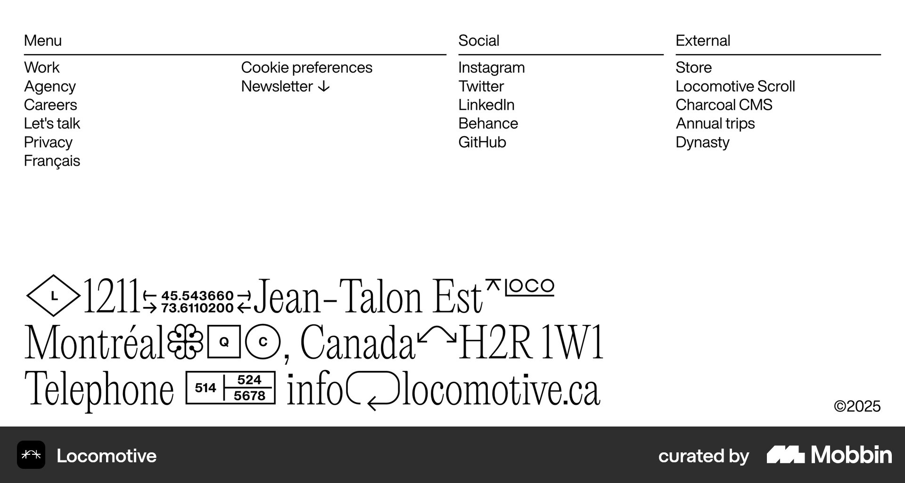

**Observed:** Three groups organize menu, social and external links, with expressive contact typography below.

**For Moriz:** Use clear groups and generous separation to keep the footer scannable.

**Tradeoff / fit:** The expressive contact block could duplicate the preceding contact section.

_Evidence: Mobbin section image visually inspected; capture date unavailable._

### 3. Structured — Mobbin

[Open section in Mobbin](https://mobbin.com/sites/sections/cf954a98-4f2e-41d3-b2a1-168e4ba0108d)

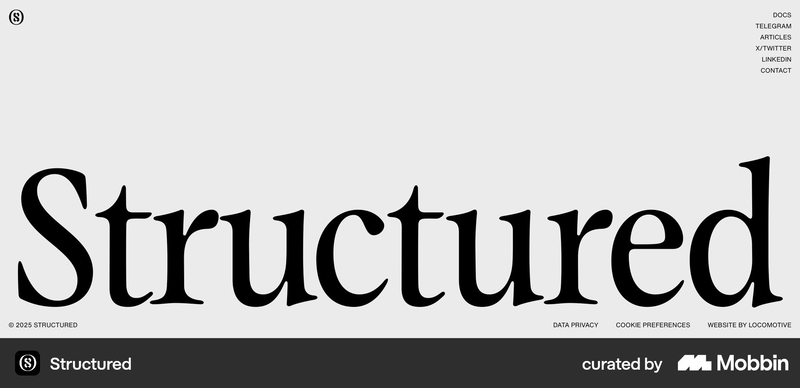

**Observed:** A large wordmark is paired with a narrow link list and a small copyright/privacy line.

**For Moriz:** Compare a strong identity with a very small secondary navigation footprint.

**Tradeoff / fit:** Use the footer composition only; the source’s scale and brand treatment are not a Moriz brand direction.

_Evidence: Mobbin section image visually inspected; capture date unavailable._

### 4. Nick Clement — Siteinspire

[Open Siteinspire reference](https://www.siteinspire.com/website/13580-nick-clement) · [Live website](https://nickclement.com/)

**Observed:** The ending includes contact/social destinations, location or status information and legal identity.

**For Moriz:** Scale the footer to an independent practitioner rather than a large agency sitemap.

**Tradeoff / fit:** Availability and location information can become stale; include it only when maintained.

_Evidence: Siteinspire listing and live website content checked. Detailed rendered layout and mobile states were not audited._

### 5. MONOLOG — Siteinspire

[Open Siteinspire reference](https://www.siteinspire.com/website/13508-monolog) · [Live website](https://bymonolog.com/)

**Observed:** The footer groups navigation, studio details and social destinations, alongside several extra utilities.

**For Moriz:** Group the essential secondary links into a short, predictable ending.

**Tradeoff / fit:** Its clocks and AI-prompt utilities add complexity; they have no established purpose for Moriz.

_Evidence: Siteinspire listing and live website content checked. Detailed rendered layout and mobile states were not audited._

## Relationship to earlier research

This adds five comparisons per current section. See [the homepage workbook](../homepage-workbook.md), [earlier Mobbin homepage research](mobbin-homepage-structure-2025-2026.md), and [owner-provided references](owner-inspiration-references.md) for the confirmed decisions and source context. It does not revise the older documents or select new homepage copy.

