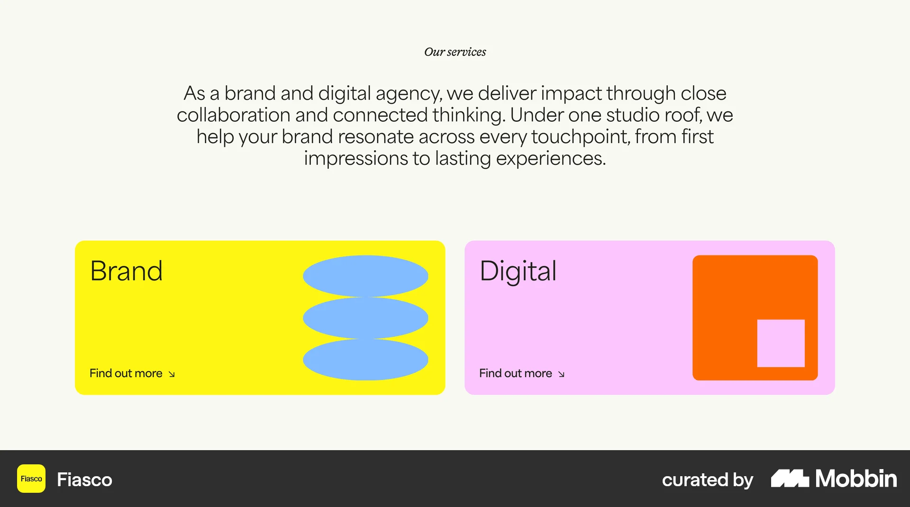
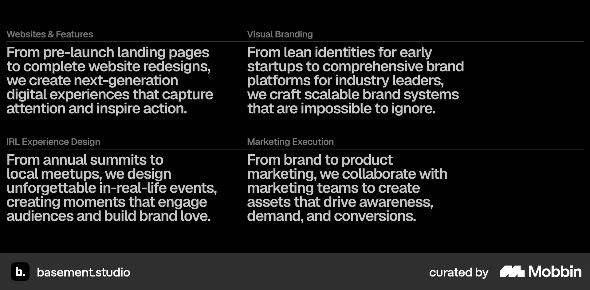
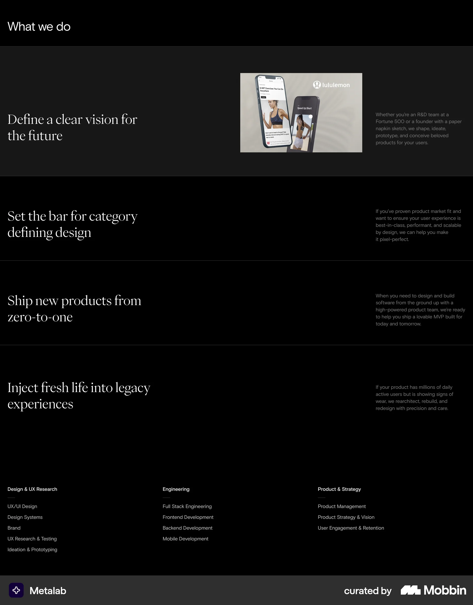
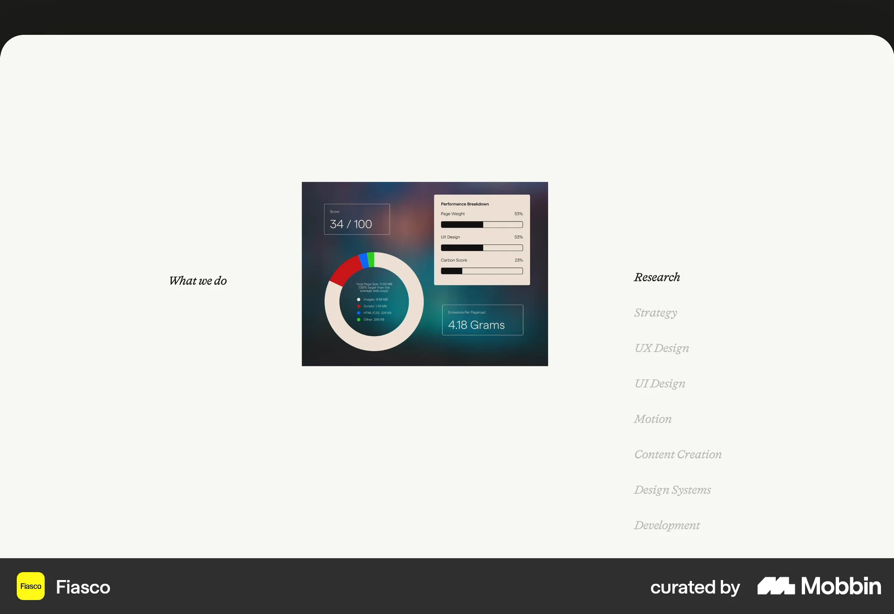
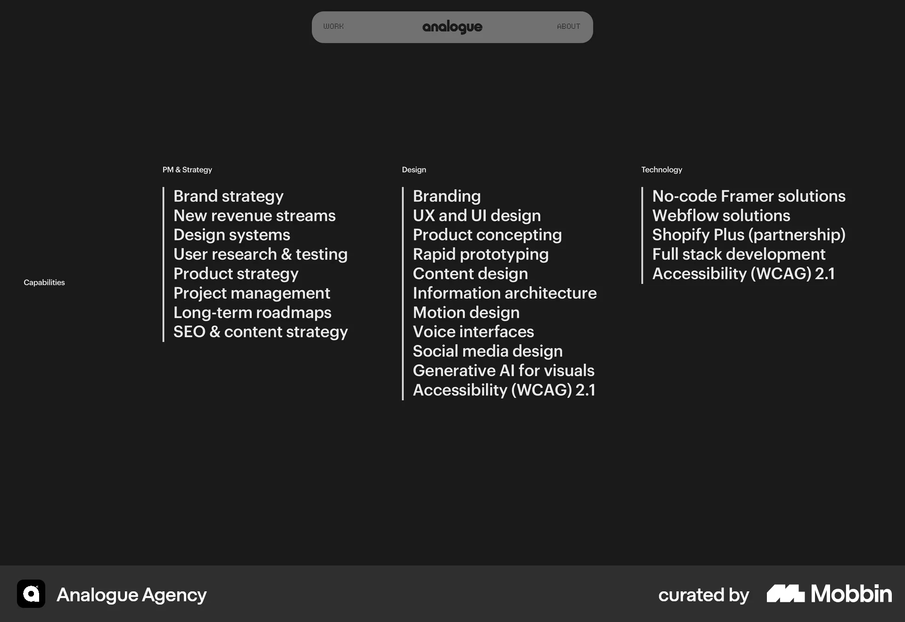
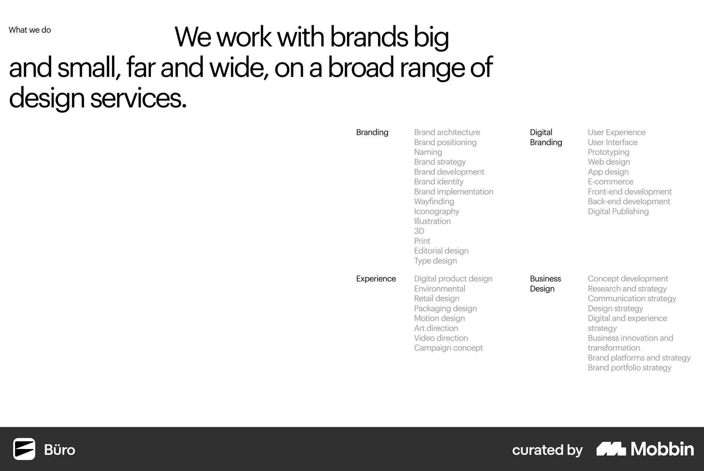
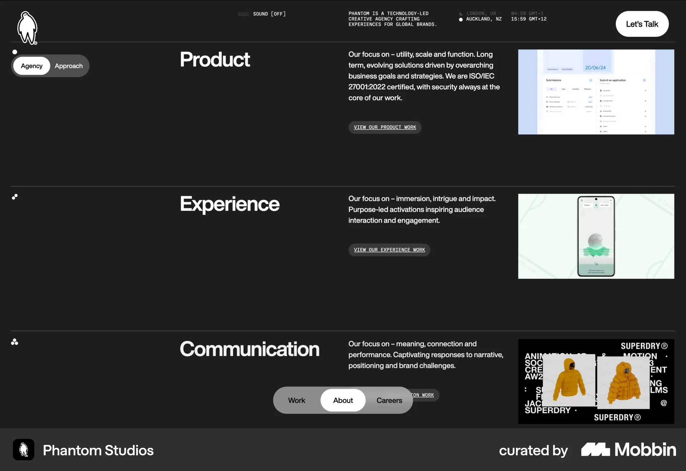
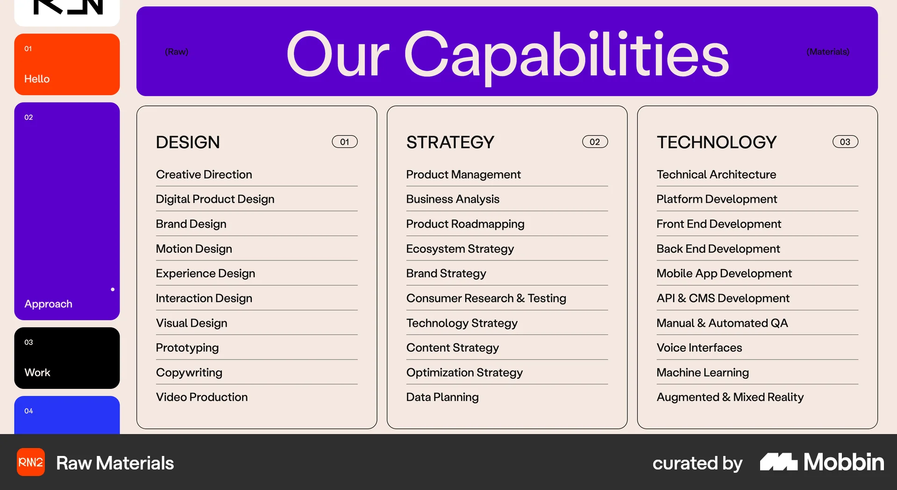

# Mobbin research for the homepage services section

Follow-up: [visual board of all three services and the wireframe-to-live development demonstration](homepage-services-visual-concepts-2026-10-10.html). The owner selected keeping the existing research pills and Party Mode, with development showing an idea becoming a working product.

Research date: 10 October 2026. Owner confirmed: keep the current categories and research layout and presentation only.

Keep the current three categories and compare how to present them between the hero and Projects. The strongest starting point is three expressive panels, combining Fiasco’s distinct visual areas with basement’s clear label-and-description hierarchy. Retain the existing research pills and Party Mode; define development’s supporting content before a coded trial.

## Current section and boundaries

The existing #advantages section contains איפיון ועיצוב מבוססי מחקר, חוויה אינטראקטיבית ואטרקטיבית and פיתוח ללא גבולות. Desktop uses three columns; mobile stacks them. Research already has a paragraph and eight falling terms. The second theme contains Party Mode with placeholder supporting copy, and development still has placeholder text and lines.

The target is the existing homepage section `#advantages`, after the hero and before Projects. Preserve the three categories, approved research copy, falling terms, Party Mode, established Danidin/Leon fonts, brand palette and Hebrew RTL reading order. This research does not select new service names, add service pages, change the homepage sequence or add contact actions. Final visual direction remains open.

Sources: [homepage implementation](../../src/app/[locale]/page.tsx), [Hebrew content](../../src/i18n/dictionaries/he.ts), [section workbook](../homepage-workbook.md#2-three-communication-themes--advantages), [design foundations](../09-design-system.md).

## Three layout directions

### Three expressive panels

**Recommended starting point.** References: Fiasco panels + basement explanations.

Three themes visible together. Each has a clear heading, short explanation and its own demonstration. Keep research pills in the first panel and Party Mode in the second.

**Mobile adaptation:** Stack research → interactive experience → development, keeping each explanation beside its demonstration in reading order.

**Tradeoff:** Needs a meaningful development visual and the two missing supporting paragraphs. Avoid giving all three demonstrations competing motion.

### Three full-width rows

**Alternative for more breathing room.** References: Metalab rows + Phantom work fragments.

One theme per horizontal row, with a title, short explanation and a demonstration or approved work fragment. Fine rules separate the rows.

**Mobile adaptation:** Stack each row’s title → explanation → demonstration, then move to the next theme. Keep the Party Mode control next to its explanation.

**Tradeoff:** Longer section before Projects. Any work fragment must remain compact enough to avoid repeating the portfolio.

### One shared demonstration area

**Exploration with more interaction.** References: Fiasco list and image.

Three visible theme names control one demonstration area. Provide a clear selected state and keep an explanation available for every category.

**Mobile adaptation:** Prefer stacked, fully visible content or a tap-controlled presentation with clear labels. Hover cannot be the only way to access a theme.

**Tradeoff:** Two themes may receive less attention when their content is hidden. It also changes how the falling tags and Party Mode are discovered.

These are proposed adaptations for Moriz. A static source screenshot does not establish the interaction or mobile behavior.

## Reference comparison

| Reference | Pattern | Best use for Moriz |
| --- | --- | --- |
| [Fiasco](https://mobbin.com/sites/sections/814e0a13-81d8-4d89-95f1-33b72ef0d9d3) | Bold service panels | Strong visual reference |
| [basement.studio](https://mobbin.com/sites/sections/46c7d616-63fa-43e1-9d92-a40549a89e16) | Service labels with prominent explanations | Strong content reference |
| [Metalab](https://mobbin.com/sites/sections/35ebf43a-f6bc-43a0-bdca-19b1f1f8b4e8) | Outcome rows with a highlighted visual | Alternative composition |
| [Fiasco](https://mobbin.com/sites/sections/6fbcef4f-e8df-4aa5-a71a-abe9504f619e) | Service list beside a shared image | Interaction reference |
| [Analogue Agency](https://mobbin.com/sites/sections/7063e124-d7b5-4fe4-9797-b318a5be20d1) | Three clearly grouped capability columns | Hierarchy reference |
| [Büro](https://mobbin.com/sites/sections/bc636344-6e5b-4b98-9baa-809b622456fb) | One large statement above grouped services | Hierarchy alternative |
| [Phantom Studios](https://mobbin.com/sites/sections/3cf723db-92c1-4601-b820-379757d44107) | Each service paired with relevant work | Proof reference |
| [Raw Materials](https://mobbin.com/sites/sections/67c9761c-a201-45f1-910a-ca8faa50cb33) | Three structured capability tables | Density comparison |

### Fiasco bold service panels

[Mobbin reference](https://mobbin.com/sites/sections/814e0a13-81d8-4d89-95f1-33b72ef0d9d3) · [Current website](https://fiasco.design/) · [Full screenshot](assets/homepage-services-2026-10-10/fiasco-service-panels.webp)

**Visible:** Two wide panels sit beneath a short introduction. Each combines a large service name, a simple graphic and a small link; the panels use contrasting flat colors.

**For Moriz:** Give each of Moriz’s three themes a distinct visual area. Keep the research pills and Party Mode as the first two demonstrations, then define a development demonstration from real material.

**Tradeoff:** The reference has two categories and very little explanatory detail. Moriz needs three themes and visible supporting text; copying the linked cards would imply service pages that are outside this task.

**Page context:** Original capture page unconfirmed. The current Fiasco homepage differs, so this is a visual pattern reference rather than a verified current homepage example.

### basement.studio service labels with prominent explanations

[Mobbin reference](https://mobbin.com/sites/sections/46c7d616-63fa-43e1-9d92-a40549a89e16) · [Current website](https://basement.studio/) · [Full screenshot](assets/homepage-services-2026-10-10/basement-capability-blocks.webp)

**Visible:** Four text blocks form a two-column arrangement on black. Small muted service labels and fine horizontal rules sit above much larger explanatory paragraphs.

**For Moriz:** Borrow the clear relationship between a theme label and its explanation. Use three concise blocks within the existing section and give development the same clarity as research.

**Tradeoff:** The captured paragraphs are visually dense. Shorten the supporting text and retain Moriz’s existing typography, palette and interactions; four source categories do not change Moriz’s three.

**Page context:** Homepage content match: the current basement homepage lists the same four capability groups and descriptions. The screenshot’s exact capture date is unavailable.

### Metalab outcome rows with a highlighted visual

[Mobbin reference](https://mobbin.com/sites/sections/35ebf43a-f6bc-43a0-bdca-19b1f1f8b4e8) · [Current website](https://www.metalab.com/) · [Full screenshot](assets/homepage-services-2026-10-10/metalab-service-rows.webp)

**Visible:** Four large horizontal rows pair a service statement with short explanatory text. The first row has a lighter background and a product image; fine rules separate the rows. Three capability lists follow below.

**For Moriz:** Compare three full-width rows, one per existing theme. Keep the title, explanation and demonstration together; place falling tags and the Party Mode control inside their corresponding rows.

**Tradeoff:** Rows lengthen the section before Projects. The screenshot does not establish whether the highlight follows hover, selection or scrolling; a hover-only design would need a touch and keyboard alternative.

**Page context:** Original capture page unconfirmed. Current homepage and About text did not expose matching row content; retained for its composition only.

### Fiasco service list beside a shared image

[Mobbin reference](https://mobbin.com/sites/sections/6fbcef4f-e8df-4aa5-a71a-abe9504f619e) · [Current website](https://fiasco.design/) · [Full screenshot](assets/homepage-services-2026-10-10/fiasco-service-preview.webp)

**Visible:** A compact list of eight capabilities sits to the right of one image. Research is dark and emphasized while the other labels are pale; the section has generous blank space.

**For Moriz:** Explore a three-item selector that changes a demonstration beside it. Moriz’s research and Party Mode could provide two of the demonstrations, while each theme’s explanation stays discoverable.

**Tradeoff:** The static capture cannot prove that the image changes or how selection works. This direction hides more content and requires a mobile composition, keyboard operation and a reduced-motion state; it could weaken the current three-theme overview.

**Page context:** Original capture page unconfirmed. Treat the selector behavior as a proposed Moriz adaptation, not an observed Fiasco interaction.

### Analogue Agency three clearly grouped capability columns

[Mobbin reference](https://mobbin.com/sites/sections/7063e124-d7b5-4fe4-9797-b318a5be20d1) · [Current website](https://analogueagency.com/) · [Full screenshot](assets/homepage-services-2026-10-10/analogue-capability-columns.webp)

**Visible:** Three columns on a dark background have small category labels, larger capability lists and thin vertical rules. The lists differ in length.

**For Moriz:** Keep the three themes recognizable at once and align their headings and supporting text. Use a few concrete capability terms only where they clarify the theme; the research card already contains eight terms.

**Tradeoff:** A long catalogue would repeat the research tags and push project evidence down the page. Borrow grouping and alignment, rather than the full density or the source service labels.

**Page context:** Original capture page unconfirmed. The current homepage’s extracted text does not contain this capability list; no current homepage placement is claimed.

### Büro one large statement above grouped services

[Mobbin reference](https://mobbin.com/sites/sections/bc636344-6e5b-4b98-9baa-809b622456fb) · [Current website](https://www.burocratik.com/) · [Full screenshot](assets/homepage-services-2026-10-10/buro-service-introduction.webp)

**Visible:** A large multiline introductory statement spans the upper area. Four service groups sit beneath it in a compact two-by-two arrangement, with category labels darker than the capability lists.

**For Moriz:** If the section needs an introduction, make it one useful sentence connecting research, experience design and development, then let the three existing themes carry the detail.

**Tradeoff:** Another oversized statement could compete with the hero and lengthen the opening. The screenshot’s pale small text is a styling reference only; Moriz’s supporting text still needs readable contrast.

**Page context:** Homepage content match: the current Büro homepage contains this introductory statement and all four service groups. No matching capture date is exposed.

### Phantom Studios each service paired with relevant work

[Mobbin reference](https://mobbin.com/sites/sections/3cf723db-92c1-4601-b820-379757d44107) · [Full screenshot](assets/homepage-services-2026-10-10/phantom-services-with-work.webp)

**Visible:** Three horizontal rows combine a large service name, a short paragraph, a work link and a rectangular project image. The captured floating navigation highlights About.

**For Moriz:** Pair a theme with a relevant fragment of Moriz’s own work when an approved asset and contribution are available. This is particularly useful for making development concrete.

**Tradeoff:** A full project gallery would duplicate the Projects section immediately below. Keep any proof compact and avoid copying claims, certifications, work links or client imagery.

**Page context:** The capture indicates an About context, not a homepage. Included only as a transferable service presentation pattern.

### Raw Materials three structured capability tables

[Mobbin reference](https://mobbin.com/sites/sections/67c9761c-a201-45f1-910a-ca8faa50cb33) · [Full screenshot](assets/homepage-services-2026-10-10/raw-materials-capability-table.webp)

**Visible:** Three bordered columns under a large capabilities heading separate Design, Strategy and Technology. Each column contains a long list divided by horizontal rules; the sidebar highlights Approach.

**For Moriz:** Use the category separation to check whether Moriz’s three themes are distinct and understandable. A compact list of deliverables could help later if the owner supplies them.

**Tradeoff:** This much detail would make the short section feel like a service catalogue. Its sidebar and long lists do not fit the current homepage scope or the interactive demonstrations.

**Page context:** The capture indicates an Approach context. Included as a density comparison, not as a homepage model.

## Presentation principles

- Keep all three theme headings visible without requiring interaction. Each needs a short explanation of what the client receives or understands.
- Treat falling terms and Party Mode as demonstrations inside the section. They should support reading rather than compete with the title or with each other.
- Use the incumbent brand colors and fonts. Reference colors, English typography and small pale text do not select new tokens for Moriz.
- For mobile, retain the Hebrew reading order and readable content before introducing optional motion. A shared preview needs tap and keyboard controls; essential text must not depend on hover.
- Distinguish categories from steps. The themes explain the offer; the separate Getting Started section explains the working process.
- Give development a specific, owner-supplied explanation and meaningful demonstration. The broad development label does not establish particular technologies, integrations, deliverables or guarantees.

## Content needed for a later trial

The remaining inputs are the interactive-experience supporting paragraph, the development paragraph and demonstration, and a choice among the three compositions. Category names remain as supplied. No new copy or service claims are approved by this research.

## Search coverage and evidence limits

Seven focused Mobbin searches returned 37 results and 22 unique sections. Eight references were selected after inspecting the returned images. Downloaded originals are 1920 pixels wide; the files above remain usable after Mobbin’s temporary image URLs expire. The [search log](homepage-services-mobbin-2026-10-10.json) retains all queries, IDs and canonical source links.

The target is Moriz’s homepage services section. Reference source pages vary: basement and Büro have matching service content on their current homepages; Phantom indicates About and Raw Materials indicates Approach. Other original capture pages are unconfirmed. Those distinctions are recorded beside each reference. Current source-page content can differ from a Mobbin capture.

Aino’s footer-like catalogue, Miro’s adjacent consulting offer, Mother’s internal Information page, Locomotive’s Agency page, unrelated product/pricing/onboarding results, the standalone basement Services opener and a blank Instrument capture were not promoted to the shortlist. Their absence from the shortlist does not imply they are absent from Mobbin.

10 October 2026 is the research and download date, not a verified capture or website redesign date. Screenshot emphasis does not prove hover, accordion, selection or scroll behavior. All mobile suggestions above are proposed adaptations for Moriz; these desktop captures do not validate responsive behavior, accessibility or conversion outcomes.

[Open the visual research board](homepage-services-mobbin-2026-10-10.html).
