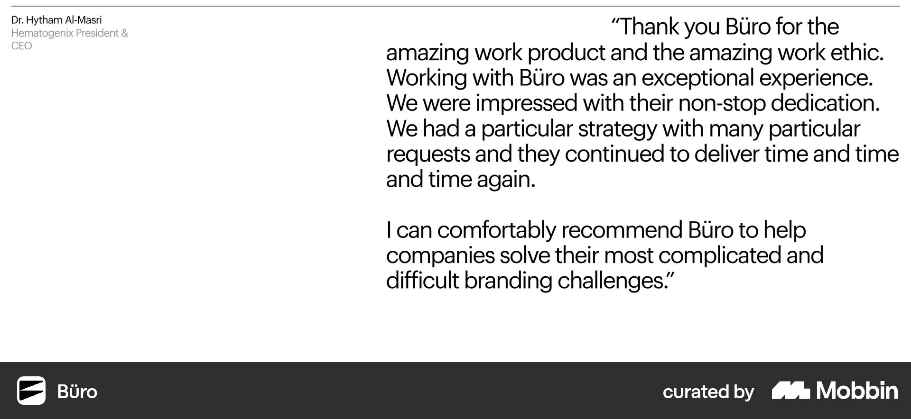
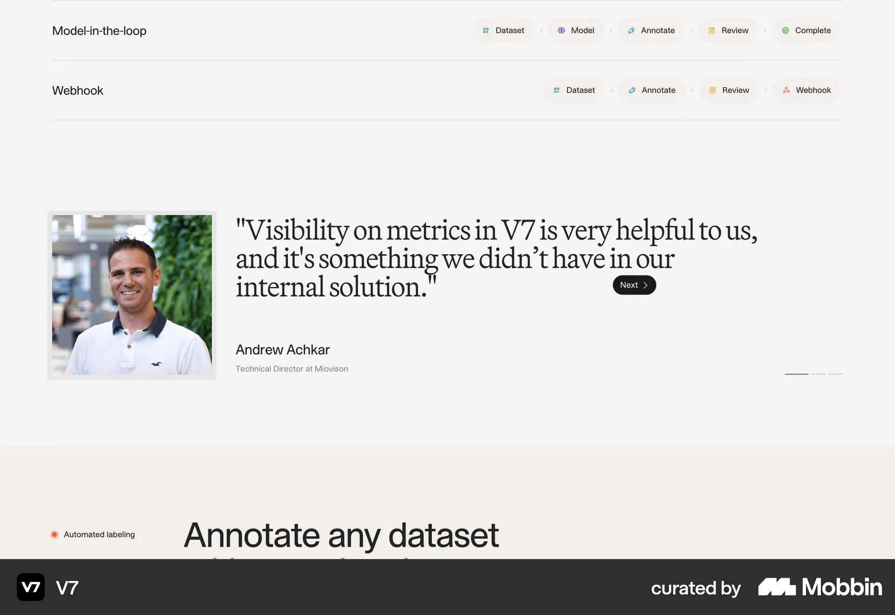
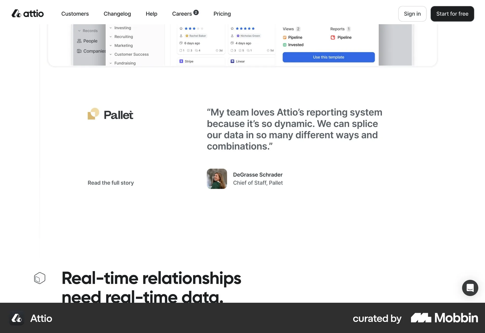
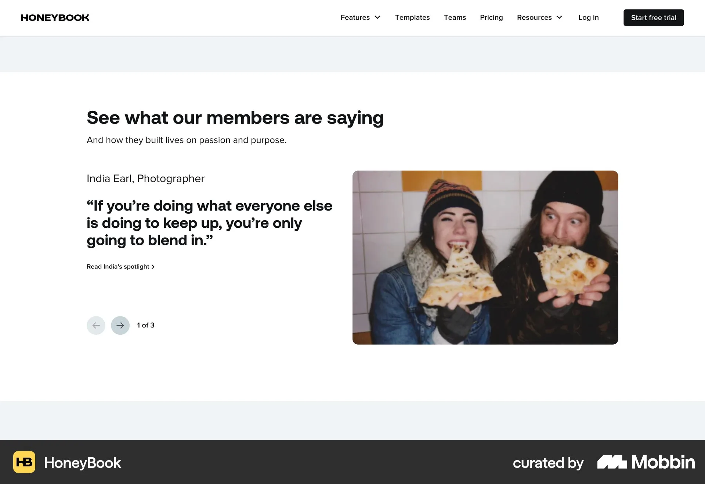
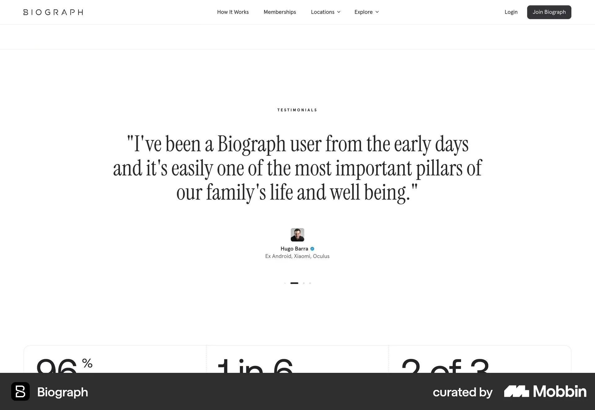
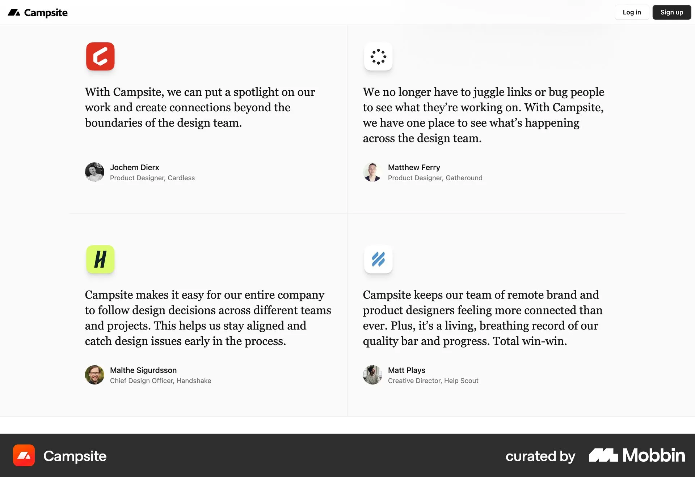
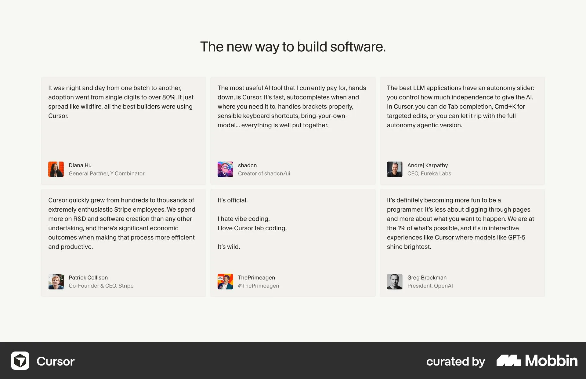

# Mobbin research for the homepage testimonials section

Research date: 10 October 2026. Owner request: research Mobbin, then implement the design judged best for the testimonials (המלצות) section.

Show one testimonial at a time, with a visible client index beside it. The recommended direction combines Büro’s attribution column with V7’s and HoneyBook’s lightweight one-at-a-time navigation: a ruled list of clients acts as tabs, and a large spotlight quote clamps long text behind **להמשך קריאה**. It has been implemented as a local trial for visual acceptance. The Büro-style stack is the main alternative, and an equal card grid is rejected for now because the quotes differ widely in length.

## Current section and boundaries

The homepage `#testimonials` section was a wireframe placeholder (`<Section id="testimonials" showHeading={false} className="bg-surface">`). It is now rendered by the trial component. Four testimonials are supplied verbatim and a fifth is expected. Their length ranges from about 30 to about 150 words:

| Order | Testimonial | Length and headline | Image |
| --- | --- | --- | --- |
| 1 | גבריאלה לסטר (Gabriella Laster), Product Marketing Director באלמנטור, about work on the Angie AI plugin | One paragraph, no headline | Round Elementor mark |
| 2 | טל לב, מטפלת סינית מוסמכת | Five paragraphs. Headline is a verbatim excerpt from her final paragraph | Portrait |
| 3 | אלבי בן שימול, ביטוחים ופיננסים | Short, with the supplied headline “העבודה עם מור הייתה ברמה אחרת!” | Logo |
| 4 | שי גורן, בעלת עסק לסדנאות | One paragraph, no headline | Portrait |

Owner update, 10 October 2026: the Elementor role is “Product Marketing Director באלמנטור” and the previously unnamed website client is שי גורן, בעלת עסק לסדנאות. The display order is now Elementor → Tal Lev → Elbi Ben Shimol → Shay Goren. The Elementor recommender is גבריאלה לסטר (Gabriella Laster).

Boundaries: there is no visible section heading (owner decision, 2026-10-08). The `Section` wrapper renders no `h2` when `showHeading={false}` and passes the Hebrew title “המלצות מלקוחות” as the section’s `aria-label`. Quote wording stays verbatim, and no names are invented; missing attribution stays marked “— להשלמה”. Keep the established Danidin/Leon fonts, the brand palette and the Hebrew RTL reading order. This record does not decide whether testimonials also appear on Projects.

Sources: [homepage implementation](../../src/app/[locale]/page.tsx), [component](../../src/components/testimonials.tsx) and [styles](../../src/components/testimonials.module.css), [Hebrew content](../../src/i18n/dictionaries/he.ts) (`testimonials.items`), [type](../../src/content/testimonials.ts), [images](../../public/images/testimonials/), [section workbook](../homepage-workbook.md#5-client-testimonials), [content inventory](../03-content.md#testimonials).

## Three layout directions

### Spotlight + client index

**Recommended, implemented as a local trial.** References: Büro attribution column + V7/HoneyBook navigation + Biograph pull-quote scale + Attio identity column.

On desktop (64rem and wider), a ruled client index sits on the start side, which is the right in RTL. Each row shows a number, a 48px avatar or logo, a name and a role. The index is a WAI-ARIA tablist: arrow keys move in the RTL-aware direction, Up/Down also work, and Home/End jump to the first or last client. A `01 / 04` counter and previous/next buttons sit below the index. The end-side spotlight shows a quote mark in the brand-red theme accent, then the Danidin pull-quote headline when one is supplied, then the Leon body text. The body is clamped to six lines (seven on mobile) with a fade, and a **להמשך קריאה** / **סגירה** toggle appears only when the text overflows. A ruled attribution closes the spotlight.

All panels are stacked in one grid cell, so the section height stays the same when switching. Inactive panels are hidden and inert. Switching uses a short crossfade, and nothing plays automatically. Under reduced motion the global duration tokens drop to 0s, so the switch is instant. A polite live region announces the selected testimonial. Without JavaScript, every quote is shown in full, one after another.

**Mobile adaptation:** Horizontal avatar chips → quote → read more → attribution → counter and arrows.

**Tradeoff:** Only one quote is visible at a time. The stage is as tall as the tallest clamped panel, so a short quote such as Elbi’s leaves empty space beneath it. Two testimonials (Elementor and Shay Goren) still have no headline, so the spotlight is less dramatic for them.

### Büro stack

**Alternative: everything visible.** References: Büro testimonial + Campsite rules.

Every testimonial is listed vertically. Each row has an attribution column (name, organization, role) and a large quote, separated by fine rules like the Projects section.

**Mobile adaptation:** Attribution → quote for each row, with the full text visible and no controls.

**Tradeoff:** Requires no interaction and every word is visible. With four or five testimonials, including the 150-word one, the section becomes very long before Getting Started and FAQ.

### Equal card grid

**Rejected for now.** References: Campsite 2×2 grid, Cursor 3×2 cards.

Cards of equal size are arranged in a ruled grid, each with an icon or avatar, a quote and a footer.

**Mobile adaptation:** One card per row, which is effectively the Büro stack with card chrome.

**Tradeoff:** With quotes ranging from about 30 to about 150 words, cards either leave large empty areas or force the longest quote to be truncated. This grid suits quotes of similar length.

These are proposed adaptations for Moriz. The source screenshots are LTR, so their layouts are mirrored for RTL: the attribution column and the index sit on the right. A static screenshot does not establish a source’s interaction or mobile behavior.

## Reference comparison

| Reference | Pattern | Best use for Moriz |
| --- | --- | --- |
| [Büro](https://mobbin.com/sites/sections/3e179ff8-d623-4415-9848-be2e5ecdb66c) | Large quote with a separate attribution column | Strong layout reference |
| [V7](https://mobbin.com/sites/sections/c88fcff1-cbaa-4aa3-afe4-aa757bf75fd5) | Photo, serif quote, small Next pill and progress dashes | Navigation reference |
| [Attio](https://mobbin.com/sites/sections/2ce67fb5-10f1-49fa-8ba6-e94d7bf516aa) | Company logo column with “Read the full story” beside the quote | Identity column reference |
| [HoneyBook](https://mobbin.com/sites/sections/07542141-06cc-4b9d-ab1e-d7e248ca4c4b) | Name eyebrow, bold quote, round arrows with a “1 of 3” counter | Control reference |
| [Biograph](https://mobbin.com/sites/sections/a1250520-2c12-46b5-8d5c-faef84b04395) | Centered large serif pull quote with small attribution | Typography reference |
| [The Performance Lab](https://mobbin.com/sites/sections/b170960d-5e07-4389-a3b7-df39dbcc298b) | Dark section, large client name beside the quote | Exploration |
| [Campsite](https://mobbin.com/sites/sections/0f7e44da-1c97-49af-a22e-72226338d032) | 2×2 ruled grid of serif quotes | Alternative composition |
| [Cursor](https://mobbin.com/sites/sections/146dd81b-925f-479d-b55c-2677c86f2fdd) | 3×2 grid of equal light cards | Counter-example |

### Büro large quote with a separate attribution column

[Mobbin reference](https://mobbin.com/sites/sections/3e179ff8-d623-4415-9848-be2e5ecdb66c) · [Full screenshot](assets/homepage-testimonials-2026-10-10/buro-testimonial.webp) · [Earlier record](mobbin-homepage-structure-2025-2026.md#4-büro--testimonial-with-explicit-attribution)

**Visible:** A fine rule runs across the top. A small name, organization and role sit in a narrow column on the left; a large two-paragraph quote fills the right half. Only one quote is visible, with no controls in the crop.

**For Moriz:** Use this for the attribution column and the idea of one substantial spotlight quote. In RTL the identity column moves to the right and becomes the client index.

**Tradeoff:** Without other quotes or controls, a section of four or five testimonials would turn into the long Büro stack. The capture shows a long quote at full size; Tal’s five paragraphs at that scale would dominate the page.

**Page context:** Carried over from the [earlier structure research](mobbin-homepage-structure-2025-2026.md#4-büro--testimonial-with-explicit-attribution); the image was converted from that record’s local JPEG. That record found testimonials on Büro’s current homepage and contact page, but with quotes that differ from this capture. Original capture page unconfirmed.

### V7 photo, serif quote, small Next pill and progress dashes

[Mobbin reference](https://mobbin.com/sites/sections/c88fcff1-cbaa-4aa3-afe4-aa757bf75fd5) · [Full screenshot](assets/homepage-testimonials-2026-10-10/v7-photo-quote-next.webp)

**Visible:** A framed square portrait sits on the left. A large three-line serif quote fills the right with a small dark “Next” pill beside its last line. The name and role follow below, and three short dashes at the far right mark progress, the first darker. Product workflow rows appear above and a feature heading below.

**For Moriz:** One quote at a time with an understated next control and position indicator. Moriz’s trial uses a numbered counter and two arrows instead of dashes, so position is readable as text.

**Tradeoff:** The large portrait suits faces, but two of Moriz’s images are logos or brand marks. A “Next”-only control does not let a visitor jump to a specific client; the index solves that.

**Page context:** Product-page context with product UI around the section. Original capture page unconfirmed; live site not checked.

### Attio company logo column with “Read the full story” beside the quote

[Mobbin reference](https://mobbin.com/sites/sections/2ce67fb5-10f1-49fa-8ba6-e94d7bf516aa) · [Full screenshot](assets/homepage-testimonials-2026-10-10/attio-logo-column-quote.webp)

**Visible:** The left column holds a client company logo at the top and a “Read the full story” link at the bottom. The right column holds a four-line quote above a square avatar with name and role. Product UI appears above and a large feature heading below.

**For Moriz:** An identity column beside the quote supports mixing logos and portraits, which matters for Elbi’s logo and the Elementor mark. Its separate read-more action informs Moriz’s in-place **להמשך קריאה** toggle.

**Tradeoff:** The capture shows a link to a fuller story. The trial expands the text in place instead of linking away.

**Page context:** Product-page context. Original capture page unconfirmed; live site not checked.

### HoneyBook name eyebrow, bold quote, round arrows with a “1 of 3” counter

[Mobbin reference](https://mobbin.com/sites/sections/07542141-06cc-4b9d-ab1e-d7e248ca4c4b) · [Full screenshot](assets/homepage-testimonials-2026-10-10/honeybook-counter-arrows.webp)

**Visible:** A section heading (“See what our members are saying”) and subheading sit above two columns. The left column has a name and role line, a bold three-line quote, a “Read India’s spotlight” link, and round previous and next buttons beside a “1 of 3” counter. A large rounded photo fills the right column. The previous button looks paler than the next button.

**For Moriz:** The counter beside two round arrows is the direct model for the trial’s controls, and the link under the quote supports a read-more affordance.

**Tradeoff:** The visible heading is not borrowed (owner decision: no heading). The static capture does not prove whether the pale previous button is disabled or whether the sequence wraps; the trial wraps around. A large lifestyle photo would need images Moriz does not have.

**Page context:** Marketing-page context with site navigation visible. Original capture page unconfirmed; live site not checked.

### Biograph centered large serif pull quote with small attribution

[Mobbin reference](https://mobbin.com/sites/sections/a1250520-2c12-46b5-8d5c-faef84b04395) · [Full screenshot](assets/homepage-testimonials-2026-10-10/biograph-centered-pull-quote.webp)

**Visible:** A small spaced “TESTIMONIALS” eyebrow sits above a large centered three-line serif quote. A small square avatar, a name with a verified badge and a credential line follow, then four pagination indicators with the second elongated and dark.

**For Moriz:** The pull-quote scale shows how a short headline can carry the section. That is the role of the Danidin headline above the Leon body text, when a headline is supplied.

**Tradeoff:** This works because the quote is one sentence; Moriz’s long testimonials need body text below the headline. The eyebrow heading is not borrowed. Centered text is harder to read across several Hebrew paragraphs.

**Page context:** Marketing-page context with site navigation and a statistics row below. Original capture page unconfirmed; live site not checked.

### The Performance Lab dark section, large client name beside the quote

[Mobbin reference](https://mobbin.com/sites/sections/b170960d-5e07-4389-a3b7-df39dbcc298b) · [Full screenshot](assets/homepage-testimonials-2026-10-10/performance-lab-huge-name.webp)

**Visible:** On a dark background, a small monospaced “WHAT OUR CLIENTS SAY” label sits top left above a large client name with a small mark. A five-line quote and a monospaced credential line sit on the right. No navigation control is visible. The very large “FEATURED FROM” text and two image cards below belong to the next section.

**For Moriz:** An exploration for a bolder treatment, with the client name as typography on one side and the quote on the other. It could suit Moriz’s Danidin display font in a later variant.

**Tradeoff:** Logos and brand marks fit a name-led layout less well. The label is not borrowed. A dark section would need its own contrast check against the surrounding `bg-surface` sections.

**Page context:** Section context only. Original capture page unconfirmed; live site not checked.

### Campsite 2×2 ruled grid of serif quotes

[Mobbin reference](https://mobbin.com/sites/sections/0f7e44da-1c97-49af-a22e-72226338d032) · [Full screenshot](assets/homepage-testimonials-2026-10-10/campsite-ruled-quote-grid.webp)

**Visible:** Four quotes form a two-by-two grid separated by thin rules. Each has a rounded company icon, a three- to four-line serif quote and a round avatar with name and role. The quotes are of similar length, so the cells look balanced. No section heading is visible in the crop.

**For Moriz:** The cleanest version of the grid direction, with rules instead of card backgrounds, consistent with Moriz’s ruled Projects section.

**Tradeoff:** The grid only looks balanced because the quotes are three to four lines each. Tal’s five paragraphs beside Elbi’s two sentences would break the rhythm or require truncation.

**Page context:** Section context only. Original capture page unconfirmed; live site not checked.

### Cursor 3×2 grid of equal light cards

[Mobbin reference](https://mobbin.com/sites/sections/146dd81b-925f-479d-b55c-2677c86f2fdd) · [Full screenshot](assets/homepage-testimonials-2026-10-10/cursor-equal-card-grid.webp)

**Visible:** A centered heading sits above six equal light cards in two rows. Each card holds a quote of four to six lines with a small square avatar, name and role pinned to the bottom. Shorter quotes leave blank space above the footer.

**For Moriz:** A counter-example. Even with a narrow spread of quote lengths, equal cards leave visible gaps; Moriz’s spread from about 30 to about 150 words is much wider.

**Tradeoff:** Equal heights keep the grid tidy but waste space or force truncation. The visible heading is not borrowed.

**Page context:** Section context only. Original capture page unconfirmed; live site not checked.

## Presentation principles

- Keep every quote verbatim. A headline is either supplied by the owner or a verbatim excerpt; nothing is paraphrased.
- Attribution must remain visible next to the quote. Placeholder names stay visibly marked until the owner supplies them.
- No visible section heading (owner decision, 2026-10-08). Headings, eyebrows and labels seen in references are not borrowed.
- Mirror LTR references for RTL: the identity column and index sit on the start (right) side and the spotlight on the end (left) side. Numerals and the counter stay LTR.
- Long text must remain readable in full: clamp only with an explicit, keyboard-accessible toggle; never truncate permanently.
- No autoplay. Motion is a short crossfade that becomes instant under reduced motion; without JavaScript every quote is shown.
- Logos, round brand marks and portraits need distinct treatments in the same index (the trial uses a fixed light tile for logos).

## Content needed

- Optional headlines for Elementor and Shay Goren, as verbatim excerpts. Candidates: “מור הביאה שילוב של מקצועיות, יצירתיות ויוזמה” (Elementor) and “בזכותה האתר יצא מדויק, מושך ועם טאץ' אישי” (Shay).
- Publication permission for names, photos and logos.
- The fifth testimonial, its image and its position in the order (now Elementor → Tal Lev → Elbi Ben Shimol → Shay Goren).

## Search coverage and evidence limits

Three Mobbin section searches (`search_sections`, page 1 of each, all with further pages available) returned 34 results:

- Testimonials section with large featured quote, client photo and name, navigation between a few testimonials: 12 results
- Testimonial cards grid with long quotes, avatar, name and role, for an agency or studio website: 12 results
- Design studio portfolio site client testimonial with big editorial pull quote headline and longer full review text below, client name and business: 10 results

The 34 results name 31 distinct sites. Clay appears three times and Leonardo AI twice. Section IDs were not retained for the non-selected results, so it is unknown whether those repeats are the same sections. The Büro reference comes from the [earlier structure research](mobbin-homepage-structure-2025-2026.md), not from these searches. The [search log](homepage-testimonials-mobbin-2026-10-10.json) keeps the queries, the returned site names and the canonical links for the selected references.

Seven images were downloaded from Mobbin on 10 October 2026, and none failed. The Büro image was converted from the existing local JPEG instead. All eight were converted to WebP at 1920 pixels wide and only these eight were inspected for this record. The rejected patterns below were assessed from the returned previews during the search session; those previews were not downloaded or retained:

- Carousels of equal cards (ElevenLabs, Clay, Chronicle, Resend) truncate or equalize long quotes.
- Walls of love (Notion, Tailscale, Framer, Clay) need many short quotes, but Moriz has four or five long ones.
- Floating or rotated cards (FOLLOW.ART, Analogue Agency) are playful but hurt the readability of long Hebrew text.
- A centered single card with a big avatar (Fresha, Copy.ai, 15Five, MasterClass) has a generic SaaS look.
- The remaining results (Jeton, Leonardo AI, Current, OpenPhone, Programa, GitHub, Ditto, Shade, Metalab, Steep, Better Stack) were not promoted. Their individual reasons were not recorded.

Live source sites were not checked for this record. Apart from the Büro notes carried over from the earlier record, no claim is made about current website content. 10 October 2026 is the research and download date, not a verified capture or redesign date. Static screenshots do not establish carousel, wrap-around, disabled-state or autoplay behavior. Mobile descriptions are proposed adaptations for Moriz, and these desktop captures do not validate responsive behavior, accessibility or conversion outcomes. The trial’s accessibility details come from the implementation, not from the references.

[Open the visual research board](homepage-testimonials-mobbin-2026-10-10.html).
