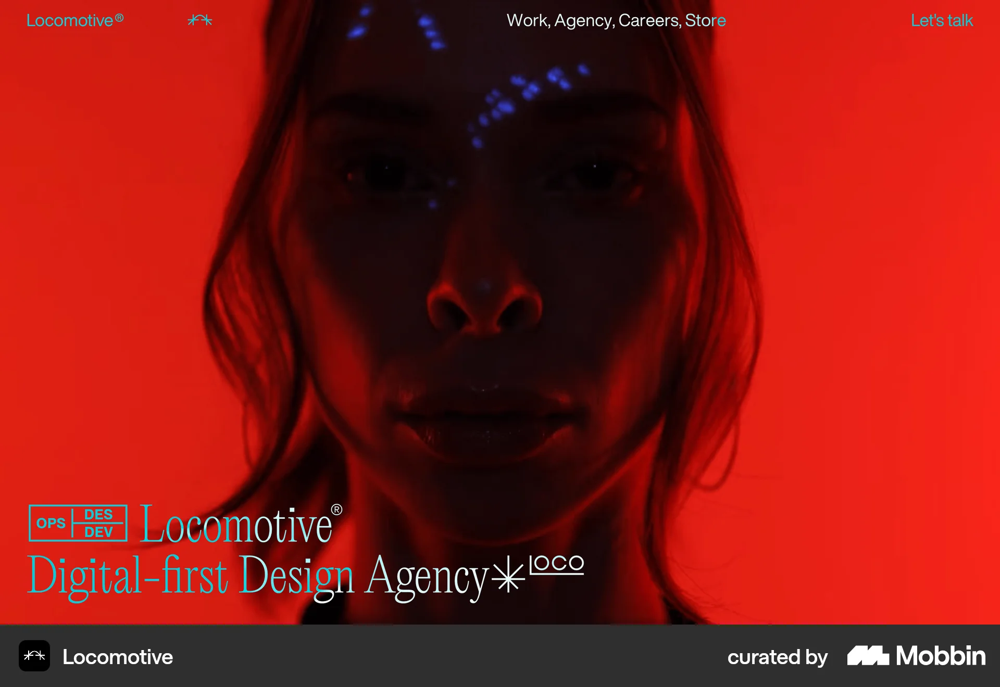
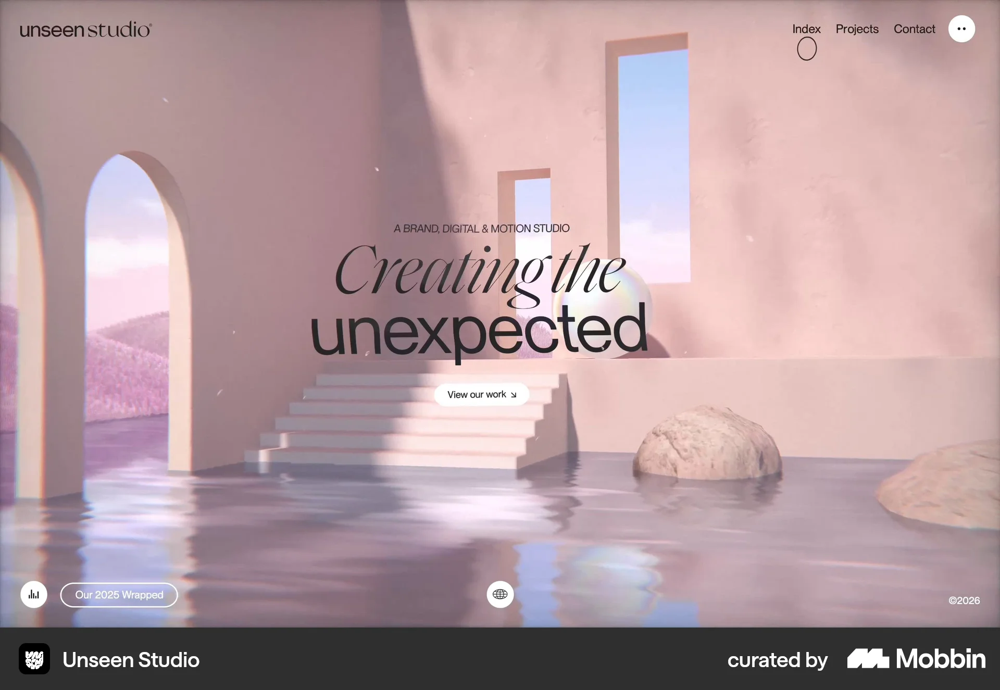
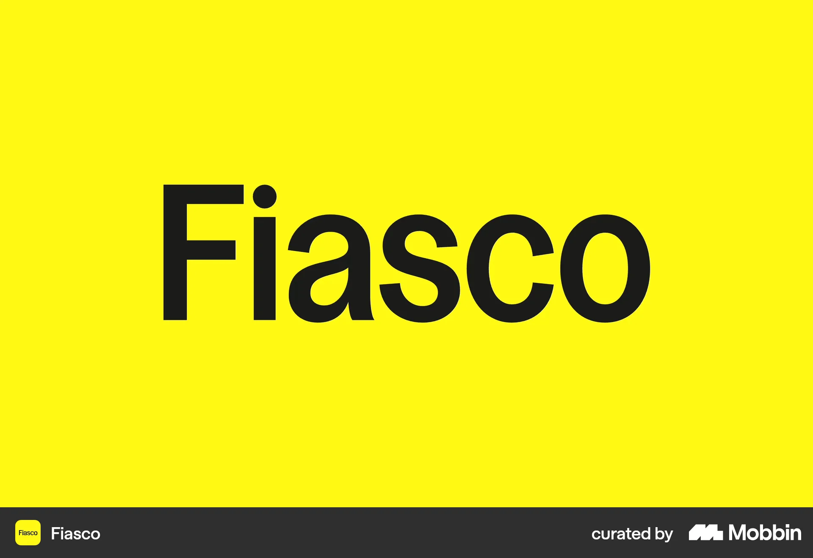

# Mobbin hero research for a web app development agency

Research date: 2026-10-06.

Moriz Studio needs an opening that communicates both UX/UI design and web app development. The strongest complete Mobbin hero references in this shortlist are **Locomotive** for a compact agency introduction over dominant imagery and **Unseen Studio** for a centered message with a direct route to work. **Fiasco** provides an additional study of large typography and committed color; its capture contains only the agency name.

The comparison covers hero composition, messaging, imagery, and visible actions. Adjacent digital and creative agencies are included, as requested. These are inspiration references, rather than evidence of conversion performance or selected Moriz design decisions.

## Hero comparison

| Reference | Visible composition | Useful pattern for Moriz | Main tradeoff |
| --- | --- | --- | --- |
| [Locomotive](https://mobbin.com/sites/sections/6a2f519f-af72-4525-a6ca-2ef3457bdf63) | Full-width red portrait; agency name and category at the lower left; navigation above. | A large visual can share the opening with a concise, explicit studio description. | The image dominates; web app capability is not explained by the category alone. |
| [Unseen Studio](https://mobbin.com/sites/sections/1bdc4e01-2f7e-4e09-9aa1-27f02c13bcbe) | Architectural scene; centered two-line headline; studio descriptor; work button. | A simple information hierarchy can remain legible within an expressive visual setting. | The headline expresses personality more clearly than the service offered. |
| [Fiasco](https://mobbin.com/sites/sections/b1072dab-8faa-4336-8cdf-980edf4d3213) | Black agency name on a yellow field. | Typography and a single color can carry a strong first impression. | This frame supplies no service explanation or visible action. |

## Locomotive

### Source and screenshot

[Mobbin hero](https://mobbin.com/sites/sections/6a2f519f-af72-4525-a6ca-2ef3457bdf63) · [Original website](https://locomotive.ca/en).

### Pattern and relevance

The portrait fills the background. A compact agency identification sits at the lower left, while navigation and a contact link occupy the top edge. Small design/development labels accompany the agency name. The [current homepage](https://locomotive.ca/en) also identifies the business as a digital-first design agency.

The useful principle is a deliberate division of space: imagery establishes character, and concise text identifies the business. For Moriz, the descriptor would need to explain web app design and development in language relevant to its business audience.

### Advantages and disadvantages

The composition gives the opening a strong visual focus. However, the portrait does not demonstrate an application, and the service labels provide little detail. Text over varied imagery also requires careful contrast checks.

### Takeaway for review

Explore the compact text placement with an appropriate real project visual. Moriz's contact access remains the owner-selected floating WhatsApp control; the reference's top contact link is not a selected action.

## Unseen Studio

### Source and screenshot

[Mobbin hero](https://mobbin.com/sites/sections/1bdc4e01-2f7e-4e09-9aa1-27f02c13bcbe) · [Original website](https://unseen.co/).

### Pattern and relevance

A short studio descriptor sits above a large centered headline. Contrasting letterforms distinguish its two lines, and a work button sits beneath. Navigation stays at the top. Architecture and water fill the background. The [studio's website](https://unseen.co/) describes its focus as brand, digital, and motion.

This hierarchy offers a useful starting point for Moriz: explain the service, make one main statement, and provide an optional route to relevant work. A product interface could give that structure more direct relevance to web app development.

### Advantages and disadvantages

The message and action form a clear central group. The expressive scene communicates visual craft, but does not show application functionality. The slogan is broad, and its English typographic contrast does not establish a suitable Hebrew font treatment.

### Takeaway for review

Compare the centered hierarchy in the black-and-white wireframe. A work action remains a proposal; its label and destination need selection. The screenshot does not establish animation behavior.

## Fiasco

### Source and screenshot

[Mobbin brand frame](https://mobbin.com/sites/sections/b1072dab-8faa-4336-8cdf-980edf4d3213) · [Original website](https://fiasco.design/).

### Pattern and relevance

Large black typography dominates a solid yellow field. No navigation, supporting explanation, or action is visible in this frame. The [current website](https://fiasco.design/) supplies broader brand-and-digital positioning, but that content is absent from the screenshot.

The reference is useful for studying visual economy and scale during later brand exploration. The frame alone cannot establish the complete hero, its sequence, or whether it is an introductory animation state.

### Advantages and disadvantages

Few elements create a forceful brand impression. A name alone gives a first-time visitor little information about services or fit.

### Takeaway for review

Retain as a typography and color reference. A Moriz opening would still need a clear explanation of its service.

## Proposed direction to compare in the wireframe

For Moriz, compare **Unseen's centered hierarchy** with **Locomotive's text positioned beside a dominant visual**. Both alternatives should accommodate a concrete service statement, a short supporting explanation, and an actual web app visual if suitable material is available. This recommendation follows Moriz's combined design/development positioning; it is a design hypothesis, not a measured finding.

| Hero element | Proposed purpose | Constraint from existing planning |
| --- | --- | --- |
| Main headline | Make the studio's web app offer understandable at a glance. | Draft and refine Hebrew copy together in the workbook; final wording requires owner agreement. |
| Supporting sentence | Clarify the relationship between UX/UI design and development. | Use supplied facts; introduce no delivery-time or outcome claims. |
| Main visual | Show the kind of application the studio can work on. | Select actual available work and attribute the studio's contribution accurately. |
| Optional work action | Help visitors inspect relevant examples. | Secondary actions remain undecided. |
| Contact access | Support a project enquiry. | WhatsApp stays floating only, with no inline hero WhatsApp CTA. |

The existing sequence remains Hero → three communication themes → projects. Reference imagery does not imply moving the Projects section into the hero. Colors, fonts, and motion remain later brand choices.

For Hebrew/RTL review, compare centered and right-aligned text using the eventual Hebrew wording. Check mixed English product names, line breaks, reading order, and text/visual balance on desktop and mobile. The floating WhatsApp control should remain clear of hero text and any work action.

## Evidence limits and excluded results

The retained screenshots are desktop captures downloaded from Mobbin's high-resolution image URLs on 2026-10-06. Mobbin did not supply capture or launch dates; these are not certified 2025–2026 redesigns. Static captures do not validate mobile layouts, interactions, loading behavior, accessibility, or conversion. Mobbin's attribution strip belongs to the saved reference image.

Results were filtered by their visible content. Cloudstudio's contact ending, basement.studio's introduction/client proof and services, Instrument's services, and agency About sections were excluded from the hero shortlist. Cloudstudio's opening crop omitted its main headline; Metalab and several OFF+BRAND captures were blank or incomplete. Fiasco is retained with its limited scope explicitly stated. Searches naming particular agencies did not always return those agencies.

## Screenshot provenance

| Reference | Canonical Mobbin section | Downloaded asset |
| --- | --- | --- |
| Locomotive | [6a2f519f-af72-4525-a6ca-2ef3457bdf63](https://mobbin.com/sites/sections/6a2f519f-af72-4525-a6ca-2ef3457bdf63) | [Hero screenshot](assets/mobbin-agency-heroes/locomotive-hero.webp) |
| Unseen Studio | [1bdc4e01-2f7e-4e09-9aa1-27f02c13bcbe](https://mobbin.com/sites/sections/1bdc4e01-2f7e-4e09-9aa1-27f02c13bcbe) | [Hero screenshot](assets/mobbin-agency-heroes/unseen-studio-hero.webp) |
| Fiasco | [b1072dab-8faa-4336-8cdf-980edf4d3213](https://mobbin.com/sites/sections/b1072dab-8faa-4336-8cdf-980edf4d3213) | [Brand frame screenshot](assets/mobbin-agency-heroes/fiasco-brand-frame.webp) |

Pattern selection for Moriz: TODO: Decision required. The [homepage workbook](../homepage-workbook.md#1-hero) now holds the Hebrew drafts, desktop/mobile layout proposals and pending joint reference review; no composition has been agreed yet.
