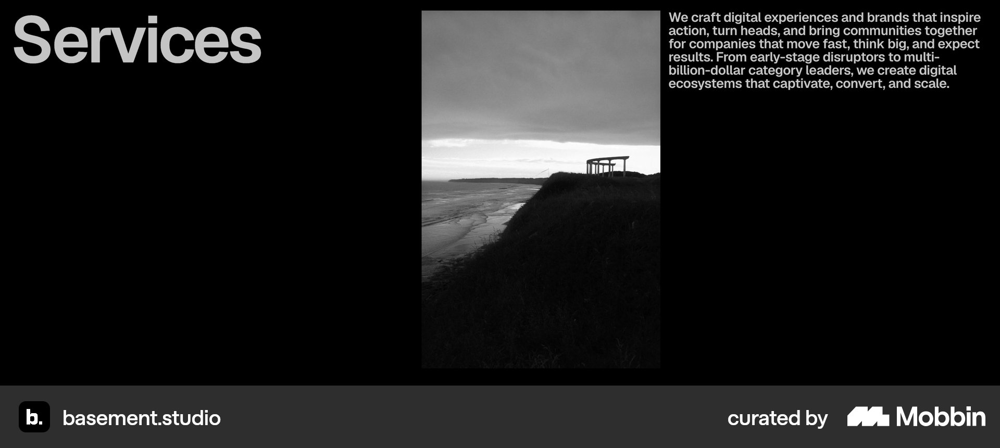
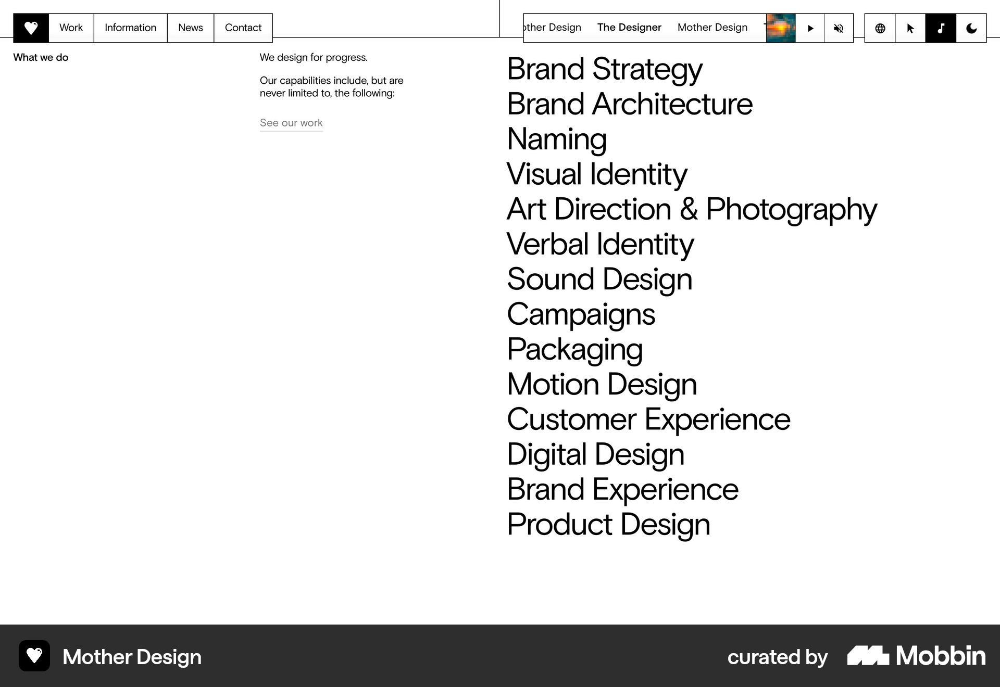
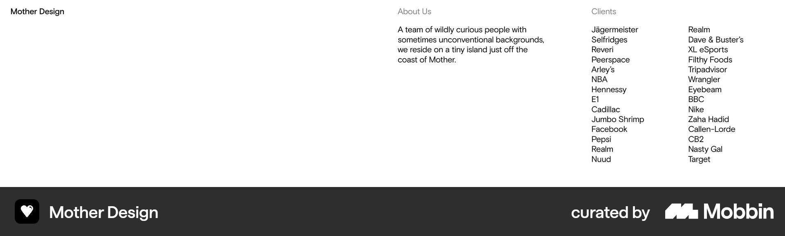

# Mobbin agency inspiration — 2025–2026 research

Research date: 2026-10-05. Source of visual references: Mobbin Sites. Intended use: inspiration for the Moriz Studio website, without selecting page hierarchy, branding, copy, or interactions.

## Date verification and limits

The requested window is 2025–2026. Mobbin's search connector returns images and canonical section links, but **does not expose screenshot capture dates or website launch dates**. Separate sources were checked for dated website/identity evidence. A recent gallery entry, copyright year, or recent client project does not establish a recent redesign.

- **basement.studio:** strong 2025 website provenance. The studio's own dated article describes its 2025 redesign; its official repository identifies the site as its 2025 website.
- **Mother Design:** strong recent-relaunch evidence in a 7 April 2025 interview. This verifies a newly relaunched website reported in 2025, not an exact launch day or the capture date of today's Mobbin image.
- **Fiasco:** confirmed April 2025 rebrand, plus a website reference featured in a November 2025 gallery. Retained separately as a candidate. Its exact website redesign date remains unconfirmed.

No 2026 agency website launch/redesign was verified in this pass. The confirmed shortlist therefore uses the 2025 part of the requested range. The exact dates of the individual Mobbin captures remain unknown for every reference.

All images below were downloaded from Mobbin's high-resolution image URLs, rather than saving its inline previews. The canonical Mobbin links are retained because image download URLs expire.

## Confirmed recent website references

| Agency | Date evidence | Relevance | Captured section |
| --- | --- | --- | --- |
| [basement.studio — Mobbin](https://mobbin.com/sites/sections/caa1a6b1-4b01-4b6a-8d30-df5454015bbf) | [Studio article, 20 May 2025](https://basement.studio/post/new-digital-hq-pt-1); [official 2025 website repository](https://github.com/basementstudio/website-2k25) | Direct design/engineering studio reference | Services presentation |
| [Mother Design — Mobbin](https://mobbin.com/sites/sections/f0c809f7-88e8-4a70-9ec9-2b4f7af538ae) | [Relaunch interview, 7 April 2025](https://www.designweek.co.uk/the-sweet-agony-of-designing-your-studios-new-website/) | Adjacent brand/design studio reference; not proof of app development services | Studio introduction, capabilities, client proof |

## Research records

These records describe inspected screenshots. Advantages and disadvantages are possible tradeoffs to investigate, not measured usability findings, conversion results, or decisions for Moriz Studio. A still image cannot verify motion, hover behavior, keyboard access, mobile behavior, or performance.

### 1. basement.studio — Services presentation

#### Source

Mobbin Sites, basement.studio. The studio's [20 May 2025 article](https://basement.studio/post/new-digital-hq-pt-1) describes the 2025 redesign and its combination of structured content and an experimental 3D environment. The [official repository](https://github.com/basementstudio/website-2k25) independently identifies this as the 2025 website. Exact Mobbin capture date: not exposed.

#### Screenshot/link

[Open the section on Mobbin](https://mobbin.com/sites/sections/caa1a6b1-4b01-4b6a-8d30-df5454015bbf).

#### Pattern

A black background with a large Services label on the left, a tall monochrome image in the middle, and a compact introductory paragraph on the right. The screenshot presents a spacious three-column composition rather than a set of service cards.

#### Why it is interesting

It is a reference for presenting a studio's capabilities with strong typographic contrast and a restrained amount of visible information. The dated studio article also provides context for a team that combines design with engineering.

#### Advantages

Possible tradeoff: the clear label and distinct image/text regions can make the section visually easy to identify. The photograph adds a studio-related visual reference alongside the capabilities introduction.

#### Disadvantages

The screenshot alone does not show a detailed service breakdown. The large amount of empty space and small introductory text warrant mobile and readability investigation. Do not infer service discoverability or conversion performance from this image.

#### Relevance to Moriz Studio

Research reference for how a design/development studio introduces its capabilities. Whether Moriz needs a dedicated Services page or any equivalent section remains undecided.

#### Decision / takeaway

TODO: Decision required

### 2. Mother Design — Studio introduction with team photography

#### Source

Mobbin Sites, Mother Design. A [7 April 2025 interview](https://www.designweek.co.uk/the-sweet-agony-of-designing-your-studios-new-website/) discusses its newly launched website and collaboration with Alright Studio. Exact Mobbin capture date: not exposed.

#### Screenshot/link

[Open the section on Mobbin](https://mobbin.com/sites/sections/f0c809f7-88e8-4a70-9ec9-2b4f7af538ae).

#### Pattern

A large studio-description paragraph on white sits directly above a full-width photograph of people working in the studio. Several phrases in the paragraph are underlined; their interaction behavior is not verified.

#### Why it is interesting

The section places a description of the company alongside visible people and a working environment. It supplies a reference for a professional studio introduction that also conveys personality.

#### Advantages

Possible tradeoff: actual studio photography can make the people behind the work more tangible. The composition gives the company introduction high visibility.

#### Disadvantages

This depends on suitable, authentic imagery. A large paragraph may dominate the viewport, and English line breaks do not establish a suitable Hebrew layout. Underlining requires later investigation to understand whether it represents links or decorative emphasis.

#### Relevance to Moriz Studio

An adjacent reference for About-page research and professional presentation. It does not establish a need for team photography or assume that Moriz has a comparable team or office.

#### Decision / takeaway

TODO: Decision required

### 3. Mother Design — Typographic capabilities list

#### Source

Mobbin Sites, Mother Design. Date evidence is the [7 April 2025 relaunch interview](https://www.designweek.co.uk/the-sweet-agony-of-designing-your-studios-new-website/); the individual capture date is unavailable.

#### Screenshot/link

[Open the section on Mobbin](https://mobbin.com/sites/sections/83653e9e-1c8a-4dbb-b9e2-103d731e662f).

#### Pattern

A narrow introduction on the left and a large vertical capabilities list on the right. The screenshot also includes a segmented top navigation/control strip. Capabilities are presented as typography, without individual illustrated cards.

#### Why it is interesting

It provides a contrasting way to expose a studio's range of work: explicit capabilities rather than a broad introductory paragraph alone.

#### Advantages

Possible tradeoff: a visible list allows visitors to scan named capabilities. The format can expose breadth with a limited visual vocabulary.

#### Disadvantages

A long list can emphasize breadth without explaining client value, scope, or the relationship between disciplines. It may be difficult for non-specialist clients to interpret. The photographed list is not a proposed Moriz service offering.

#### Relevance to Moriz Studio

A reference for investigating how UX/UI design and development could be communicated together. The services, labels, grouping, and hierarchy for Moriz remain undecided.

#### Decision / takeaway

TODO: Decision required

### 4. Mother Design — Client proof as a text list

#### Source

Mobbin Sites, Mother Design. Recent-relaunch evidence: [7 April 2025 interview](https://www.designweek.co.uk/the-sweet-agony-of-designing-your-studios-new-website/). Individual capture date: unavailable.

#### Screenshot/link

[Open the section on Mobbin](https://mobbin.com/sites/sections/237c4e0d-4262-43f5-9904-ee380f7fe902).

#### Pattern

A sparse white section divides the studio name, a brief company description, and a two-column client-name list across the width.

#### Why it is interesting

It is a reference for showing client experience through text rather than a logo wall or testimonial cards.

#### Advantages

Possible tradeoff: client names can be displayed compactly, and the presentation does not depend on a large collection of logo assets.

#### Disadvantages

Names alone do not explain the studio's role, the project, or the outcome. Recognizability will depend on the audience. Permission to identify clients and the availability of supporting evidence require separate decisions.

#### Relevance to Moriz Studio

A credibility reference to compare with case studies and other proof formats. No Moriz client names, testimonials, or claims are supplied by this research.

#### Decision / takeaway

TODO: Decision required

## Candidate with incomplete website-date verification

### 5. Fiasco — Selected work with project context

#### Source

Mobbin Sites, Fiasco. Its own [April 2025 announcement](https://fiasco.design/goodbye-fiasco-design-hello-fiasco/) confirms a new identity. [MaxiBestOf's November 2025 collection](https://maxibestof.one/websites/popular/november-2025) includes its website. These establish a 2025 rebrand and dated gallery presence, **not the exact launch/redesign date of the displayed website**. It is a candidate, not a fully date-verified website in the main shortlist.

#### Screenshot/link

[Open the section on Mobbin](https://mobbin.com/sites/sections/4ed7c118-a866-41fa-824c-32a24323c927).

#### Pattern

An introductory statement sits above an asymmetric two-column arrangement of project images. Each visible project includes a name, a short contextual description, and small category labels. Image sizes and vertical positions vary.

#### Why it is interesting

The screenshot offers a reference for pairing portfolio imagery with context about what a project involved, rather than displaying unexplained thumbnails.

#### Advantages

Possible tradeoff: descriptions and labels provide more context than the image alone. Variation in image size and placement changes the visual rhythm.

#### Disadvantages

The pictured work covers branding and digital projects, so it is not a direct app-development portfolio reference. Uneven layouts need separate examination for reading order, mobile stacking, and keyboard navigation. None of those behaviors was verified here.

#### Relevance to Moriz Studio

A candidate for later Projects-page research, subject to date verification. No layout, category system, or project description has been selected for Moriz.

#### Decision / takeaway

TODO: Decision required

## Date checks that did not qualify additional references

These sources explain exclusions; they are not additional selected inspiration references.

- Unseen Studio's main site has [an Awwwards record dated 6 February 2023](https://www.awwwards.com/sites/unseen-studio). A [gallery entry dated 10 January 2026](https://mesh3d.gallery/website/unseen-studio-brand-digital-motion) does not by itself prove a 2026 redesign. A separate [2025 Wrapped microsite](https://2025.unseen.co/) has a [9 March 2026 award record](https://www.cssdesignawards.com/sites/unseen-studio-2025-wrapped/48957/), but Mobbin returned main-site sections rather than that microsite. The main-site screenshots were therefore not relabelled as the 2026 microsite.
- Cloudstudio has [a project case study explicitly dated 2026](https://cloudstudio.es/work/moneyincheck), but that dates the client project, not the agency website's launch. The agency site was not admitted as a confirmed 2026 redesign.
- Aino has [a gallery entry added in January 2026 that explicitly dates the website project to 2023](https://designeverywhere.co/work/aino). That entry cannot verify the date of the current Mobbin capture. An unrelated 2025 speculative redesign concept was not used as evidence of an official website relaunch.
- Instrument, OFF+BRAND, and Locomotive were returned by Mobbin, but this pass did not establish 2025–2026 redesign dates for their captured agency sections.

## Open research questions

- [ ] Can Mobbin's own site interface supply capture/version dates for these exact sections?
- [ ] Which additional web/app development agency sites have primary-source 2026 launch evidence and matching Mobbin captures?
- [ ] How do the shortlisted patterns behave on mobile, with keyboard input, and with reduced motion?
- [ ] Which of these references has an audience and project scale comparable to Moriz's small-business/startup audience?
- [ ] How would Hebrew content and RTL reading order affect each composition? No translation or RTL design is proposed here.

## Project decisions

Page hierarchy, website copy, brand direction, and interaction selection: TODO: Decision required

This report does not promote any pattern into the sitemap, page-structure documents, design system, or selected-interaction register.
