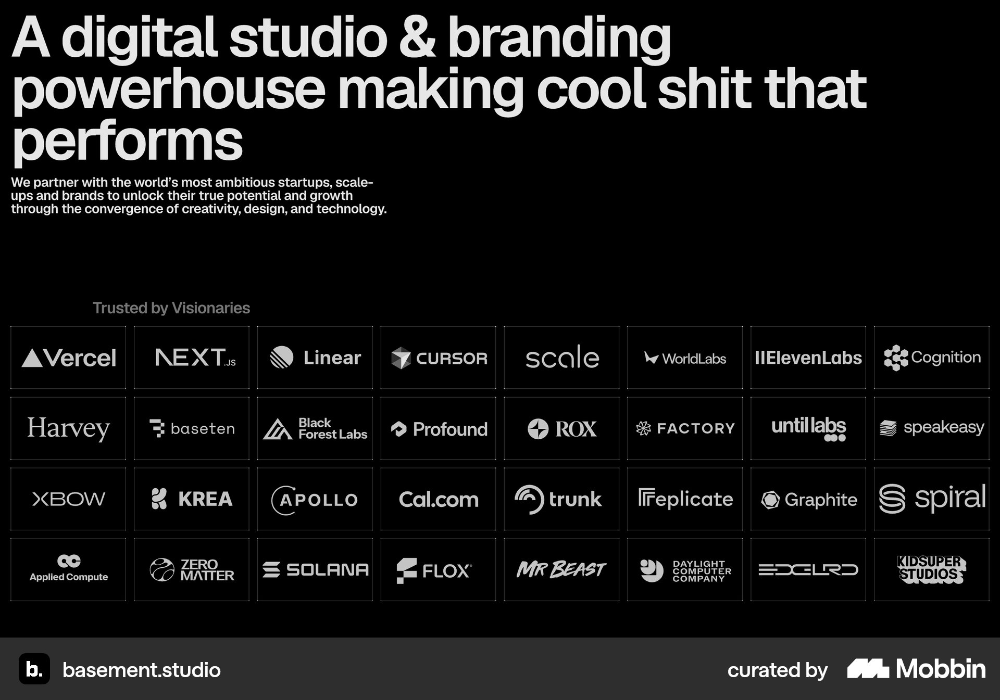
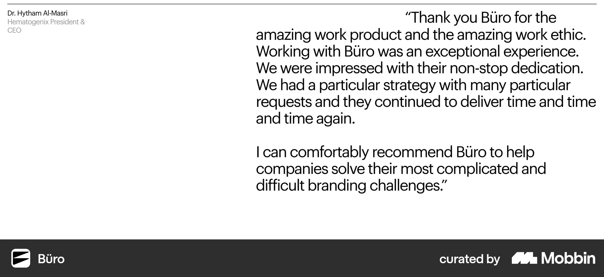
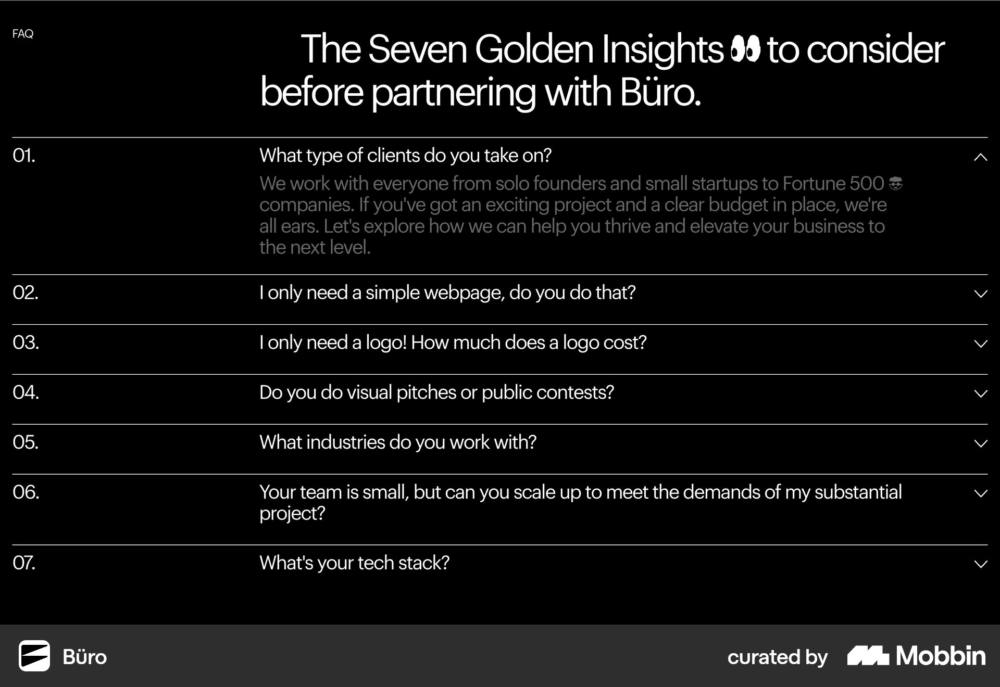
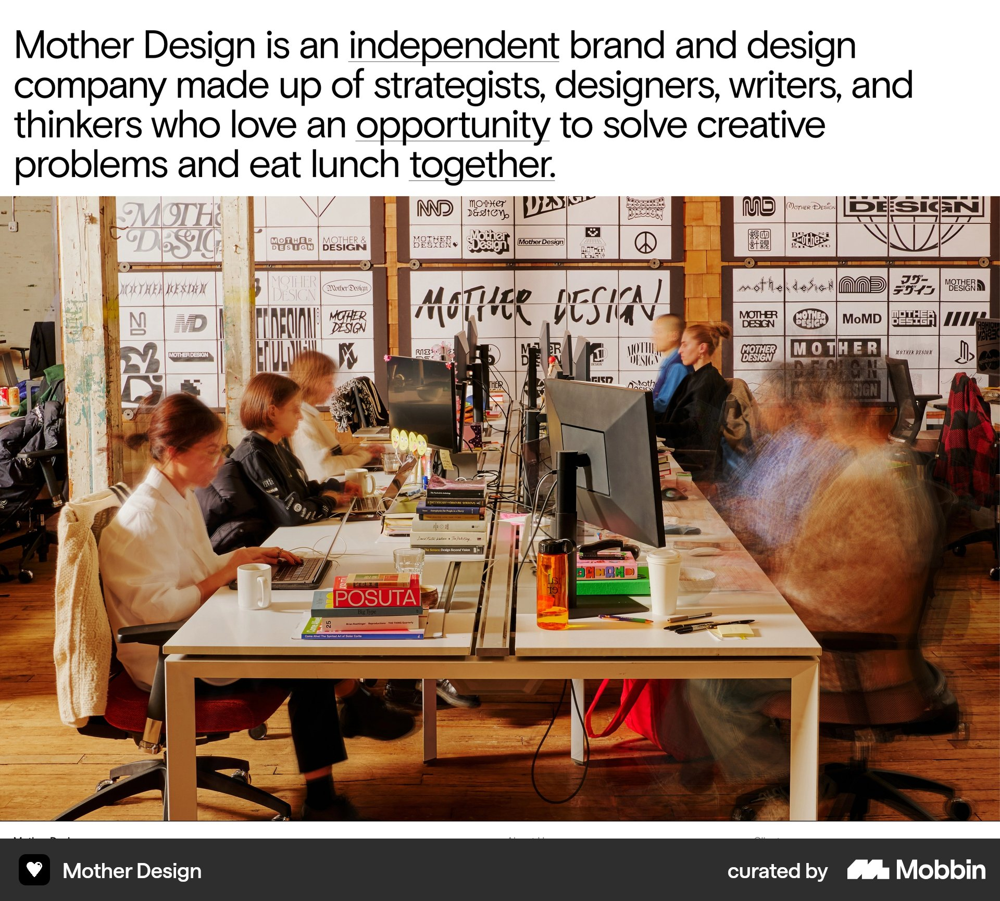

# Mobbin research — homepage structure, 2025–2026

Research date: 2026-10-06. Focus: evidence to help the owner decide Moriz Studio's homepage structure before Hebrew/RTL black-and-white wireframes.

## Scope and status

This research examined the owner's seven initially proposed sections: hero, three communication themes, projects, brief owner introduction, testimonials, FAQ, and how to start working together. At the time of research they were an unordered inventory. The owner subsequently confirmed the full nine-section sequence, including Contact and Footer, in [02-page-structure.md](../02-page-structure.md#hierarchy). Current section-by-section content/layout review is recorded in [the homepage workbook](../homepage-workbook.md); the research comparisons below retain their original context and do not reopen confirmed section positions or floating-only WhatsApp access.

The report contains inspected Mobbin screenshots, dated website evidence, supplementary source-page content sequences, and possible tradeoffs. It does not select a Moriz section order, layout, copy, branding, or interaction. Tradeoffs are research hypotheses, not measured usability or conversion findings.

Final Moriz hierarchy: TODO: Define hierarchy after UX/UI research.

## Date evidence and research limits

The requested window is 2025–2026. Mobbin's section-search results expose the site name, section ID, image, and canonical link, but no capture or launch date. Website provenance was therefore checked separately:

| Studio | Dated evidence | What it establishes | Limit |
| --- | --- | --- | --- |
| basement.studio | [Studio article, 20 May 2025](https://basement.studio/post/new-digital-hq-pt-1), and [official 2025 website repository](https://github.com/basementstudio/website-2k25) | The studio's 2025 website redesign. | The exact capture date and subsequent content updates are unknown. |
| Büro / Bürocratik | [European Design Awards project record](https://awards.europeandesign.org/winner/261155): the studio's new website is a 2025 Gold-winning project. | A website project documented in 2025. | This is an award/project year, not an exact launch day or a date for each Mobbin section. |
| Mother Design | [Relaunch interview published 7 April 2025](https://www.designweek.co.uk/the-sweet-agony-of-designing-your-studios-new-website/) | A newly relaunched website reported in 2025, with testimony from its designers. | The exact launch day and capture date are unknown. It is an adjacent brand/design reference, not a direct development-studio equivalent. |

No matching Mobbin agency reference with a verified 2026 website launch/redesign was established in this pass. The dated evidence uses the 2025 portion of the requested window. **Individual Mobbin screenshots cannot be certified as captured in 2025–2026.**

Section screenshots establish local presentation, not whole-page order. The sequences below come from the current original websites' extracted content, checked on the research date. A browser was unavailable, so rendered scroll order, sticky behavior, hidden states, mobile layouts, and interaction behavior were not verified. These are current content sequences, not reconstructions of each site's 2025 launch version.

There is an explicit version difference: Büro's Mobbin FAQ shows seven entries; its current contact page lists eight. Its captured testimonial is also different from the quotes returned by the current homepage. Those captures are retained as section references with the difference recorded.

## Homepage content sequences

These observations describe the references only. They are not proposed Moriz wireframes.

| Reference | Current extracted sequence | Structural observation |
| --- | --- | --- |
| [basement.studio homepage](https://basement.studio/) | Studio positioning → client logos → featured projects → detailed capabilities → contact → footer. | Work is grouped in a featured-project block. Client proof precedes it; detailed capabilities follow it. The intro, project, and contact content match the three Mobbin captures below. |
| [Büro homepage](https://www.burocratik.com/) | Intro/reel entry → studio history → first project pair → awards/principles → more projects → service groups → testimonials → contact/footer. | Projects are interleaved with studio and credibility content. Detailed services and testimonials appear later in the extracted sequence. Blank Mobbin hero/work captures were excluded, so the full sequence is supplementary source-page evidence. |

Both inspected homepages place project examples before detailed capability lists. This small, selected sample does not establish the best order for Moriz's audience or its shorter three-theme section. Neither extracted homepage sequence supplies a comparable three-step client-starting process.

The [Büro contact page](https://www.burocratik.com/lets-talk) groups an enquiry form, FAQ, testimonials, and further contact information. That supplies context for its FAQ reference; it does not establish a homepage FAQ position. Mother Design's introduction screenshot belongs to its [Information page](https://www.motherdesign.com/information), not its homepage.

## Mobbin research records

### 1. basement.studio — positioning followed by client proof

#### Source

Mobbin Sites, basement.studio. Website provenance: the [studio's 2025 redesign article](https://basement.studio/post/new-digital-hq-pt-1). Capture date is unavailable. Matching content appears on the [current homepage](https://basement.studio/).

#### Screenshot/link

[Open in Mobbin](https://mobbin.com/sites/sections/a3cf46f9-dafe-4cee-9fee-186aabb025aa).

#### Pattern

A prominent studio statement and short explanatory paragraph precede a large client-logo grid. This is an introduction/proof section, not verification of the site's complete opening 3D experience.

#### Why it is interesting

It links a studio's self-description to visible evidence before the featured work.

#### Advantages

Possible advantage: relevant, recognizable clients may support the introductory claim without a long explanation.

#### Disadvantages

A large grid takes substantial space. Logos alone do not explain the studio's role or outcomes, and recognition depends on the audience.

#### Relevance to Moriz Studio

The owner has reported recognizable organizations and both employed and independent work. Any comparable proof would need accurate role/context attribution; organization experience is not automatically an independent studio client relationship. A logo wall has not been selected.

#### Decision / takeaway

TODO: Decision required

### 2. basement.studio — project rows with context

#### Source

Mobbin Sites, basement.studio. Matching featured-project content appears on the [homepage](https://basement.studio/). Website provenance is documented above; the capture date is unknown.

#### Screenshot/link

[Open in Mobbin](https://mobbin.com/sites/sections/2c1653b2-e228-4044-bd56-10be54f7403c).

#### Pattern

Wide project rows combine a large visual on the left, a contextual description in the middle, and the project name on the right. Service labels sit below the description. Two projects are visible in this crop.

#### Why it is interesting

It exposes what the studio did alongside the visual work, making project presentation a reference for both layout and information.

#### Advantages

Possible advantage: consistent rows can make project information comparable. Context and scope labels provide information beyond a thumbnail.

#### Disadvantages

Each project occupies considerable height. The wide composition needs separate mobile and Hebrew reading-order investigation; the screenshot does not show those states.

#### Relevance to Moriz Studio

Useful for comparing ways to present the selected web systems and distinguish research, design, and development contributions. This is a counterpart to the owner's interest in Huncwot's project layout, not a replacement for that reference. Project details and layout remain open.

#### Decision / takeaway

TODO: Decision required

### 3. basement.studio — a concentrated contact ending

#### Source

Mobbin Sites, basement.studio. The [homepage's extracted content](https://basement.studio/) places this contact material after capabilities. The screenshot itself does not establish that position.

#### Screenshot/link

[Open in Mobbin](https://mobbin.com/sites/sections/a2f3898a-cd70-4d7d-b549-5f5dbb5a9fa6).

#### Pattern

A compact contact label, large invitation, and prominent email address form a single contact region, separate from the project rows.

#### Why it is interesting

It provides a reference for how a portfolio narrative can end in a clearly identifiable enquiry action.

#### Advantages

Possible advantage: one visible destination can make the next action easy to identify at that point in the page.

#### Disadvantages

An ending alone may be missed by visitors who stop earlier. This capture cannot verify other contact entry points or explain what happens after the action.

#### Relevance to Moriz Studio

Moriz's confirmed action is sending a WhatsApp message. This reference informs investigation of prominence and placement; it does not change that channel or select an additional eighth section.

#### Decision / takeaway

TODO: Decision required

### 4. Büro — testimonial with explicit attribution

#### Source

Mobbin Sites, Büro. The studio's website is [documented as a 2025 project](https://awards.europeandesign.org/winner/261155). This specific capture's date and original page are unconfirmed. The current [homepage](https://www.burocratik.com/) and [contact page](https://www.burocratik.com/lets-talk) both contain testimonials, but their extracted quotes differ from this capture.

#### Screenshot/link

[Open in Mobbin](https://mobbin.com/sites/sections/3e179ff8-d623-4415-9848-be2e5ecdb66c).

#### Pattern

A large quote occupies the main column; a smaller column identifies the speaker, organization, and role. Only one testimonial is visible. A carousel cannot be inferred from this still image.

#### Why it is interesting

It treats the testimony as substantial page content and makes attribution visible alongside it.

#### Advantages

Possible advantage: attribution supplies context, while a single visible quote can receive focused attention.

#### Disadvantages

A long quote dominates space and needs later readability investigation. This crop does not show access to other quotes or a relationship to the relevant project.

#### Relevance to Moriz Studio

Five testimonials are reported as available. The record helps compare a dedicated section with testimonials associated with projects; it provides no evidence for choosing one or for repeating them across pages.

#### Decision / takeaway

TODO: Decision required

### 5. Büro — FAQ in the enquiry context

#### Source

Mobbin Sites, Büro. The matching question topics appear on the [current contact page](https://www.burocratik.com/lets-talk), after its enquiry form. The capture shows seven entries; the live extracted page now lists eight. The exact capture version/date is unknown.

#### Screenshot/link

[Open in Mobbin](https://mobbin.com/sites/sections/2ecc50d0-4f74-4e6b-be84-848204dc64d9).

#### Pattern

Numbered question rows are separated by rules. One answer is expanded, with chevrons indicating other row states. The questions address working with the agency rather than generic product help.

#### Why it is interesting

Its source-page context places practical clarification close to the enquiry flow, rather than establishing FAQ as a compulsory homepage block.

#### Advantages

Possible advantage: collapsed answers keep the question list visible while allowing a specific concern to be explored.

#### Disadvantages

Hidden answers require an action. Keyboard behavior, screen-reader semantics, focus, contrast, and mobile use were not tested.

#### Relevance to Moriz Studio

The owner proposed homepage FAQ and deferred its content. This reference is for placement and presentation comparison only. No questions or answers are imported, and no form, public budget field, or navigation change is proposed.

#### Decision / takeaway

TODO: Decision required

### 6. Mother Design — introduction connected to real people

#### Source

Mobbin Sites, Mother Design. This existing local screenshot was reinspected for this research. Its content matches the [Information page](https://www.motherdesign.com/information). Website relaunch evidence is the [7 April 2025 interview](https://www.designweek.co.uk/the-sweet-agony-of-designing-your-studios-new-website/); capture date is unavailable.

#### Screenshot/link

[Open in Mobbin](https://mobbin.com/sites/sections/f0c809f7-88e8-4a70-9ec9-2b4f7af538ae).

#### Pattern

A large company-description paragraph sits directly above a full-width photograph of people working in the studio. This is an internal information-page reference, not a homepage hero.

#### Why it is interesting

It connects an explanation of the studio to visible people and a working environment.

#### Advantages

Possible advantage: authentic imagery can make the people behind the work more tangible.

#### Disadvantages

The combination occupies substantial space and relies on appropriate source imagery. A multi-person studio photograph is not directly comparable to Moriz's personal working model.

#### Relevance to Moriz Studio

Useful for comparing the role of a brief owner introduction on Home with fuller information on About. Photography, content length, and placement have not been selected.

#### Decision / takeaway

TODO: Decision required

## Evidence mapped to the owner's section inventory

Row order follows the existing inventory, not a proposed page sequence. The last column records decisions for later review; it is not an intake questionnaire to complete now.

| Proposed section | Relevant evidence | Comparison to consider | Status |
| --- | --- | --- | --- |
| Hero | basement introduction/proof capture; Büro's source-page intro/reel entry. | An introductory claim can be supported by evidence nearby; the scope and amount of opening information vary. Neither reference establishes the right opening for Moriz. | Hero information and hierarchy: TODO: Decision required |
| Three communication themes | Detailed capabilities follow work on both reviewed homepages. The [earlier Mobbin report](mobbin-agency-inspiration-2025-2026.md) includes service/capability presentation references. | A short theme section before projects could orient visitors; after projects it could explain the demonstrated work. Moriz's three themes are not equivalent to the references' long service lists. | Position, label, depth, and relationship to projects: TODO: Decision required |
| Projects | basement's contextual rows; Büro's source-page interleaving of work with studio/proof content. | A single block keeps projects together; interleaving adds context between project groups but lengthens and fragments the presentation. The owner's Huncwot layout preference remains a separate input. | Homepage selection, order, information, and layout: TODO: Decision required |
| Brief owner introduction | Mother Design's internal Information page; studio history in Büro's homepage content. | A brief introduction could point to fuller About information. Extensive studio background consumes space and is not necessarily suitable for the owner's requested short section. | Facts, length, page relationship, and position: TODO: Decision required |
| Testimonials / reviews | Büro's attributed quote; live homepage testimonials after services; basement's earlier logo proof. | Quotes, usage evidence, and organization experience serve different purposes. A dedicated testimonial section and project-associated proof are alternatives to evaluate with the actual material. | Selection, attribution, position, and reuse on Projects: TODO: Decision required |
| FAQ | Büro contact-page FAQ, with a recorded capture/live version difference. | Clarification can be near an enquiry flow. Its presence on an internal page does not justify moving Moriz's proposed FAQ or fixing its homepage position. | Placement/presentation: TODO: Decision required. Content remains deferred. |
| How to start working together | No sufficiently matched, dated Mobbin example found in this pass. Mother's process principles are not a client-starting sequence. | Use the owner's confirmed short call, specification discussion, and quote as source facts for future planning. No scheduling, fees, timing, or extra steps can be inferred. | Supporting information and presentation: TODO: Decision required |

The WhatsApp conversion action applies across page planning. The contact reference exposes an ending, but does not settle Moriz's top-of-page access, repetition, or relationship to FAQ and the three starting steps. CTA placement: TODO: Decision required

## Structure decisions supported for later review

These are comparison dimensions, not selected UX conclusions:

- [x] The owner subsequently selected the opening sequence: Hero → three communication themes / advantages → projects. See [the decision record](../14-decisions.md#homepage-opening-sequence).
- [ ] Compare a single project block with project groups separated by other content. TODO: Decision required
- [ ] Decide which proof belongs near which claim or project, using the actual available material. TODO: Decision required
- [ ] Define the boundary between the brief homepage introduction and About. TODO: Decision required
- [ ] Decide the relationship between FAQ, the confirmed client-starting steps, and WhatsApp. TODO: Decision required
- [ ] Define final section scope and order. TODO: Define hierarchy after UX/UI research.

The research pass itself did not select a Moriz hierarchy or interaction. The owner's subsequent full sequence and floating-only WhatsApp choice are recorded in the decision log and page-structure document. A black-and-white wireframe exists as a provisional reference; the owner later authorized a [Mammoth hero/header coded trial](../14-decisions.md#mammoth-murals-hero-trial) before finishing the workbook. Later section content/layout choices continue through [the workbook review process](../homepage-workbook.md#working-process) before their code updates.

## Hebrew / RTL relevance

The retained screenshots are English/LTR desktop references. They do not validate Hebrew hierarchy or responsive behavior. Later wireframe review should examine project name/context/visual reading order, testimonial attribution, mixed Hebrew/English product names, long question labels, and the reading order of the three starting steps. No mirroring rules, typography values, breakpoints, or interaction implementation have been defined.

## Search coverage and gaps

Mobbin searches covered agency introductions, selected work, capabilities, testimonials, FAQs, contact, and client-starting processes. Focused searches also used basement.studio, Büro, Mother Design, Fiasco, and the three owner-provided reference names.

Representative queries:

- `Büro homepage hero introducing a fearless digital studio with two decades of craft and a play reel`
- `basement.studio contact section inviting new project enquiries`
- `Mother Design capabilities list in the Information page`

Search results were checked by their returned site name and inspected image, rather than attributed to the name in the query. For example, the Mother capabilities query returned Raw Materials and Analogue Agency; those results were not recorded as Mother Design. Blank Büro captures were omitted. Recruitment, software-product, and unrelated service-process examples were not used to fill the client-starting gap.

The searches did not yield matching captures of Huncwot, Mammoth Murals, or Stokt. This does not establish that they are absent from Mobbin. They remain in [the owner's reference document](owner-inspiration-references.md), with their date checks open.

Fiasco's project-layout candidate remains in the [earlier report](mobbin-agency-inspiration-2025-2026.md#candidate-with-incomplete-website-date-verification). A 2025 identity announcement alone does not certify its website redesign date, so it has not been promoted into this report's dated website sample.

## Screenshot provenance

The five new files were downloaded on 2026-10-06 from Mobbin's high-resolution image URLs. The existing Mother screenshot was reused. Canonical links are preserved because download URLs expire. Download date is not capture date.

| Site | Mobbin section ID / canonical link | Local screenshot | Page context |
| --- | --- | --- | --- |
| basement.studio | [a3cf46f9-dafe-4cee-9fee-186aabb025aa](https://mobbin.com/sites/sections/a3cf46f9-dafe-4cee-9fee-186aabb025aa) | [Introduction and clients](assets/mobbin-homepage-structure-2025-2026/basement-introduction-and-clients.jpg) | Content matches current Home. |
| basement.studio | [2c1653b2-e228-4044-bd56-10be54f7403c](https://mobbin.com/sites/sections/2c1653b2-e228-4044-bd56-10be54f7403c) | [Featured projects](assets/mobbin-homepage-structure-2025-2026/basement-featured-projects.jpg) | Content matches current Home. |
| basement.studio | [a2f3898a-cd70-4d7d-b549-5f5dbb5a9fa6](https://mobbin.com/sites/sections/a2f3898a-cd70-4d7d-b549-5f5dbb5a9fa6) | [Contact](assets/mobbin-homepage-structure-2025-2026/basement-contact.jpg) | Content matches current Home. |
| Büro | [3e179ff8-d623-4415-9848-be2e5ecdb66c](https://mobbin.com/sites/sections/3e179ff8-d623-4415-9848-be2e5ecdb66c) | [Testimonial](assets/mobbin-homepage-structure-2025-2026/buro-testimonial.jpg) | Original capture page unconfirmed; current quotes differ. |
| Büro | [2ecc50d0-4f74-4e6b-be84-848204dc64d9](https://mobbin.com/sites/sections/2ecc50d0-4f74-4e6b-be84-848204dc64d9) | [FAQ](assets/mobbin-homepage-structure-2025-2026/buro-faq.jpg) | Matching topics on current contact page; seven/eight-entry version difference. |
| Mother Design | [f0c809f7-88e8-4a70-9ec9-2b4f7af538ae](https://mobbin.com/sites/sections/f0c809f7-88e8-4a70-9ec9-2b4f7af538ae) | [Introduction](assets/mobbin-2025-2026/mother-about.jpg) | Content matches current Information page. |
