# Mobbin portfolio project section research

Research date: 7 October 2026. Prepared for the Moriz Studio redesign in the `projects` worktree.

For Moriz's three selected products, explore large project imagery with a short explanation of the product and the studio's contribution. The strongest desktop comparison is between contextual rows, a staggered two-column grid, and three equal previews. On mobile, an ordered vertical presentation gives room for readable interface imagery and Hebrew descriptions.

[Open the visual gallery](mobbin-projects-2026-10-07.html) · [Reference manifest](mobbin-projects-2026-10-07.json)

## Reference scope

The collection contains **10 desktop website sections from 10 studios** and **10 native iOS app screens from six apps**. The mobile screens demonstrate portfolio presentation on phones; they are **not mobile website captures of the desktop studios**. The available Mobbin Sites searches returned desktop images even for mobile queries, and a browser session was unavailable for checking the corresponding live responsive sites. A matched set of desktop and mobile website captures remains open.

Every selected image was visually inspected. Screenshots are saved from Mobbin's high-resolution download URLs, and each example links to its canonical Mobbin page. Capture dates and website launch dates are not exposed by these tools. The date above is the research/download date.

Visible layout and content are observations. Strengths, tradeoffs and Moriz applications are design assessments, not measured usability findings. Stills do not verify hover, scrolling, motion or keyboard behavior.

## Desktop comparison

| Example | Source | Project presentation | Main comparison |
| --- | --- | --- | --- |
| [D01](#d01) | [basement.studio](https://mobbin.com/sites/sections/2c1653b2-e228-4044-bd56-10be54f7403c) | Context beside large visuals | Explains the contribution alongside the work. |
| [D02](#d02) | [Fiasco](https://mobbin.com/sites/sections/4ed7c118-a866-41fa-824c-32a24323c927) | Staggered two-column grid | Adds visual rhythm while preserving context. |
| [D03](#d03) | [Cloudstudio](https://mobbin.com/sites/sections/48890788-7d16-4887-baaa-5b22583ef055) | Edge-to-edge image tiles | Makes digital product visuals prominent. |
| [D04](#d04) | [MOUTHWASH Studio](https://mobbin.com/sites/sections/e2bc218a-3568-43c0-a95e-b95b0d829e6c) | One dominant project and one smaller project | Creates deliberate emphasis. |
| [D05](#d05) | [Unseen Studio](https://mobbin.com/sites/sections/79d328bc-800b-4830-9de1-7ef8fd2dd00f) | Consistent grid with category controls | Supports comparison through a predictable structure. |
| [D06](#d06) | [TinyWins](https://mobbin.com/sites/sections/b497edad-c01e-4184-8d52-12689631b694) | Project rows with image strips | Shows depth within each project. |
| [D07](#d07) | [Wild](https://mobbin.com/sites/sections/c18cb634-beea-4af7-8d3a-08211610a68b) | Three equal previews with explanations | Fits a three-project selection compactly. |
| [D08](#d08) | [Raw Materials](https://mobbin.com/sites/sections/88014607-d7fa-4793-a09b-de483fe6c931) | Compact project index | Makes work information scannable. |
| [D09](#d09) | [Pentagram](https://mobbin.com/sites/sections/0964cb3b-e8a4-4e57-a6d1-e2ecfe445497) | Mixed-size image grid with descriptions | Varies emphasis without separating context from imagery. |
| [D10](#d10) | [Vucko](https://mobbin.com/sites/sections/1ddce7a9-2f0c-4020-ac01-d853579e54ac) | Two featured projects and archive link | Separates selected work from an archive. |

## Mobile comparison

All ten examples below are native app screens. Multiple screens from the same app show different portfolio contexts rather than ten different portfolio websites.

| Example | Source | Phone presentation | Main comparison |
| --- | --- | --- | --- |
| [M01](#m01) | [Behance](https://mobbin.com/screens/2494ee16-8a68-471f-8860-24bd68150f8f) | Compact portfolio grid | Lets work dominate with a small identity area. |
| [M02](#m02) | [Behance](https://mobbin.com/screens/2191f32c-d5fd-4e71-8f93-2e77de002e73) | Creator introduction before the grid | Connects the work to its author. |
| [M03](#m03) | [Behance](https://mobbin.com/screens/66c624c2-c63e-4f0e-b3e0-07b1ce0e6894) | Projects grouped by discipline | Shows a visible way to group related work. |
| [M04](#m04) | [Upwork](https://mobbin.com/screens/81a34c6e-2c3e-482d-82a1-74ad63db25d6) | Interface previews with descriptive titles | Titles explain more than client names alone. |
| [M05](#m05) | [Fiverr](https://mobbin.com/screens/d82abffd-554a-4f4f-b375-3521cad09b76) | Portfolio introduction and rich cards | Explains the purpose of the work and indicates more project material. |
| [M06](#m06) | [Fiverr](https://mobbin.com/screens/a5a4a395-14c9-4a46-bf3a-81fb89b112a6) | Small portfolio teaser with See All | Distinguishes a short teaser from a large archive. |
| [M07](#m07) | [Fiverr](https://mobbin.com/screens/070d98e6-87bb-458b-aff0-725c9c3f11d6) | Masonry portfolio archive | Accommodates varied image proportions. |
| [M08](#m08) | [Skillshare](https://mobbin.com/screens/b48e484e-f3bb-42c0-a3ce-975b69a5aff9) | Horizontal project previews | The partial next card indicates more work. |
| [M09](#m09) | [VSCO](https://mobbin.com/screens/32d03c59-00b6-467d-93e8-41a4f54c7c0c) | Project narrative with supporting images | Pairs explanation with multiple supporting images. |
| [M10](#m10) | [Wabi](https://mobbin.com/screens/aa92c2c0-8154-4b58-8d0d-c51579cd10b7) | Product gallery with simple names | Keeps products visibly distinct and named. |

## Desktop examples

### D01 basement.studio

[Open in Mobbin](https://mobbin.com/sites/sections/2c1653b2-e228-4044-bd56-10be54f7403c) · [Full screenshot](assets/mobbin-projects-2026-10-07/d01-basement-studio.jpg)

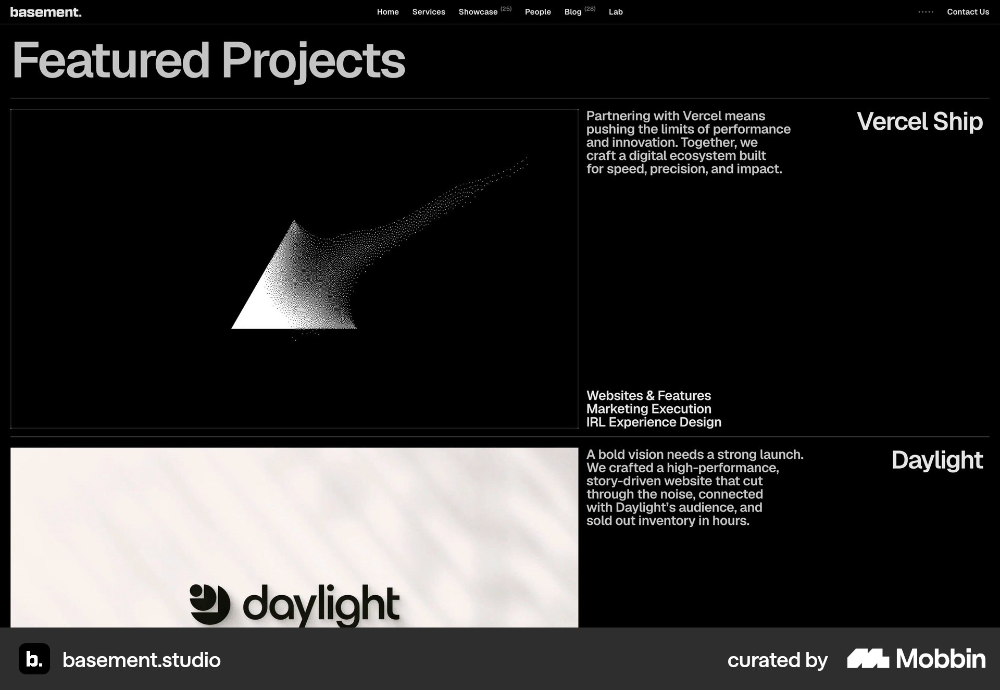

**Visible pattern:** Large project images occupy the left region; descriptions and discipline labels sit beside them, with project names at the far edge.

**Strength:** Explains the contribution alongside the work.

**Tradeoff:** Wide separation can make image/text association harder; the copy is compact.

**Moriz application:** Strong candidate for three projects: one substantial row per product, using supplied role and scope facts.

### D02 Fiasco

[Open in Mobbin](https://mobbin.com/sites/sections/4ed7c118-a866-41fa-824c-32a24323c927) · [Full screenshot](assets/mobbin-projects-2026-10-07/d02-fiasco.jpg)

**Visible pattern:** Unequal image sizes and vertical offsets form two columns. Each project has a name, short description and small category labels.

**Strength:** Adds visual rhythm while preserving context.

**Tradeoff:** Offsets complicate reading order; gaps lengthen the section.

**Moriz application:** Explore the owner's Huncwot preference through an expressive grid with explicit document order.

### D03 Cloudstudio

[Open in Mobbin](https://mobbin.com/sites/sections/48890788-7d16-4887-baaa-5b22583ef055) · [Full screenshot](assets/mobbin-projects-2026-10-07/d03-cloudstudio.jpg)

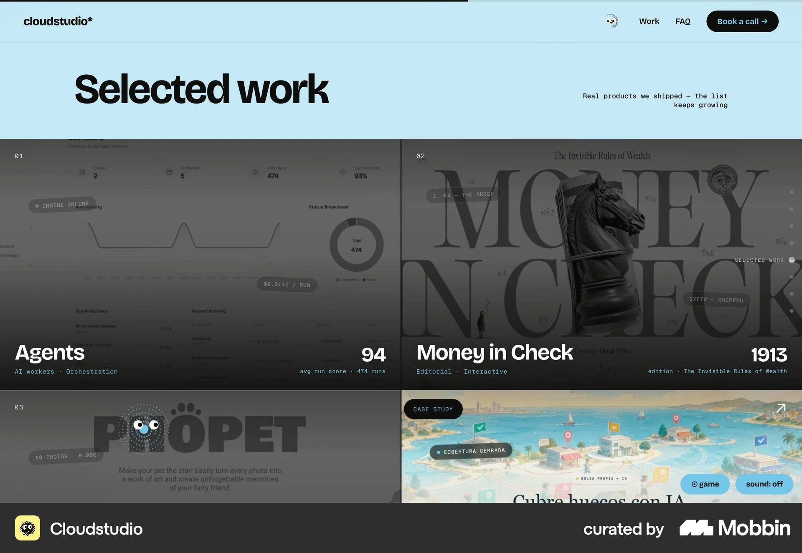

**Visible pattern:** A large Selected work heading leads into adjacent image columns; names and small labels sit over each tile's bottom.

**Strength:** Makes digital product visuals prominent.

**Tradeoff:** Dark overlays reduce detail; text needs careful contrast.

**Moriz application:** Show real interface previews with project titles legible independently of the image.

### D04 MOUTHWASH Studio

[Open in Mobbin](https://mobbin.com/sites/sections/e2bc218a-3568-43c0-a95e-b95b0d829e6c) · [Full screenshot](assets/mobbin-projects-2026-10-07/d04-mouthwash-studio.jpg)

**Visible pattern:** A larger portrait image sits beside a smaller image; project names and discipline labels appear below.

**Strength:** Creates deliberate emphasis.

**Tradeoff:** The smaller tile makes one project secondary; tiny captions explain little.

**Moriz application:** Explore a lead project plus supporting projects after project priority is supplied.

### D05 Unseen Studio

[Open in Mobbin](https://mobbin.com/sites/sections/79d328bc-800b-4830-9de1-7ef8fd2dd00f) · [Full screenshot](assets/mobbin-projects-2026-10-07/d05-unseen-studio.jpg)

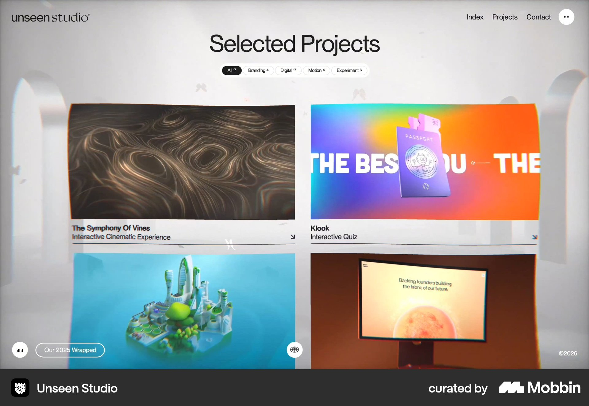

**Visible pattern:** Selected Projects sits above category pills and an even two-column image grid; titles and project-type descriptions sit below.

**Strength:** Supports comparison through a predictable structure.

**Tradeoff:** The atmospheric backdrop competes with information; filters add controls.

**Moriz application:** Borrow image/name/description grouping. Three projects do not yet justify filters.

### D06 TinyWins

[Open in Mobbin](https://mobbin.com/sites/sections/b497edad-c01e-4184-8d52-12689631b694) · [Full screenshot](assets/mobbin-projects-2026-10-07/d06-tinywins.jpg)

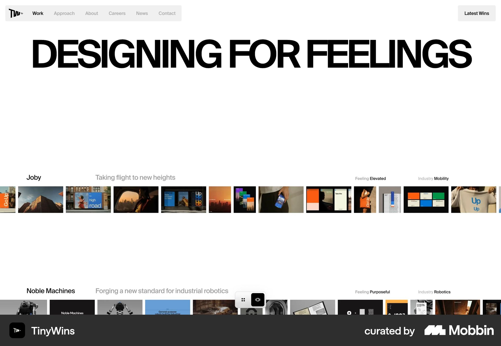

**Visible pattern:** Each row includes a project name, short statement and metadata, followed by a horizontal strip of many project images.

**Strength:** Shows depth within each project.

**Tradeoff:** Tiny previews are hard to read for interface work; horizontal behavior is unverified.

**Moriz application:** Useful for a sequence of product screens if a primary visual remains readable.

### D07 Wild

[Open in Mobbin](https://mobbin.com/sites/sections/c18cb634-beea-4af7-8d3a-08211610a68b) · [Full screenshot](assets/mobbin-projects-2026-10-07/d07-wild.jpg)

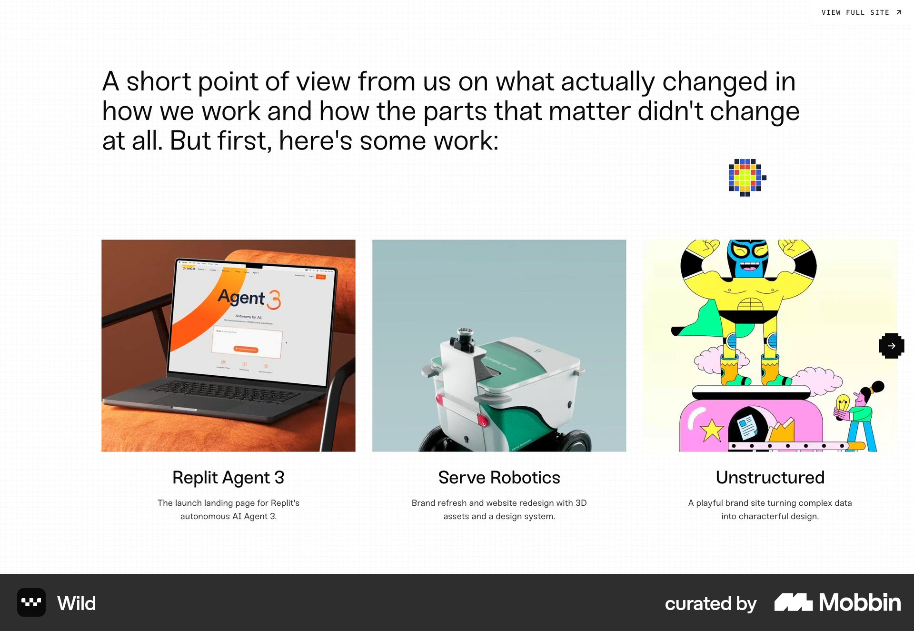

**Visible pattern:** Three image columns share a top edge and carry centered names and short explanatory copy.

**Strength:** Fits a three-project selection compactly.

**Tradeoff:** Equal priority may not suit unequal projects; small UI previews hide detail.

**Moriz application:** Direct comparison candidate for the three Moriz products, with clear descriptions.

### D08 Raw Materials

[Open in Mobbin](https://mobbin.com/sites/sections/88014607-d7fa-4793-a09b-de483fe6c931) · [Full screenshot](assets/mobbin-projects-2026-10-07/d08-raw-materials.jpg)

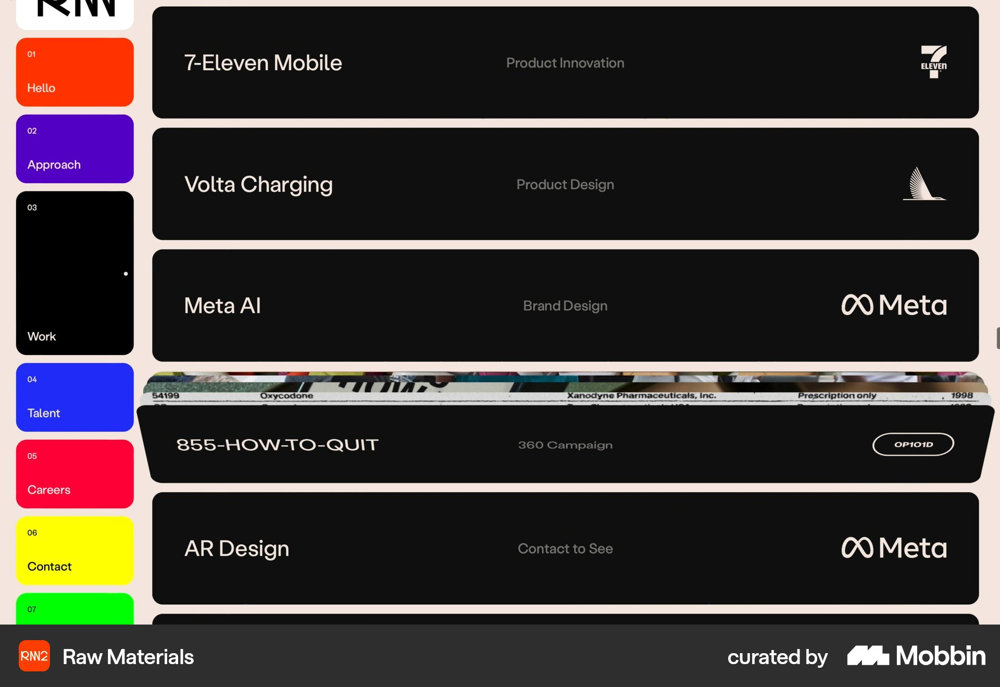

**Visible pattern:** Dark horizontal rows pair project names with discipline labels and client marks; one row includes a narrow visual strip.

**Strength:** Makes work information scannable.

**Tradeoff:** Most work is not visibly pictured; hover or expansion cannot be inferred.

**Moriz application:** Possible future archive pattern; a visual homepage showcase exposes design quality more directly.

### D09 Pentagram

[Open in Mobbin](https://mobbin.com/sites/sections/0964cb3b-e8a4-4e57-a6d1-e2ecfe445497) · [Full screenshot](assets/mobbin-projects-2026-10-07/d09-pentagram.jpg)

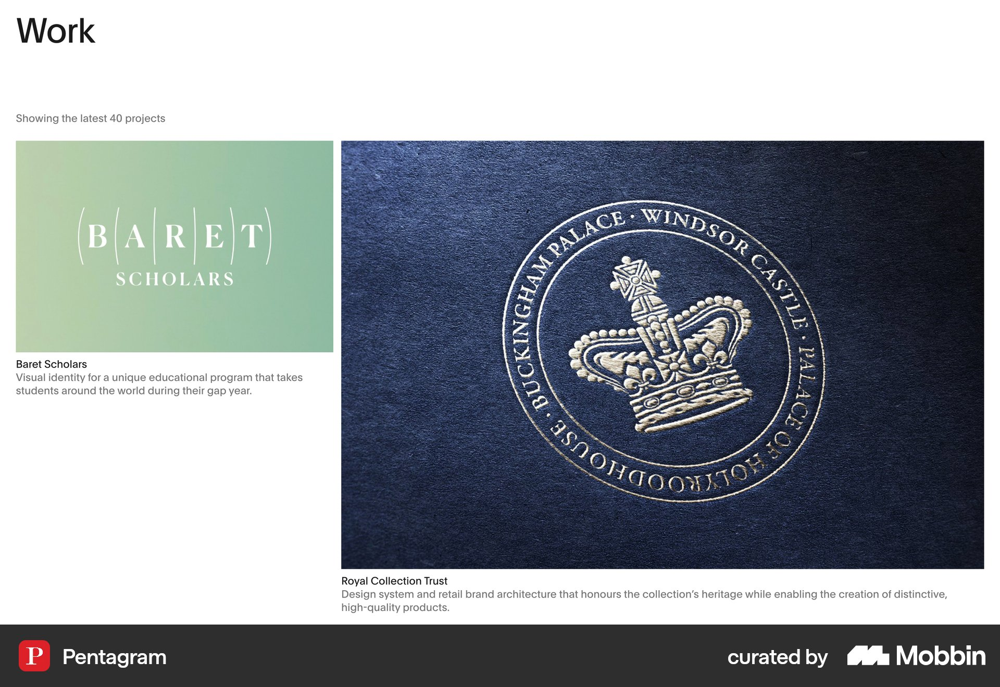

**Visible pattern:** A Work heading and project count lead to a smaller left image and larger right image; both have names and explanatory captions.

**Strength:** Varies emphasis without separating context from imagery.

**Tradeoff:** The large archive differs from a three-project homepage.

**Moriz application:** Borrow captions and intentional scale variation while keeping the selection small.

### D10 Vucko

[Open in Mobbin](https://mobbin.com/sites/sections/1ddce7a9-2f0c-4020-ac01-d853579e54ac) · [Full screenshot](assets/mobbin-projects-2026-10-07/d10-vucko.jpg)

**Visible pattern:** An oversized WORK heading leads to two large images with title/client captions; a See all projects link follows.

**Strength:** Separates selected work from an archive.

**Tradeoff:** Covers provide little product explanation; the archive link requires a real destination.

**Moriz application:** Explore large visuals plus one sentence of product context. Add an archive action only if a Projects page is selected.

## Mobile examples

### M01 Behance

Native iOS app reference. [Open in Mobbin](https://mobbin.com/screens/2494ee16-8a68-471f-8860-24bd68150f8f) · [Full screenshot](assets/mobbin-projects-2026-10-07/m01-behance.jpg)

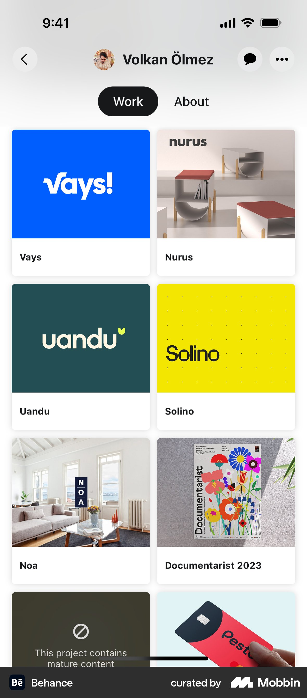

**Visible pattern:** A compact creator bar and Work/About tabs precede a two-column grid of covers with title strips.

**Strength:** Lets work dominate with a small identity area.

**Tradeoff:** Narrow columns leave little space for context.

**Moriz application:** Useful for a larger archive; compare with a single column for three products.

### M02 Behance

Native iOS app reference. [Open in Mobbin](https://mobbin.com/screens/2191f32c-d5fd-4e71-8f93-2e77de002e73) · [Full screenshot](assets/mobbin-projects-2026-10-07/m02-behance.jpg)

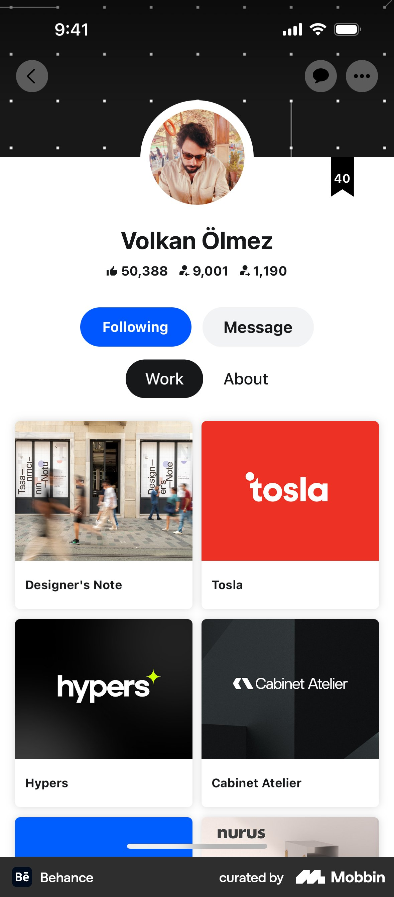

**Visible pattern:** A cover, avatar, name, metrics and actions precede Work/About tabs and two-column project cards.

**Strength:** Connects the work to its author.

**Tradeoff:** The identity area delays projects; follower metrics are not product outcomes.

**Moriz application:** Use a short section introduction instead of duplicating a large homepage identity block.

### M03 Behance

Native iOS app reference. [Open in Mobbin](https://mobbin.com/screens/66c624c2-c63e-4f0e-b3e0-07b1ce0e6894) · [Full screenshot](assets/mobbin-projects-2026-10-07/m03-behance.jpg)

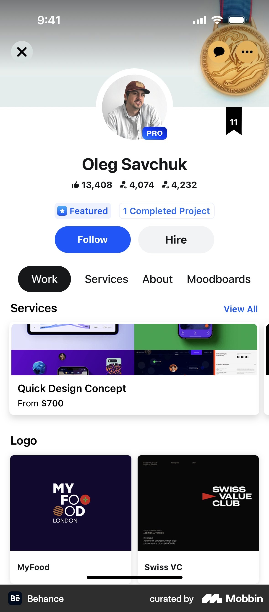

**Visible pattern:** The profile is followed by a service preview, a Logo group heading and two-column named covers.

**Strength:** Shows a visible way to group related work.

**Tradeoff:** Services and completed work can blur together; grouping consumes space.

**Moriz application:** Relevant if future portfolio breadth warrants groups. Three current products do not establish a taxonomy.

### M04 Upwork

Native iOS app reference. [Open in Mobbin](https://mobbin.com/screens/81a34c6e-2c3e-482d-82a1-74ad63db25d6) · [Full screenshot](assets/mobbin-projects-2026-10-07/m04-upwork.jpg)

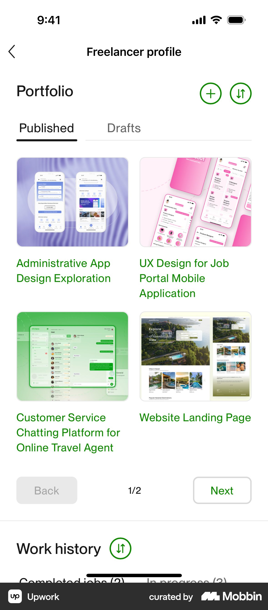

**Visible pattern:** A Portfolio heading and Published/Drafts tabs precede two-column UI covers with multiline descriptive titles and pagination.

**Strength:** Titles explain more than client names alone.

**Tradeoff:** Small collages hide interface detail; owner controls do not belong in a public showcase.

**Moriz application:** Borrow descriptive product titles and use a readable primary screen; omit editing controls.

### M05 Fiverr

Native iOS app reference. [Open in Mobbin](https://mobbin.com/screens/d82abffd-554a-4f4f-b375-3521cad09b76) · [Full screenshot](assets/mobbin-projects-2026-10-07/m05-fiverr.jpg)

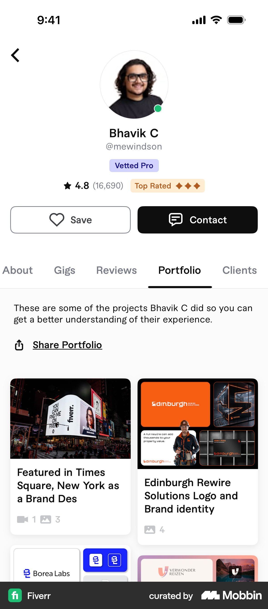

**Visible pattern:** A Portfolio tab is followed by explanatory copy, a share action and two-column project cards with titles and media counts.

**Strength:** Explains the purpose of the work and indicates more project material.

**Tradeoff:** Profile/navigation occupy space; truncated titles lose context.

**Moriz application:** Use a concise introduction and clear case-study action with full project names.

### M06 Fiverr

Native iOS app reference. [Open in Mobbin](https://mobbin.com/screens/a5a4a395-14c9-4a46-bf3a-81fb89b112a6) · [Full screenshot](assets/mobbin-projects-2026-10-07/m06-fiverr.jpg)

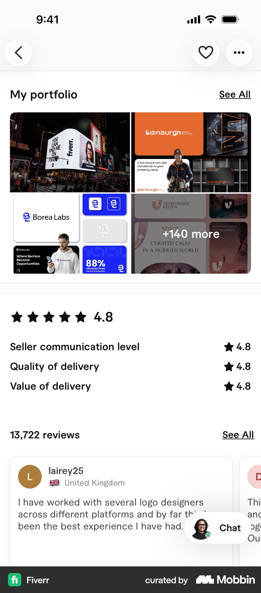

**Visible pattern:** My portfolio and See All frame a two-by-two collage; its final tile carries a +140 more overlay. Reviews follow.

**Strength:** Distinguishes a short teaser from a large archive.

**Tradeoff:** Images lack visible names; the quantity cue suits a large archive.

**Moriz application:** Compare a compact teaser with a complete three-project section. Keep names visible; do not invent counts.

### M07 Fiverr

Native iOS app reference. [Open in Mobbin](https://mobbin.com/screens/070d98e6-87bb-458b-aff0-725c9c3f11d6) · [Full screenshot](assets/mobbin-projects-2026-10-07/m07-fiverr.jpg)

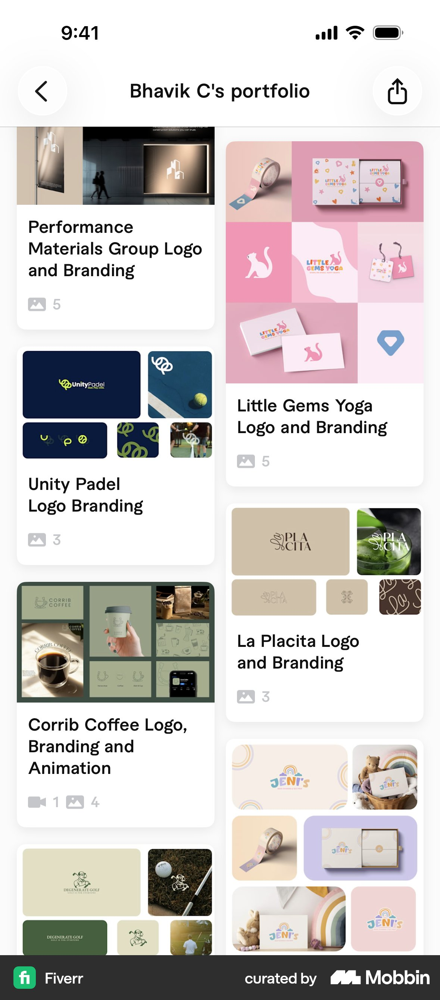

**Visible pattern:** Two uneven-height columns show project imagery, full titles and media counts under a compact portfolio header.

**Strength:** Accommodates varied image proportions.

**Tradeoff:** Uneven positions complicate scanning; some titles are long.

**Moriz application:** Compare visual variety with an ordered single column for Hebrew product descriptions.

### M08 Skillshare

Native iOS app reference. [Open in Mobbin](https://mobbin.com/screens/b48e484e-f3bb-42c0-a3ce-975b69a5aff9) · [Full screenshot](assets/mobbin-projects-2026-10-07/m08-skillshare.jpg)

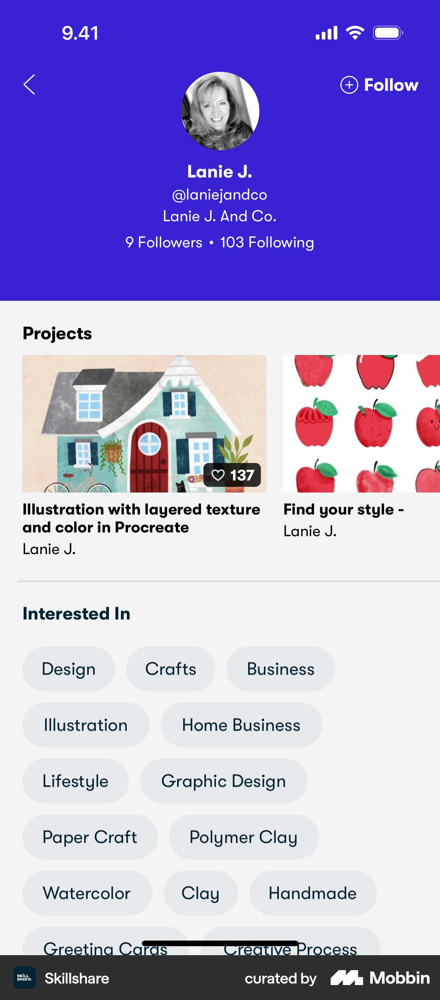

**Visible pattern:** Below the creator identity, a Projects row shows one preview card and part of another, each with a title; interest chips follow.

**Strength:** The partial next card indicates more work.

**Tradeoff:** Later projects need sideways discovery; swipe behavior is untested.

**Moriz application:** Possible secondary gallery. Keep primary projects reachable through vertical scrolling.

### M09 VSCO

Native iOS app reference. [Open in Mobbin](https://mobbin.com/screens/32d03c59-00b6-467d-93e8-41a4f54c7c0c) · [Full screenshot](assets/mobbin-projects-2026-10-07/m09-vsco.jpg)

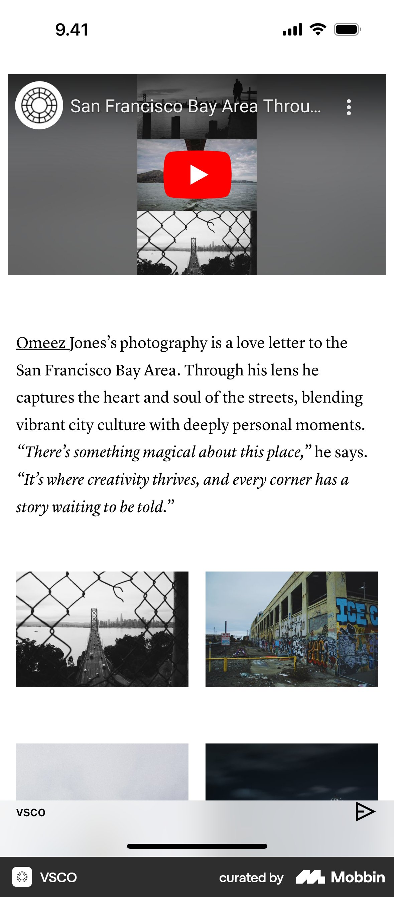

**Visible pattern:** A video preview precedes a photographer's narrative paragraph and a two-column set of photographs.

**Strength:** Pairs explanation with multiple supporting images.

**Tradeoff:** This is an editorial photography story, not a project index; it takes more space.

**Moriz application:** Useful for a featured product or future case study: overview followed by meaningful interface details.

### M10 Wabi

Native iOS app reference. [Open in Mobbin](https://mobbin.com/screens/aa92c2c0-8154-4b58-8d0d-c51579cd10b7) · [Full screenshot](assets/mobbin-projects-2026-10-07/m10-wabi.jpg)

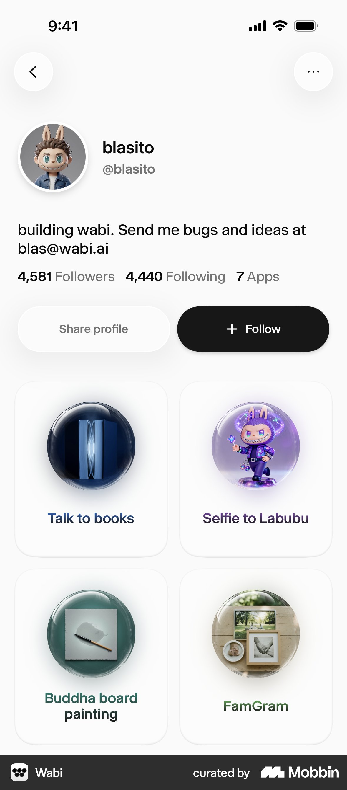

**Visible pattern:** A creator profile states an app count and shows a two-column grid of rounded cards, each with an image and short app name.

**Strength:** Keeps products visibly distinct and named.

**Tradeoff:** Icon-like images expose less interface detail; social actions are platform-specific.

**Moriz application:** Adapt clear identification with real product screenshots rather than decorative icons.

## Three directions to compare for Moriz

These are proposals for the Projects review, not selected layouts.

| Direction | Desktop proposal | Mobile proposal | Supporting references |
| --- | --- | --- | --- |
| Contextual project rows | Three substantial rows, each with a large product visual and a neighboring title, one-sentence product description and supplied contribution. | One column in document order: visual, title, product description, contribution and project action. | [basement.studio](https://mobbin.com/sites/sections/2c1653b2-e228-4044-bd56-10be54f7403c) for contextual rows; [Upwork](https://mobbin.com/screens/81a34c6e-2c3e-482d-82a1-74ad63db25d6) for descriptive project titles. |
| Expressive project grid | Unequal image sizes in a two-column composition with captions below; order chosen deliberately. | Preserve the same project order in a single column; remove the offsets and keep captions close to each image. | [Fiasco](https://mobbin.com/sites/sections/4ed7c118-a866-41fa-824c-32a24323c927), [MOUTHWASH Studio](https://mobbin.com/sites/sections/e2bc218a-3568-43c0-a95e-b95b0d829e6c) and [Fiverr masonry](https://mobbin.com/screens/070d98e6-87bb-458b-aff0-725c9c3f11d6). |
| Three clear previews | Three equal columns with one image, title and short description per project. | Stack the three previews vertically with enough space to read the product interface and description. | [Wild](https://mobbin.com/sites/sections/c18cb634-beea-4af7-8d3a-08211610a68b) and [Wabi](https://mobbin.com/screens/aa92c2c0-8154-4b58-8d0d-c51579cd10b7) for distinct named products. |

**Recommended first comparison:** contextual rows versus the expressive grid. Rows give the three products room for explanation; the grid explores the owner's recorded preference for Huncwot's project presentation. The equal-preview direction is a compact alternative. These choices need review with the real project visuals.

For a three-project homepage, keep all projects visible through ordinary vertical scrolling. Category filters, pagination, masonry, horizontal strips and archive actions become useful comparisons when the amount or shape of work warrants them. The examples do not establish a need to add those controls now.

## Project content and Hebrew layout

The [project inventory](../04-projects-and-case-studies.md) names practice ai learning system, the Haaretz project and Chabad Club. Presentation order, the final Haaretz title, roles, scope, visuals and outcomes remain to be supplied.

For each project, prepare a real primary visual, final name, one sentence explaining the product, the studio's actual contribution and the intended action. Show usage/outcome figures only when their value, definition, date and source are supplied. Decide case-study destinations before displaying case-study links.

For Hebrew, compare right-aligned descriptions, mixed Hebrew/English names and the document order of each project. Give title, description and action independent readable text rather than baking them into screenshots. Desktop columns should preserve the same project order when stacked on phones. Mobile two-column references expose more covers, but they leave less room for product explanation and readable interface detail.

The selected palette, typography, homepage sequence and floating-only WhatsApp remain the project foundations. Final project copy, composition, interaction and case-study hierarchy stay open in the [homepage workbook](../homepage-workbook.md#3-projects).

## Selection and source notes

Desktop website sections were retained only when project presentation was visible. Blank captures from OFF+BRAND, Studio Freight and Metalab were excluded. Stripe's investment portfolio, Webflow's product showcase and FLORA's customer case studies were not used to fill the studio sample.

Mobile references were narrowed to portfolios, creator projects and product galleries. Fiverr's service listings, Upwork's reorder editor, Google Drive's About document, Savee's saved board, Klima's project-photo grid and Artsy's single-artwork details were excluded. VSCO remains an explicitly adjacent editorial story reference for presenting project depth.

Search queries and canonical IDs are preserved in the manifest. All 20 assets belong to this research collection; source images were not turned into Moriz project imagery.
