# Mobbin research for homepage projects and case studies

Research date: 11 October 2026. Prepared for Moriz Studio. Scope: project presentation on the homepage and dedicated case study pages.

**Recommended direction:** retain the current stacked homepage panels as the starting point, with a readable product cover, name, one-sentence explanation, actual contribution and a visible case study link. Give the dedicated page an open narrative: overview → challenge → key decisions with supporting screens → delivered solution → documented outcome → next project.

[Fiasco](https://mobbin.com/sites/sections/4ed7c118-a866-41fa-824c-32a24323c927) supports the compact image-and-caption approach; [Koto and Lyft](https://mobbin.com/sites/sections/0e52c0f5-c6f6-40a3-be31-06a104e486a1) is the strongest direct studio reference for combining project context with large visuals. The sequence above is a proposal for Moriz, not a claim that either reference uses that entire sequence.

[Visual reference board](projects-presentation-mobbin-2026-10-11.html) · [Search and source manifest](projects-presentation-mobbin-2026-10-11.json) · [Earlier homepage alternatives and mobile captures](homepage-projects-mobbin-2026-10-10.md)

## The two surfaces have different jobs

| Surface | Visitor question | Essential content | Depth |
| --- | --- | --- | --- |
| Homepage project panel | Is this relevant to the kind of work I need? | Recognizable product visual, name, product purpose, contribution, case study link. | A short preview that remains understandable without interaction. |
| Dedicated case study | Can this studio solve a problem like mine? | Client and context, challenge, actual role, decisions, product screens, delivered solution, documented outcome. | A story with evidence, readable by scanning headings or reading closely. |
| Projects collection | What else has the studio done? | Consistent previews and direct project links. | A browsable index using the same project identities. |

The audience already recorded in [PRODUCT.md](../../PRODUCT.md) includes product managers and decision-makers at existing businesses. The suggested hierarchy helps them assess product understanding and delivery scope as well as visual quality. Its effect on enquiries remains a hypothesis.

## Current implementation and research history

The current source is newer than parts of the earlier planning documents:

- [Homepage component](../../src/components/projects-section.tsx): numbered project headers accumulate above bodies containing a description, contribution, categories and linked media. The homepage branch does **not** render the four-question accordion; the collection branch still renders an accordion.
- [Case study component](../../src/components/project-detail.tsx): title, optional headline and description, client/year, categories/services, a large cover and ordered content blocks. It ends with a return link.
- [CMS adapter](../../src/lib/cms/project-card.ts): Home uses its own image with cover fallback; the collection has a separate image with the same fallback. Short descriptions fall back to full descriptions; services supply the contribution string.
- [Content blocks](../../src/components/project-content.tsx) already support open or collapsible text, images with captions, video, paired images and galleries.

The [10 October research](homepage-projects-mobbin-2026-10-10.md) is useful for alternative compositions and existing live mobile captures. Its description of homepage rows, universal null images and four questions on Home should not be treated as verified current runtime content. This study reads the source structure; it does not inspect the live CMS records.

## Homepage recommendations

Keep the stacked panel structure for the first content trial. The strongest adaptation is better project information and a clearer route into the story.

1. **Make the product identifiable.** Use one real screen or a purposeful crop as the main cover. Choose a cover per surface through the existing CMS fields; the Home cover can be concise while the case page opens with a wider product view.
2. **Keep the explanation beside the work.** Show the name, one sentence about what the product helps people do, and the studio's actual services. Avoid making category tags carry the whole explanation. [Fiasco](https://mobbin.com/sites/sections/4ed7c118-a866-41fa-824c-32a24323c927) provides the clearest visual precedent.
3. **Expose the case study action.** The current media link has an accessible label; inspect whether it is sufficiently visible to sighted touch users. A persistent text action such as **לסיפור הפרויקט** is a proposed label, pending copy review. [OFF+BRAND](https://mobbin.com/sites/sections/0b70740a-eb7a-415b-b48d-09d66ce3ec38) demonstrates the useful distinction between case study and live-site actions.
4. **Keep the preview short.** Put detailed decisions, process evidence and outcomes on the dedicated page. If the existing four questions return to Home, keep them supplemental and preserve the basic explanation outside the disclosures.
5. **Let asset quality determine composition.** Keep all three projects visible through vertical scrolling. A feature stage like [Analogue](https://mobbin.com/sites/sections/c27f50ff-dd09-41f9-afc8-598c3ccae77a) needs a chosen lead project; an index like [Raw Materials](https://mobbin.com/sites/sections/88014607-d7fa-4793-a09b-de483fe6c931) is an alternative when visual assets are insufficient.

Avoid adding filters, view switches or a carousel for three projects. This is a scope and discoverability judgment, not a measured finding about those controls.

## Proposed case study sequence

| Order | Section | What it should establish | Existing capability |
| --- | --- | --- | --- |
| 1 | Project overview | Project name, a useful one-line summary, client, year and actual services; role boundaries where needed. | Title, headline, descriptions, client/year, services and categories. |
| 2 | Main product visual | What was delivered and what kind of interface it is. | Case cover. |
| 3 | Context and challenge | Who needed the product, what they needed to accomplish, and the constraint that made it difficult. | Open text block. |
| 4 | Key decisions | Two or three meaningful decisions, each explained beside a real supporting screen or artifact. | Text, image/caption, paired images or gallery. |
| 5 | Delivered experience | A coherent view of the main user flow and responsive screens where relevant. | Images or short video with poster and visible controls. |
| 6 | Outcome | Documented usage, business evidence, client feedback or a precise account of what shipped. | Open text and supporting images; an approved quote can be text. |
| 7 | Continue browsing | Next project and back to all projects, with a clear contact route. | Back to Home exists; next-project and collection navigation would need a later UI change. |

[Koto and Lyft](https://mobbin.com/sites/sections/0e52c0f5-c6f6-40a3-be31-06a104e486a1) supports a context column beside generous imagery. [ClickUp](https://mobbin.com/sites/sections/a83266aa-57d8-4877-9a0a-c830a6488d9b) supports a compact challenge/solution/outcome summary. [Stripe](https://mobbin.com/sites/sections/019cfa66-d01d-4a4b-ae77-d99f65391966) demonstrates a problem paired with the interface that addresses it.

Use open headings and short text for the main story. Reserve accordions for optional technical detail or extra process material. Lead with the useful decisions and their consequences rather than a generic list of design methods. These are editorial recommendations; this sample does not establish that accordions reduce conversion.

An outcome does not have to be numerical. State what shipped and the evidence available. Numerical claims need a source, definition, measurement period and baseline where applicable. A client quote needs attribution and permission to publish. The [Vanta](https://mobbin.com/sites/sections/8c361668-0512-4caf-93eb-ba229eddcec3) and [Dropbox Paper](https://mobbin.com/sites/sections/c8b92330-0ff0-4c52-9d02-d7396c5b5b06) examples show evidence presentation, not results that Moriz can claim.

## Mobile and Hebrew recommendations

These are proposed adaptations, not newly tested responsive behavior:

- Home: project name and short explanation → main visual → contribution and case study action. Preserve one meaningful reading order when the desktop columns collapse.
- Case study: overview → cover → story sections with their supporting media. Convert any side context column to inline content; avoid a tall fixed navigation that consumes the phone viewport.
- Keep critical interface details readable. Show a full screen for context, then an enlarged crop for the decision being discussed. Do not shrink multiple desktop screens into a phone-width collage.
- Use real text outside images for Hebrew headings and captions. Isolate mixed Latin names and numbers as the current title components already do with `bdi`; use logical alignment and review arrow direction.
- Verify the accumulating homepage headers at narrow widths and larger text sizes. They must not consume most of the viewport or cover the current project's action.
- Keep video supplementary, with a still image and explanatory text. Respect reduced motion and make links discoverable through keyboard focus and touch.

The earlier [mobile captures](homepage-projects-mobbin-2026-10-10.md#live-mobile-findings-new) are dated 10 October. No fresh mobile websites or physical devices were tested in this study.

## Content needed for each project

The inventory currently names practice ai learning system, הארץ — וורדעל and Chabad Club. Selection and final order remain an owner decision according to the [project inventory](../04-projects-and-case-studies.md).

Prepare a minimum useful case study package per project:

- Final name, product purpose, client and the studio's exact role and services.
- One deliberate Home cover, one case cover, and approximately three to five supporting real screens or artifacts. This is a proposed working range, not a publishing requirement.
- A concise challenge and two or three decisions with enough context to explain why they mattered.
- A precise delivery statement; results and a client quote only when supported and approved.
- Accurate alternative text and a short caption explaining each visual's role in the story.

Use the real owner material to decide which project can carry the richest story. Do not invent product goals, research activity, team roles, usage figures or launch results from project names.

## Research method and evidence limits

Eleven Mobbin searches returned 46 result placements representing 40 unique references. Every returned preview was examined; 14 references were retained and downloaded from the full-resolution image URLs. The [manifest](projects-presentation-mobbin-2026-10-11.json) preserves exact queries, IDs, canonical links, local files and selection notes.

The homepage group contains studio work previews and collection patterns. The case group contains one direct studio case view, customer-story sections, embedded customer modules and an explicitly labelled testimonial module. These are not 14 complete case studies. Blank captures, private project-management interfaces, portfolio editing views and generated demo portfolios were excluded. Huncwot was not returned by the targeted Mobbin search; the existing live research remains the reference for that owner preference.

Mobbin retrieval date is not the original capture date. Still images do not verify scrolling, stickiness, hover, transitions, video playback, keyboard behavior, accessibility or performance. This is a visual precedent study, not customer interviews or usability testing.

| Conclusion | Confidence and basis |
| --- | --- |
| Pair project visuals with understandable context. | High confidence that this is a recurring visible pattern across independent sites in the retained sample. Business effectiveness is unmeasured. |
| Keep Home concise and give the case page narrative depth. | Medium confidence as an editorial recommendation supported by preview and story patterns; not a tested Moriz funnel. |
| Retain the current stacked panels for the initial trial. | Medium confidence based on the current source and project context. Requires review with real content and mobile rendering. |
| This direction will improve enquiries. | Unvalidated. The research supplies no conversion evidence. |

## Reference library

The observations below describe visible content. Adaptations and cautions are design assessments. Every image links back to its canonical Mobbin reference.

### Fiasco

**Context:** Selected work section. [Open in Mobbin](https://mobbin.com/sites/sections/4ed7c118-a866-41fa-824c-32a24323c927) · [Local full-resolution image](assets/projects-presentation-2026-10-11/home-fiasco.webp)

[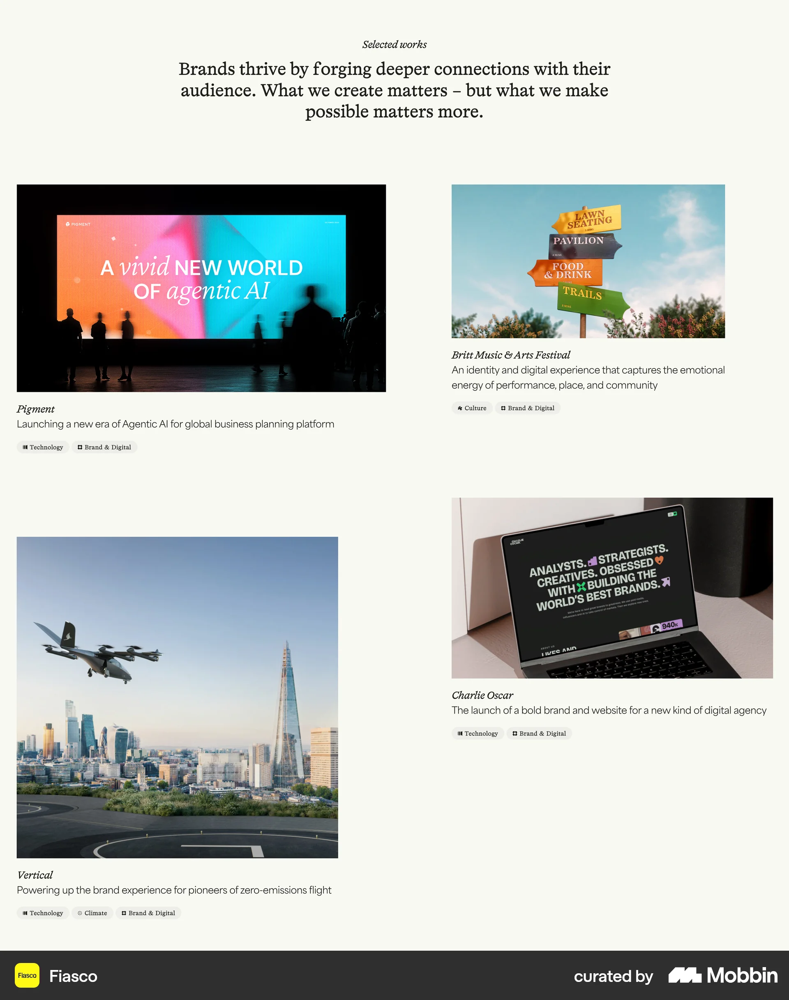](https://mobbin.com/sites/sections/4ed7c118-a866-41fa-824c-32a24323c927)

**Visible pattern:** Unequal image sizes form a staggered two-column composition. Names, brief explanations and discipline labels stay beside each visual.

**Adaptation for Moriz:** Keep a one-sentence product explanation with every cover. Visual variety can come from image scale while the text structure stays consistent.

**Caution:** Offsets can lengthen the section and complicate reading order. Replacing the current stacked panels is a separate design choice.

### Cloudstudio

**Context:** Selected work section. [Open in Mobbin](https://mobbin.com/sites/sections/48890788-7d16-4887-baaa-5b22583ef055) · [Local full-resolution image](assets/projects-presentation-2026-10-11/home-cloudstudio.webp)

[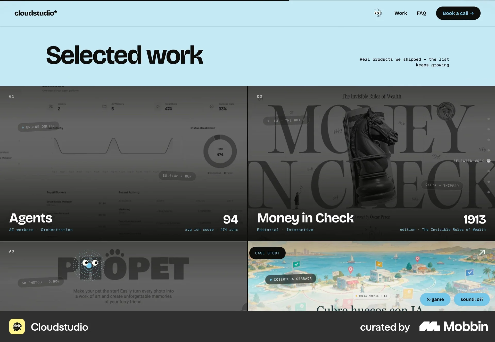](https://mobbin.com/sites/sections/48890788-7d16-4887-baaa-5b22583ef055)

**Visible pattern:** A large Selected work heading precedes adjacent interface tiles with names and small metadata over the lower edge.

**Adaptation for Moriz:** Use actual interface imagery so visitors can identify the kind of product before opening the project.

**Caution:** The dark treatment obscures UI details. Keep essential names and descriptions outside busy images.

### OFF+BRAND

**Context:** Client project cards. [Open in Mobbin](https://mobbin.com/sites/sections/0b70740a-eb7a-415b-b48d-09d66ce3ec38) · [Local full-resolution image](assets/projects-presentation-2026-10-11/home-offbrand.webp)

[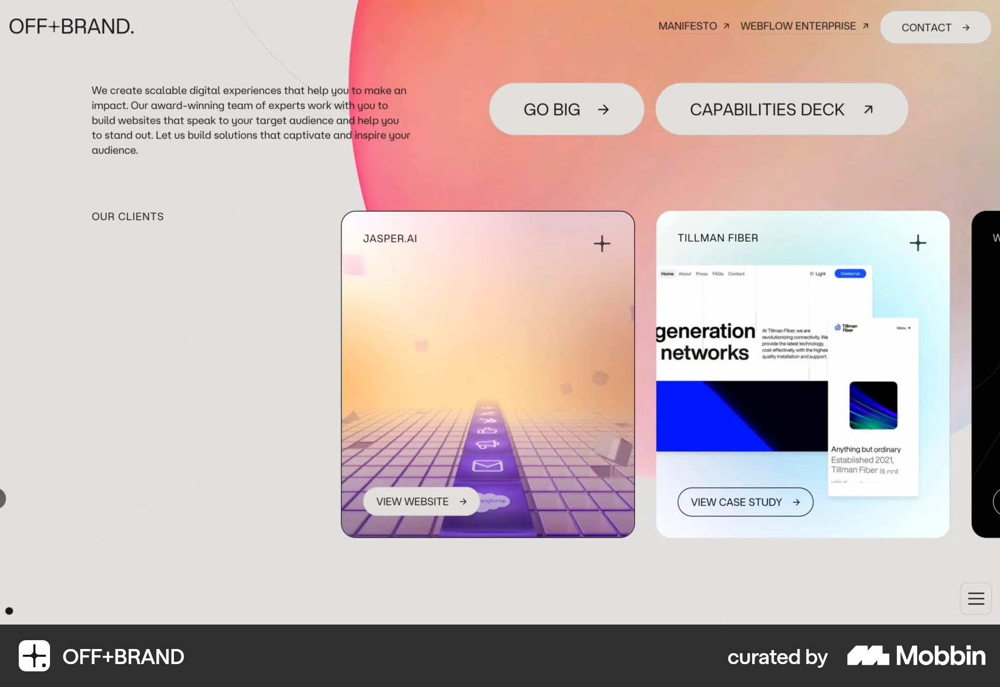](https://mobbin.com/sites/sections/0b70740a-eb7a-415b-b48d-09d66ce3ec38)

**Visible pattern:** Named cards contain a project preview and a visible action. One says View website and another says View case study.

**Adaptation for Moriz:** Distinguish opening the studio's case study from visiting the client's live product. Use precise action labels.

**Caution:** The horizontal row leaves later cards partly outside the viewport. Keep all three Moriz projects discoverable through vertical scrolling.

### Instrument

**Context:** Work collection section. [Open in Mobbin](https://mobbin.com/sites/sections/05811dd7-a07a-41ae-9fa7-192b8eede1b1) · [Local full-resolution image](assets/projects-presentation-2026-10-11/home-instrument.webp)

**Visible pattern:** A large statement sits over an asymmetric project pairing. The smaller project includes a client name, explanation and discipline label; Stack and Grid controls are visible.

**Adaptation for Moriz:** Give a project a prominent visual and preserve a useful caption. Deliberate scale can communicate priority once a lead project is chosen.

**Caution:** This is a collection reference, not proof of homepage behavior. Filters and layout switches would add little to three projects.

### Raw Materials

**Context:** Work index section. [Open in Mobbin](https://mobbin.com/sites/sections/88014607-d7fa-4793-a09b-de483fe6c931) · [Local full-resolution image](assets/projects-presentation-2026-10-11/home-raw-materials.webp)

[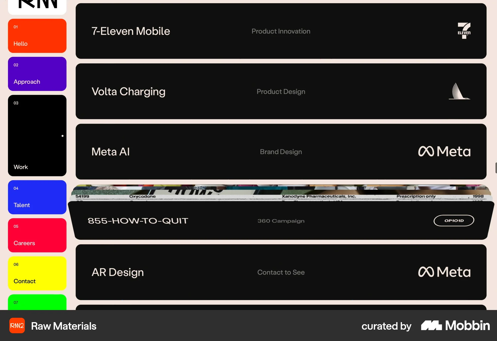](https://mobbin.com/sites/sections/88014607-d7fa-4793-a09b-de483fe6c931)

**Visible pattern:** Dark horizontal rows pair client or project names with discipline labels and marks. One row includes a narrow band of imagery.

**Adaptation for Moriz:** An index can explain scope with very little imagery. It is a credible fallback while real visual assets are being prepared.

**Caution:** Most work is not pictured in the capture. Hover, expansion and transitions cannot be inferred from the still.

### Analogue Agency

**Context:** Featured case teaser. [Open in Mobbin](https://mobbin.com/sites/sections/c27f50ff-dd09-41f9-afc8-598c3ccae77a) · [Local full-resolution image](assets/projects-presentation-2026-10-11/home-analogue.webp)

[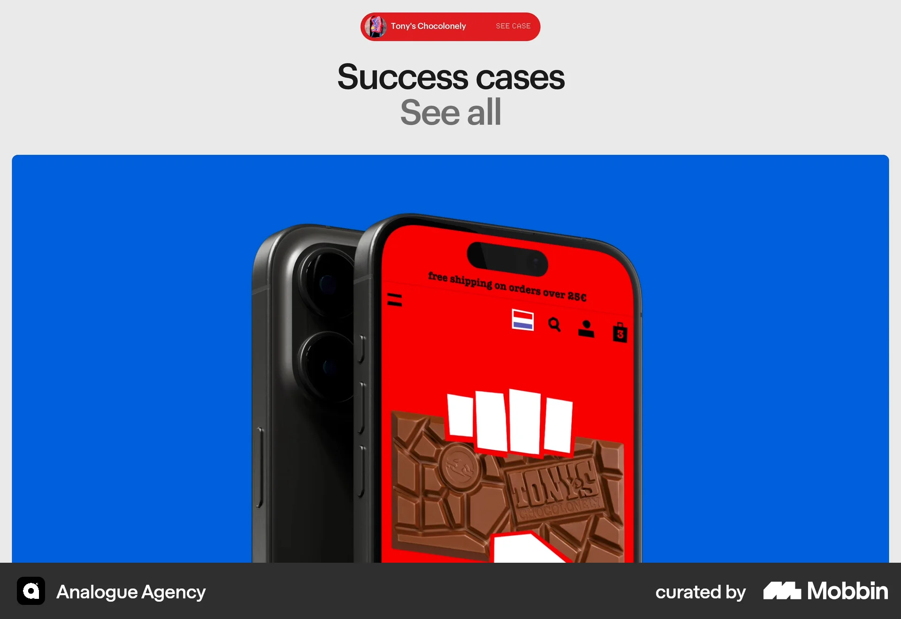](https://mobbin.com/sites/sections/c27f50ff-dd09-41f9-afc8-598c3ccae77a)

**Visible pattern:** A Success cases heading and case action sit above a large device visual. One project dominates the section.

**Adaptation for Moriz:** A single readable screen can be a stronger cover than a collage of many tiny screens.

**Caution:** A featured stage requires a deliberate lead project and strong assets. The still does not establish carousel behavior.

### Koto and Lyft

**Context:** Direct studio case study. [Open in Mobbin](https://mobbin.com/sites/sections/0e52c0f5-c6f6-40a3-be31-06a104e486a1) · [Local full-resolution image](assets/projects-presentation-2026-10-11/case-koto-lyft.webp)

[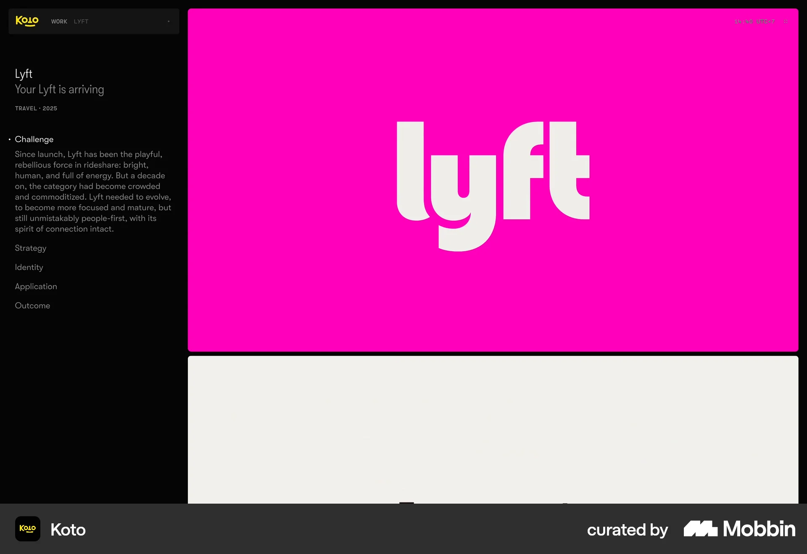](https://mobbin.com/sites/sections/0e52c0f5-c6f6-40a3-be31-06a104e486a1)

**Visible pattern:** A narrow left column names the project, shows a short positioning line and a Challenge paragraph, then lists Strategy, Identity, Application and Outcome. Large branded imagery fills the right column.

**Adaptation for Moriz:** Combine an immediately visible explanation with generous project imagery. Use named narrative sections to explain the studio's decisions.

**Caution:** The capture shows one part of a branding case study. Sticky navigation and section interactions are unverified; it does not establish a complete UX process.

### ClickUp and STANLEY Security

**Context:** Adjacent customer story. [Open in Mobbin](https://mobbin.com/sites/sections/a83266aa-57d8-4877-9a0a-c830a6488d9b) · [Local full-resolution image](assets/projects-presentation-2026-10-11/case-clickup.webp)

[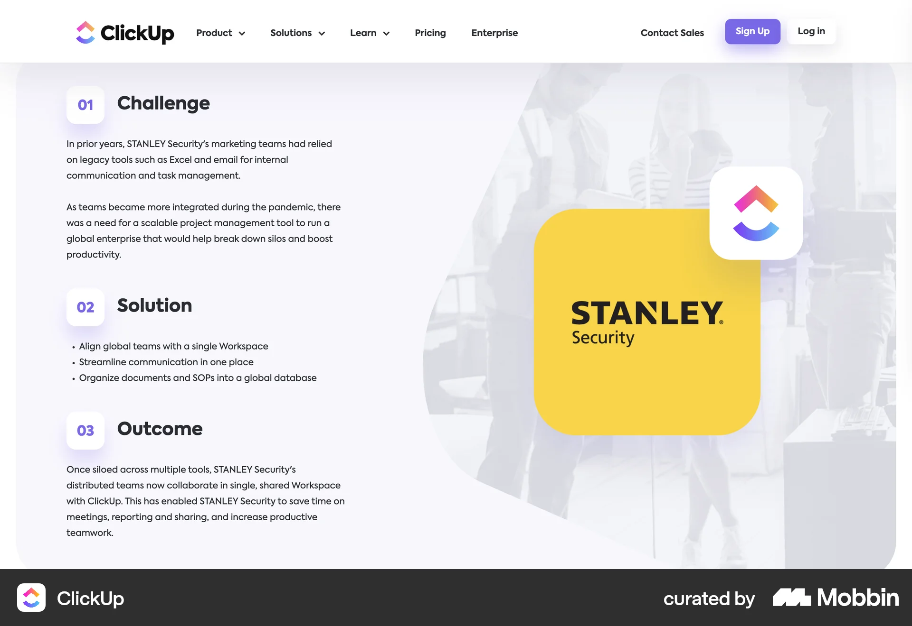](https://mobbin.com/sites/sections/a83266aa-57d8-4877-9a0a-c830a6488d9b)

**Visible pattern:** Three numbered text groups label Challenge, Solution and Outcome. The solution is presented as a short list beside a large client graphic.

**Adaptation for Moriz:** Use a compact narrative summary so readers can understand the problem, intervention and change before reading the full story.

**Caution:** A SaaS customer story explains product adoption. Moriz still needs to identify its own design and development contribution.

### Dropbox Paper and Designit

**Context:** Adjacent customer story. [Open in Mobbin](https://mobbin.com/sites/sections/c8b92330-0ff0-4c52-9d02-d7396c5b5b06) · [Local full-resolution image](assets/projects-presentation-2026-10-11/case-dropbox-paper.webp)

[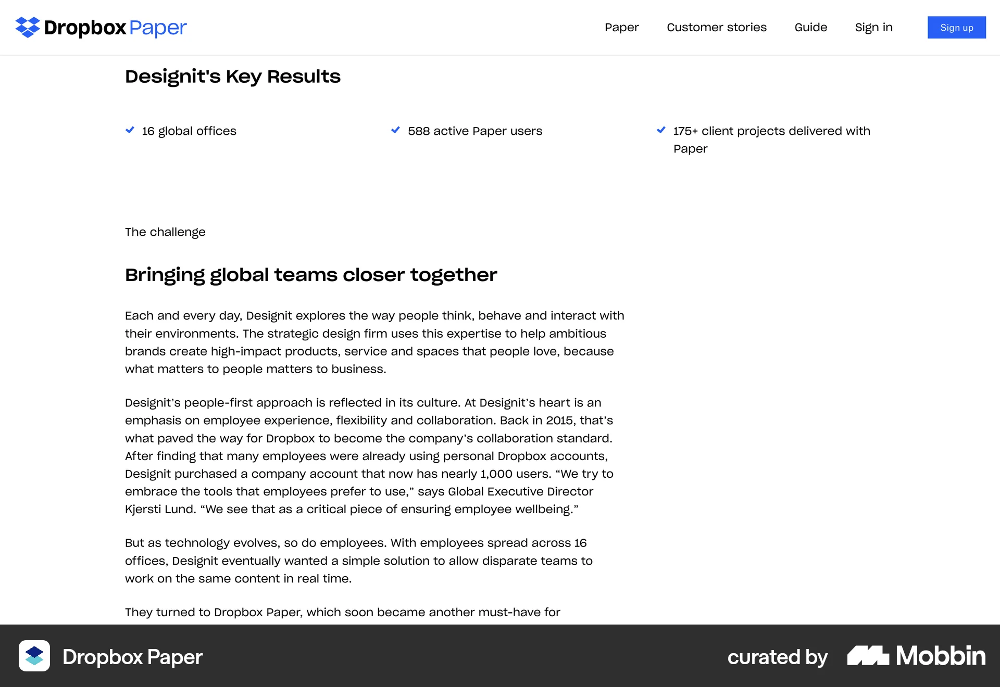](https://mobbin.com/sites/sections/c8b92330-0ff0-4c52-9d02-d7396c5b5b06)

**Visible pattern:** A row of three labelled results precedes a challenge heading and a narrow editorial text column.

**Adaptation for Moriz:** Give evidence labels and context, then make the story comfortable to read. Reuse a narrow text measure between wider media sections.

**Caution:** The source's statistics describe its customer. Moriz has no supplied equivalent figures; omit a results strip until evidence exists.

### Mural and Officeworks

**Context:** Adjacent customer story. [Open in Mobbin](https://mobbin.com/sites/sections/e9b28b7a-1ac7-47fe-95ab-d4be76ff58df) · [Local full-resolution image](assets/projects-presentation-2026-10-11/case-mural.webp)

[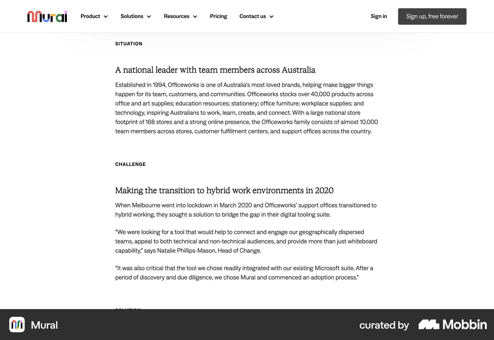](https://mobbin.com/sites/sections/e9b28b7a-1ac7-47fe-95ab-d4be76ff58df)

**Visible pattern:** A single editorial column separates Situation and Challenge with clear headings, short paragraphs and attributed quotations.

**Adaptation for Moriz:** Separate business context from the specific user or operational problem. Make quoted evidence attributable.

**Caution:** Long narrative passages need supporting product visuals in a studio case study. This capture does not show a complete page.

### Vanta and SmartRecruiters

**Context:** Adjacent customer story hero. [Open in Mobbin](https://mobbin.com/sites/sections/8c361668-0512-4caf-93eb-ba229eddcec3) · [Local full-resolution image](assets/projects-presentation-2026-10-11/case-vanta.webp)

[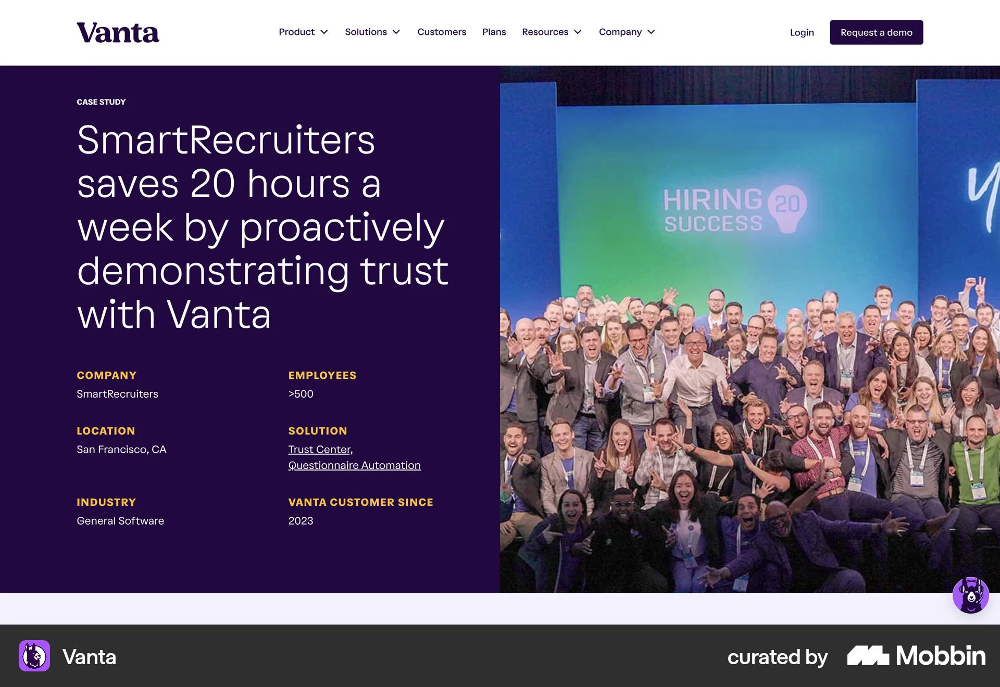](https://mobbin.com/sites/sections/8c361668-0512-4caf-93eb-ba229eddcec3)

**Visible pattern:** A large outcome statement sits beside a team photograph. A facts grid identifies the company, location, industry and solution.

**Adaptation for Moriz:** Orient readers immediately with the client, product purpose and actual scope. An outcome headline is useful when documented.

**Caution:** Employee counts and customer tenure are SaaS sales facts. For Moriz, use role, services and year only when relevant and supplied.

### Stripe and Lyft

**Context:** Adjacent embedded case module. [Open in Mobbin](https://mobbin.com/sites/sections/019cfa66-d01d-4a4b-ae77-d99f65391966) · [Local full-resolution image](assets/projects-presentation-2026-10-11/case-stripe.webp)

[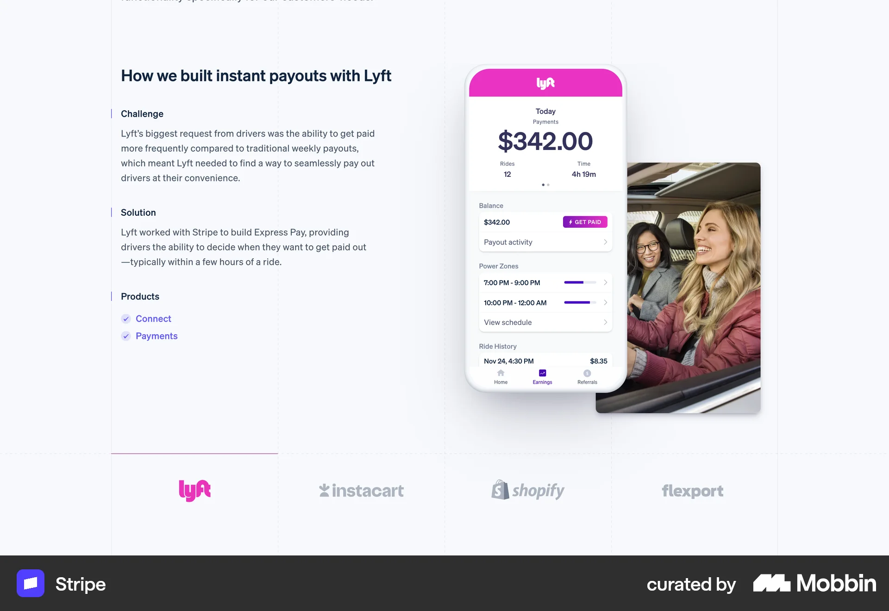](https://mobbin.com/sites/sections/019cfa66-d01d-4a4b-ae77-d99f65391966)

**Visible pattern:** Challenge and Solution text sit beside a phone interface and a usage-context photograph; product links and customer tabs follow.

**Adaptation for Moriz:** Pair a specific problem with the interface that answers it. A short caption should explain which design decision the screenshot demonstrates.

**Caution:** This is a customer case module, not an individual studio case page. Do not copy the customer tabs into a three-project case study.

### Stripe and Lyft

**Context:** Adjacent embedded case module. [Open in Mobbin](https://mobbin.com/sites/sections/362971b8-a13e-4f3a-8fd7-eeb8638c8742) · [Local full-resolution image](assets/projects-presentation-2026-10-11/case-stripe-impact.webp)

[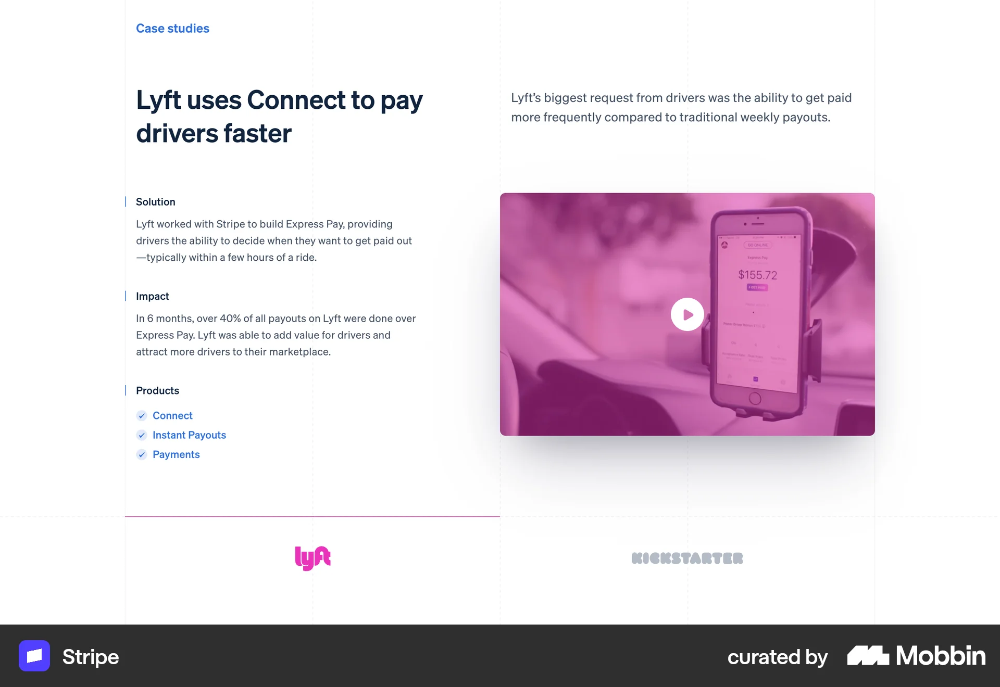](https://mobbin.com/sites/sections/362971b8-a13e-4f3a-8fd7-eeb8638c8742)

**Visible pattern:** A customer-specific title leads into Solution and Impact text alongside a video poster and product links.

**Adaptation for Moriz:** Place outcome evidence close to the solution it evaluates. Provide a readable still and explanation when a video is optional.

**Caution:** The visible percentage and time window belong to Stripe's customer story. They are not evidence about Moriz or the effectiveness of this layout.

### Koto client testimony

**Context:** Studio testimonial beside case teaser. [Open in Mobbin](https://mobbin.com/sites/sections/236ebdda-2aa3-483b-ab5f-4cf9bc702095) · [Local full-resolution image](assets/projects-presentation-2026-10-11/case-koto-quote.webp)

[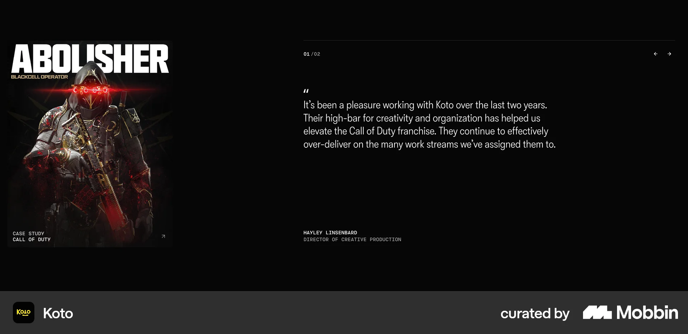](https://mobbin.com/sites/sections/236ebdda-2aa3-483b-ab5f-4cf9bc702095)

**Visible pattern:** A project teaser sits beside a prominent quote, with the speaker's name and creative-production role below. Small previous and next controls are visible.

**Adaptation for Moriz:** Keep an approved client quote connected to the project it describes. Include the person's name and role.

**Caution:** This is a testimonial module beside a case link, not the case study body. Do not assume carousel timing or reproduce the source quote.
