# Mobbin research for the moriz.ai side chatbot

Research date: 12 October 2026. Prepared for Moriz Studio. Scope: the floating "moriz.ai" launcher and the chat surface it opens on every public page.

**Recommended direction:** replace the small one-question box with a full-height side drawer that speaks as Mor.
- **Persona.** Mor's photo is the launcher, the header identity, and the face beside every answer. [Delphi](https://mobbin.com/screens/99e9fbbc-9af0-4b2c-967e-01b9df3fb4ea) is the closest precedent: a personal AI clone fronted by a real person's photo.
- **Empty state.** A greeting, one line about what can be asked, and 3–4 suggested questions, following [Resend Help](https://mobbin.com/screens/27ace4ea-bb61-4141-b7aa-ae5551b66dfd) and [Origin](https://mobbin.com/screens/60faab58-185e-49fb-b554-8fcde9e15e67).
- **Conversation.** Real follow-ups in a thread.
- **Gradient.** A soft, slow brand gradient, inspired by [Jobber](https://mobbin.com/screens/6e4ec3e6-b5c6-452e-9258-82bd3b2b079d) and [Cleo](https://mobbin.com/screens/81550181-2282-4421-97d6-0d93e2d86349). It goes on the input ring and in the empty-state background, never behind text.

[Visual reference board](side-chatbot-mobbin-2026-10-12.html) · [Search and source manifest](side-chatbot-mobbin-2026-10-12.json)

## Current implementation

- [Floating actions](../../src/components/floating-actions.tsx) shows a yellow "moriz.ai" pill (sparkle glyph) above the WhatsApp pill. Both sit in the inline-end corner, which is lower-left in RTL.
  - The pill opens a 22rem box headed "לא מצאת תשובה?".
  - The box has no maximum height, shadow or motion.
- [Ask AI form](../../src/components/ask-ai-form.tsx) handles one question and one answer.
  - Each submit replaces the previous result.
  - The question is not echoed back, and there are no bubbles, avatars, suggestions or loading animation beyond a button label.
- [API route](../../src/app/api/ai/ask/route.ts) answers a single question from the Supabase `ai_knowledge` rows through Kimi in JSON mode. It has no conversation memory and no streaming.

The current surface works, but it reads like a form field rather than a conversation with Mor.

## Patterns that recur in the sample

| Pattern | Seen in | Use for moriz.ai |
| --- | --- | --- |
| Full-height panel docked to one edge while the page stays visible | HoneyBook, HubSpot, Linear (compact variant) | A side drawer on the pills' edge, non-modal on desktop so visitors can keep reading |
| A real person's photo as the assistant identity | Delphi, Bond, Aboard | Mor's photo on the launcher, in the header and beside answers |
| Greeting plus example questions in the empty state | Resend, Origin, Deel, Otter, Base44 | Four suggested questions built from the live knowledge topics |
| Avatar beside the assistant's bubble only | Resend, Zendesk, Aboard | The avatar on answers. Visitor bubbles stay plain and differ by colour and alignment |
| Visible "thinking" state inside the thread | Resend ("Analyzing") | Dots in an answer bubble with Mor's avatar |
| Gradient glow on the input or background | Jobber, Cleo | A slow brand-gradient ring on the composer and soft blobs in the empty state |

## Recommendations

1. **Make it a side drawer, not a popover.**
   - Full height, about 26rem wide, docked on the same edge as the pills.
   - On desktop it should not block the page, as HoneyBook's panel doesn't. On phones it becomes a full-screen sheet.
   - The panel keeps the thread when it is closed and reopened.
2. **Lead with Mor.**
   - The launcher shows Mor's photo with "Ask moriz.ai".
   - The header repeats the photo with a slowly turning gradient ring, the "moriz.ai" name and a short subtitle.
   - Answers carry a small avatar. [Delphi](https://mobbin.com/screens/99e9fbbc-9af0-4b2c-967e-01b9df3fb4ea) shows how strongly a face signals "this is me answering".
3. **Never open on a blank field.** Show the greeting, one intro line and four suggested questions taken from the live knowledge rows: pricing, process, services, and who it suits. Tapping a question sends it.
4. **Show progress.** Echo the visitor's question as a bubble straight away, show thinking dots with Mor's avatar, then reveal the answer word by word. The answer itself arrives as one JSON response.
5. **Animate the input placeholder.** Type "אפשר לשאול כל שאלה…" letter by letter while the field is empty, and show it static under reduced motion.
6. **Keep motion gentle and on-brand.** Use red `#fb2c36` and yellow `#dddc8c` at low opacity, on slow 20–30s loops. Never put them behind body text at a strength that hurts contrast.
7. **Keep the WhatsApp exit.** When the knowledge base has no answer, put the WhatsApp button inside the answer bubble, as today's fallback does.

## Mobile and Hebrew

- Below about 640px the drawer fills the screen with a safe-area-padded composer. This follows the Bond, Jobber and Otter sheets.
- Suggested questions sit above the composer on mobile, as in Bond and Cleo, so they stay within thumb reach.
- In RTL, visitor bubbles align right and answers align left beside the avatar. The send arrow must be mirrored.
- Copy speaks as Mor in feminine first person and addresses visitors in the plural, matching the knowledge rows.
- **Known mismatch:** the system prompt still describes "Mor's studio" in the third person.

## Research method and evidence limits

Five Mobbin searches returned 54 result placements:
- three web screen searches for a side panel, a floating widget and a right-edge drawer with avatars;
- one web search for an avatar launcher;
- one iOS search for a chat sheet with chips.

Every preview was examined. Fifteen references were kept and downloaded at full resolution.

Full-page AI apps with sidebars were used only for empty-state and suggestion patterns, not layout. These include Claude, ChatGPT, Notion, Writer and Devin.

The stills do not show slide-in motion, typing animations or gradient movement. Those recommendations are design judgments, not observed behaviour. No usability testing was done.

| Conclusion | Confidence and basis |
| --- | --- |
| Suggested questions in the empty state | High: recurs across most assistant surfaces in the sample. |
| A person's photo as assistant identity | Medium: clear in Delphi, Bond and Aboard; rarer in product assistants, which use logos. |
| Non-modal side drawer on desktop | Medium: HoneyBook and HubSpot dock without blocking. Linear uses a smaller floating card. |
| The redesign will increase enquiries | Unvalidated. |

## Reference library

Observations describe visible content. Adaptations and cautions are design assessments.

### HoneyBook

**Context:** AI assistant docked over the dashboard. [Open in Mobbin](https://mobbin.com/screens/bd3369e2-8dce-4335-bd24-144c0d85b356) · [Local image](assets/side-chatbot-2026-10-12/drawer-honeybook.webp)

[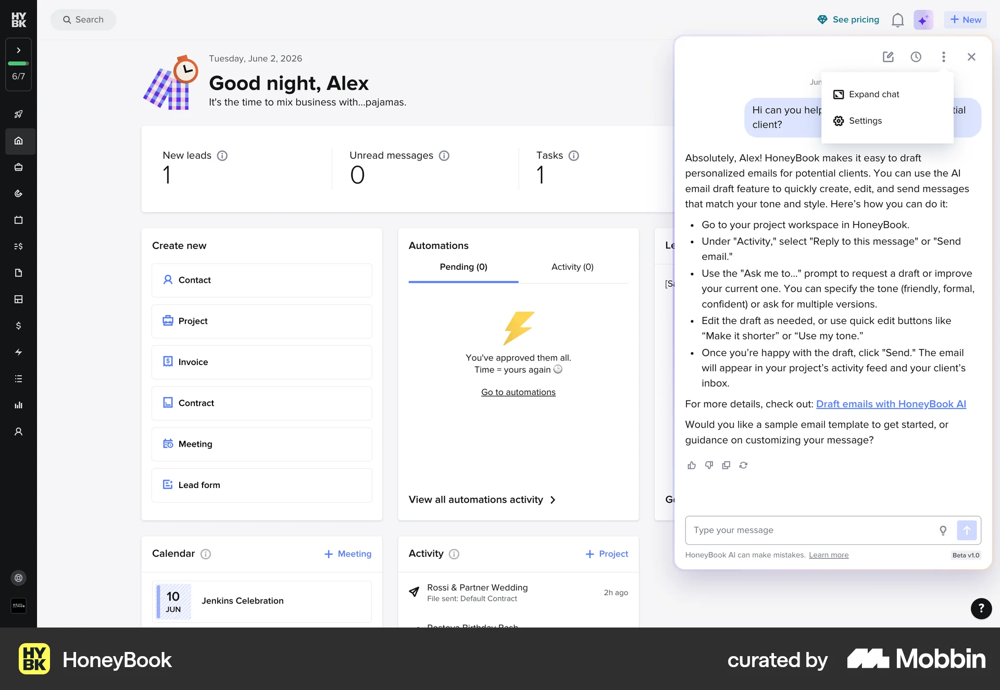](https://mobbin.com/screens/bd3369e2-8dce-4335-bd24-144c0d85b356)

**Visible pattern:** A rounded, nearly full-height panel floats over the right edge with a small gap. It has a header with history, expand and close icons, a long answer, feedback icons and the composer pinned at the bottom. The page behind stays visible.

**Adaptation for Moriz:** The core drawer shape: inset from the viewport, rounded, non-modal, with the composer pinned to the bottom.

**Caution:** It is dense for a marketing site. Keep the header to identity and close.

### Linear

**Context:** Compact "Ask Linear" panel. [Open in Mobbin](https://mobbin.com/screens/51c2bd60-f22d-4879-8c28-c5800ac1f4b6) · [Local image](assets/side-chatbot-2026-10-12/drawer-linear.webp)

[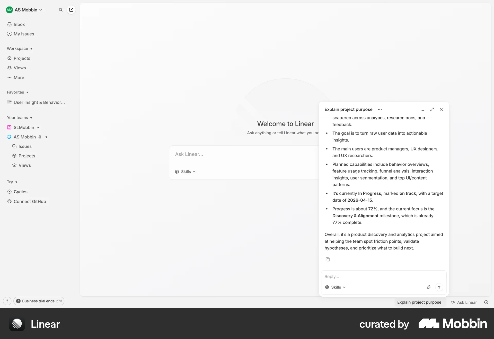](https://mobbin.com/screens/51c2bd60-f22d-4879-8c28-c5800ac1f4b6)

**Visible pattern:** A floating card in the lower-right with minimise, expand and close controls, and a reply field at the bottom.

**Adaptation for Moriz:** Confirms that a corner-anchored panel can coexist with the page.

**Caution:** The card is shorter than Mor wants. The drawer should use the full height.

### HubSpot

**Context:** Agent preview drawer. [Open in Mobbin](https://mobbin.com/screens/2421e56a-c26b-4e1a-85fa-5645153c6b86) · [Local image](assets/side-chatbot-2026-10-12/drawer-hubspot.webp)

**Visible pattern:** A full-height right drawer with a coloured header band. Every message shows an avatar and a name, with sources listed under the answer.

**Adaptation for Moriz:** Full-height docking and a strong header.

**Caution:** Avatars on both sides add noise. Keep avatars on answers only, as decided.

### Zendesk

**Context:** Web messaging widget. [Open in Mobbin](https://mobbin.com/screens/da27ab97-e2c3-4543-999b-dd09496e552b) · [Local image](assets/side-chatbot-2026-10-12/drawer-zendesk.webp)

[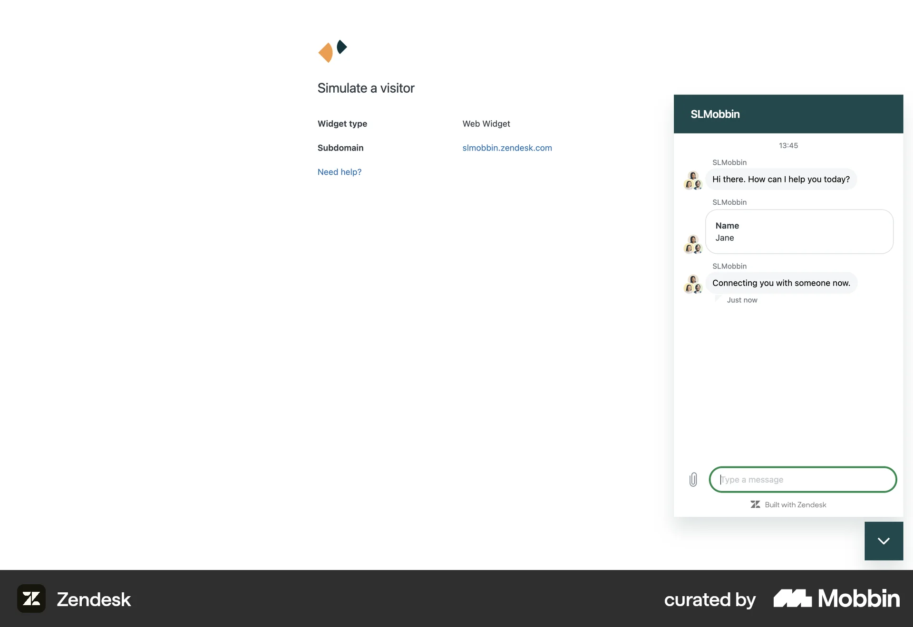](https://mobbin.com/screens/da27ab97-e2c3-4543-999b-dd09496e552b)

**Visible pattern:** A classic widget above a square launcher. Each bot bubble has an avatar, with a timestamp at the top and a focused input ring.

**Adaptation for Moriz:** A small avatar beside each answer bubble.

**Caution:** This is a generic support look. Moriz needs its own identity: photo, type and gradient.

### Delphi

**Context:** Personal AI clone conversation. [Open in Mobbin](https://mobbin.com/screens/99e9fbbc-9af0-4b2c-967e-01b9df3fb4ea) · [Local image](assets/side-chatbot-2026-10-12/persona-delphi.webp)

[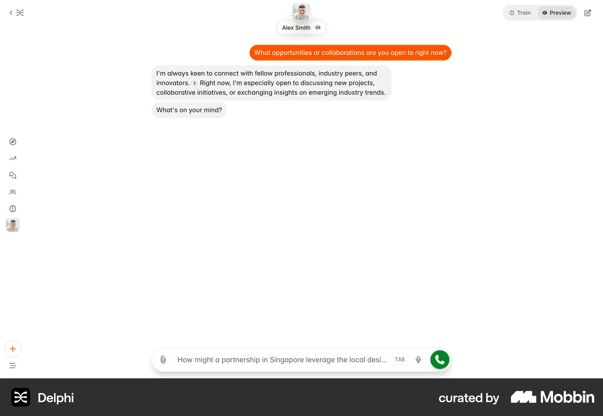](https://mobbin.com/screens/99e9fbbc-9af0-4b2c-967e-01b9df3fb4ea)

**Visible pattern:** A real person's photo and name sit at the top. Visitor messages are in a bold orange bubble, and answers are in soft grey bubbles written in the first person.

**Adaptation for Moriz:** The closest analogue to moriz.ai: Mor's face in the header and a strongly coloured visitor bubble (brand yellow).

**Caution:** It only works if answers really sound like Mor. That needs the first-person prompt tweak.

### Aboard

**Context:** Onboarding chat panel. [Open in Mobbin](https://mobbin.com/screens/304bebf4-8055-4ada-883b-24e938686783) · [Local image](assets/side-chatbot-2026-10-12/persona-aboard.webp)

[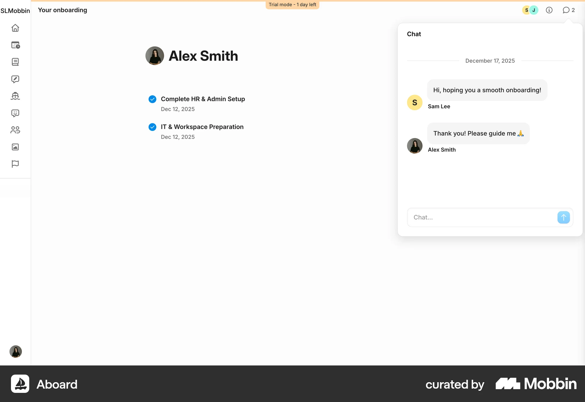](https://mobbin.com/screens/304bebf4-8055-4ada-883b-24e938686783)

**Visible pattern:** A popover chat where a portrait photo sits beside a person's bubble and a lettered avatar marks the other side.

**Adaptation for Moriz:** A small round portrait reads well beside a bubble at about 28–32px.

**Caution:** Use a well-cropped head, not the full cutout.

### Resend Help

**Context:** AI help with example questions. [Open in Mobbin](https://mobbin.com/screens/27ace4ea-bb61-4141-b7aa-ae5551b66dfd) · [Local image](assets/side-chatbot-2026-10-12/persona-resend.webp)

[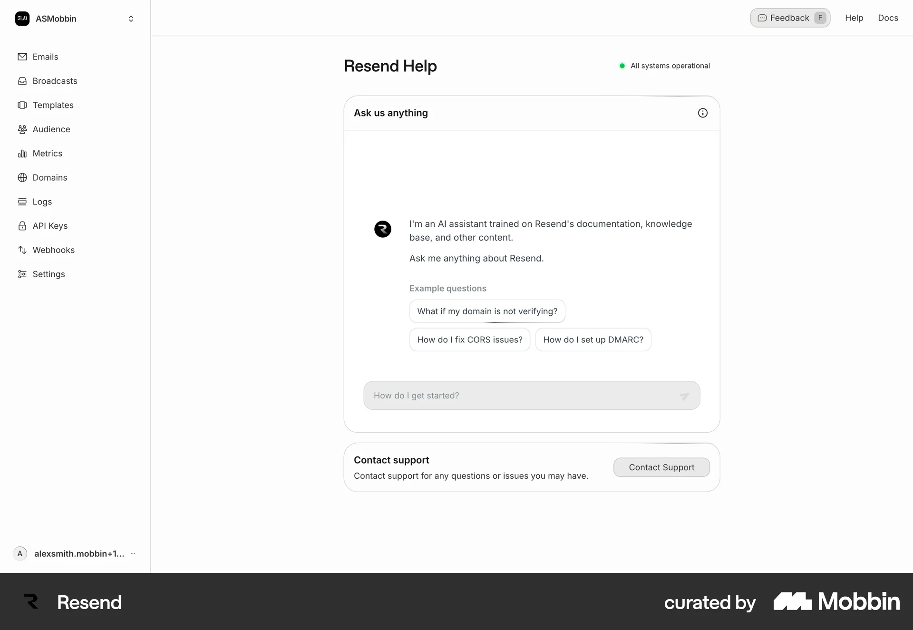](https://mobbin.com/screens/27ace4ea-bb61-4141-b7aa-ae5551b66dfd)

**Visible pattern:** The assistant's mark sits beside a two-line introduction ("I'm an AI assistant trained on…"), followed by "Example questions" chips and the input below.

**Adaptation for Moriz:** The empty-state recipe: avatar, intro, chips.

**Caution:** Keep the intro honest about the scope: answers come from Mor's own information.

### Resend Help: thinking

**Context:** The same assistant while it works. [Open in Mobbin](https://mobbin.com/screens/df37df16-1c1f-4af0-97b4-9fc8c1209b2e) · [Local image](assets/side-chatbot-2026-10-12/persona-resend-thinking.webp)

[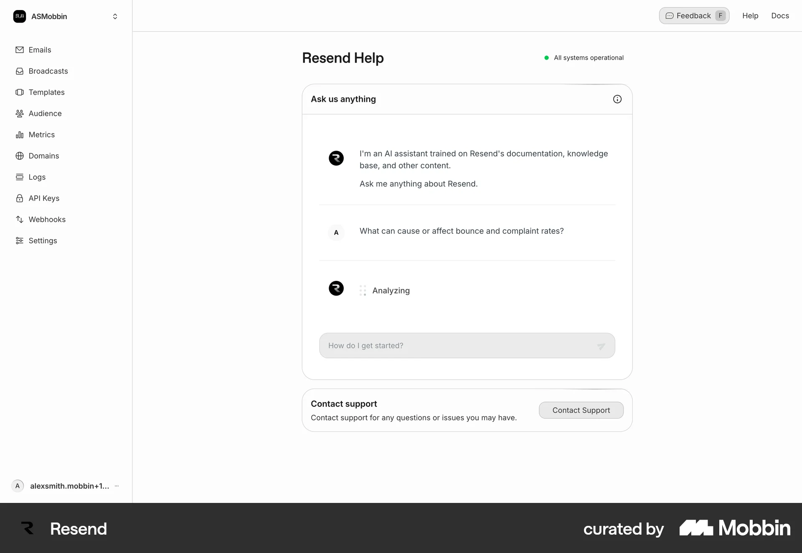](https://mobbin.com/screens/df37df16-1c1f-4af0-97b4-9fc8c1209b2e)

**Visible pattern:** The visitor's question is echoed, then an "Analyzing" row appears with the assistant mark.

**Adaptation for Moriz:** Echo the question at once and show a thinking bubble with Mor's avatar.

**Caution:** Announce the state to screen readers once, not on a loop.

### Bond

**Context:** "Asking Alex" sheet (iOS). [Open in Mobbin](https://mobbin.com/screens/8fb43b1f-cfa7-46c6-86a6-eaa192bc659f) · [Local image](assets/side-chatbot-2026-10-12/persona-bond-ios.webp)

[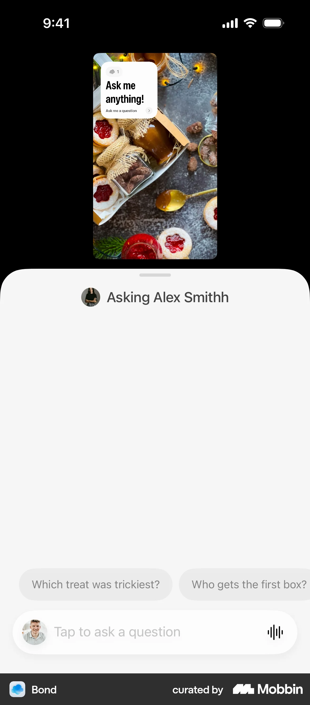](https://mobbin.com/screens/8fb43b1f-cfa7-46c6-86a6-eaa192bc659f)

**Visible pattern:** The sheet header names the person with their photo. Suggested questions sit right above the input, and the input itself holds the person's avatar.

**Adaptation for Moriz:** The mobile layout: suggestions above the composer, and identity in the header.

**Caution:** A horizontally scrolling chip row hides options. Keep it to four short questions.

### Origin

**Context:** AI advisor modal empty state. [Open in Mobbin](https://mobbin.com/screens/60faab58-185e-49fb-b554-8fcde9e15e67) · [Local image](assets/side-chatbot-2026-10-12/prompts-origin.webp)

[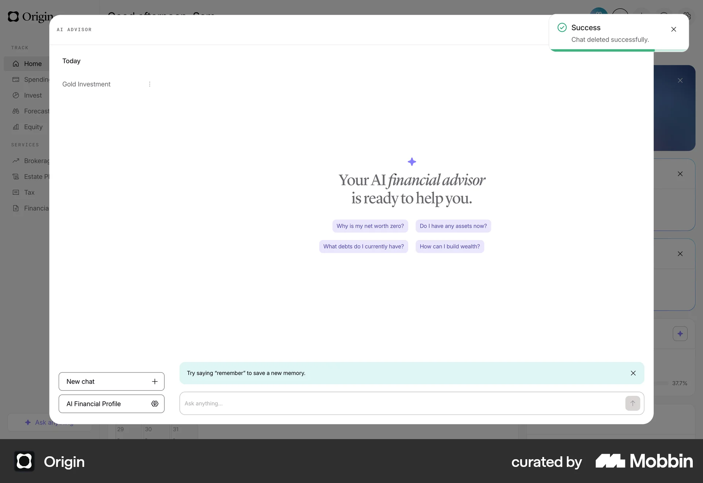](https://mobbin.com/screens/60faab58-185e-49fb-b554-8fcde9e15e67)

**Visible pattern:** A sparkle, a two-line headline and four tinted question chips are centred in a large empty canvas.

**Adaptation for Moriz:** The centred empty state with tinted chips.

**Caution:** The empty canvas is large. In a 26rem drawer, keep the greeting near the composer.

### Deel

**Context:** AI help home. [Open in Mobbin](https://mobbin.com/screens/db357932-0e83-43e7-89ff-5f47a06ef246) · [Local image](assets/side-chatbot-2026-10-12/prompts-deel.webp)

[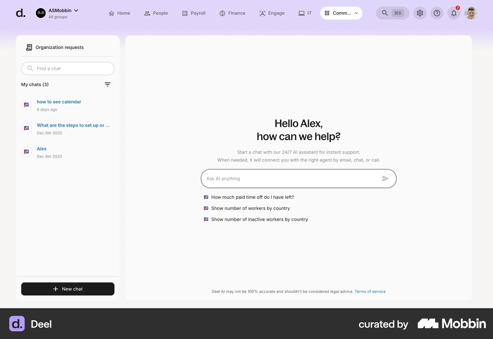](https://mobbin.com/screens/db357932-0e83-43e7-89ff-5f47a06ef246)

**Visible pattern:** A greeting, a scope sentence and a rounded input, with three suggested questions listed below the input.

**Adaptation for Moriz:** A one-line scope sentence under the greeting.

**Caution:** This is a full-page layout. Only the empty-state recipe applies.

### Otter AI

**Context:** Chat sheet with question cards (iOS). [Open in Mobbin](https://mobbin.com/screens/4cccb2f8-ef9c-4c1a-a4c2-f9f2d9acd25e) · [Local image](assets/side-chatbot-2026-10-12/prompts-otter-ios.webp)

[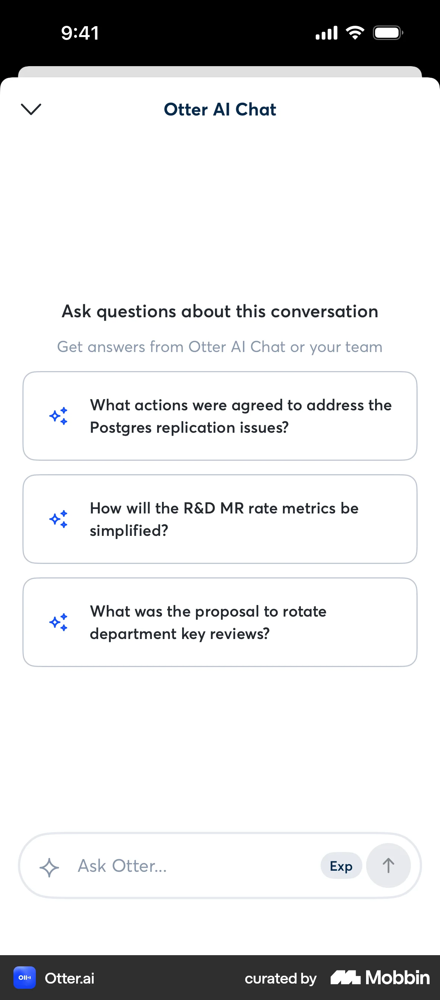](https://mobbin.com/screens/4cccb2f8-ef9c-4c1a-a4c2-f9f2d9acd25e)

**Visible pattern:** Full-width suggestion cards, each with a sparkle icon, are centred above a rounded input.

**Adaptation for Moriz:** Full-width, wrapped question cards suit longer Hebrew questions better than pills.

**Caution:** The cards take space. They collapse once the conversation starts.

### Base44

**Context:** Agent chat with suggestions row. [Open in Mobbin](https://mobbin.com/screens/2bc7b827-089b-4245-aea7-bca28d079e44) · [Local image](assets/side-chatbot-2026-10-12/prompts-base44.webp)

[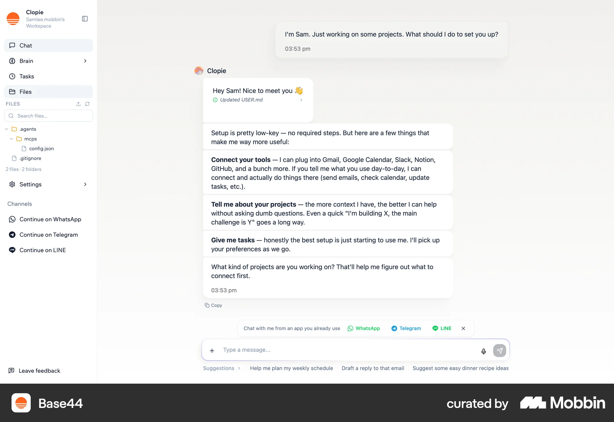](https://mobbin.com/screens/2bc7b827-089b-4245-aea7-bca28d079e44)

**Visible pattern:** Mid-conversation, a "Suggestions" row stays under the composer, and the assistant name and avatar head each answer.

**Adaptation for Moriz:** Keep the questions not yet asked available after the first answer.

**Caution:** Keep the row quiet so it doesn't compete with the thread.

### Jobber

**Context:** AI assistant with glowing input (iOS). [Open in Mobbin](https://mobbin.com/screens/6e4ec3e6-b5c6-452e-9258-82bd3b2b079d) · [Local image](assets/side-chatbot-2026-10-12/glow-jobber-ios.webp)

[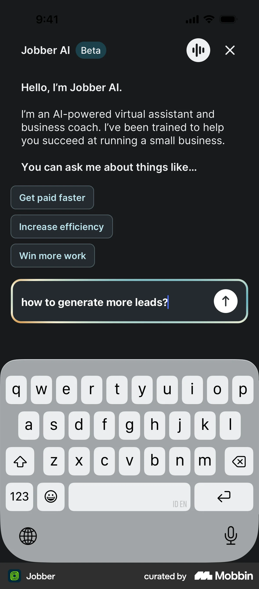](https://mobbin.com/screens/6e4ec3e6-b5c6-452e-9258-82bd3b2b079d)

**Visible pattern:** A dark surface with an intro and topic chips. The input has a multi-colour gradient border glow.

**Adaptation for Moriz:** A slow conic-gradient ring in red and yellow on the composer, brighter on focus.

**Caution:** Keep the ring thin. The text field still needs a clear, accessible focus indicator.

### Cleo

**Context:** Chat with warm gradient background (iOS). [Open in Mobbin](https://mobbin.com/screens/81550181-2282-4421-97d6-0d93e2d86349) · [Local image](assets/side-chatbot-2026-10-12/glow-cleo-ios.webp)

[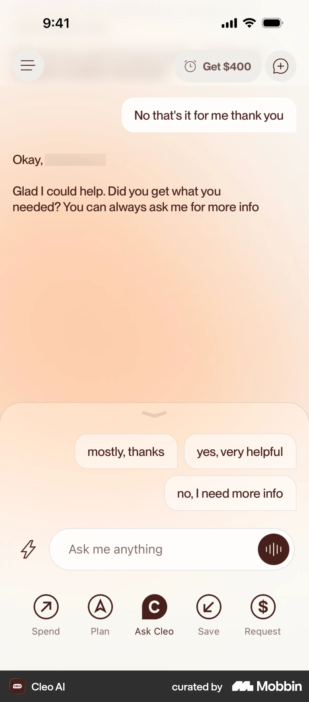](https://mobbin.com/screens/81550181-2282-4421-97d6-0d93e2d86349)

**Visible pattern:** A soft peach-to-white gradient wash fills the chat. Quick-reply chips sit above the input, and visitor bubbles are white.

**Adaptation for Moriz:** Low-opacity brand blobs that drift slowly behind the header and empty state.

**Caution:** Fade the wash out behind the message list so contrast stays high, especially in dark mode.
